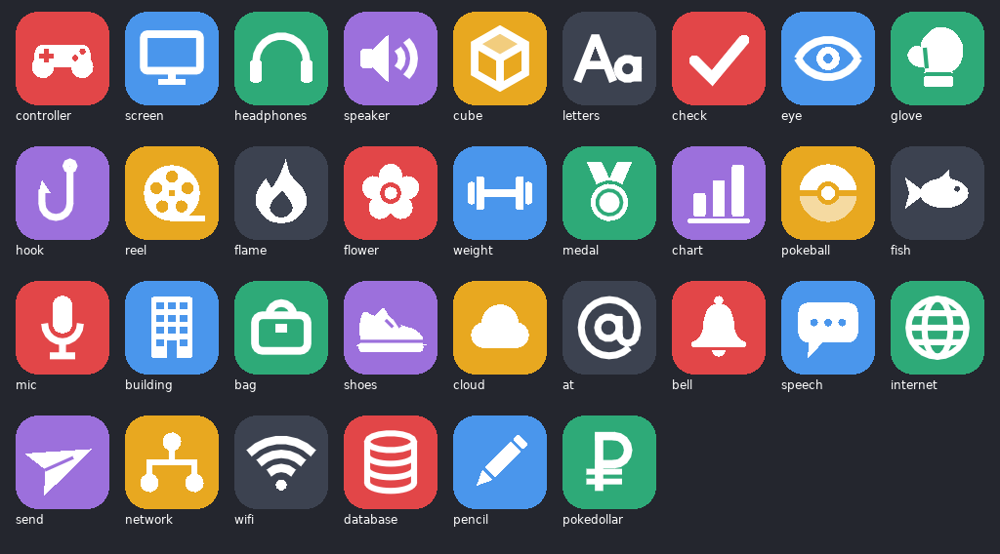

# WoobOS: development notes

For people working on the mod. Players want [README.md](README.md).

## Layout

| File | What it is |
|---|---|
| `main.lua` | Wiring: loads the modules below, the engine reads they need (session, clock, the Pokédollar glyph), options, `mod.exports` |
| `src/ui_kit.lua` | The drawing kit: page layout on the window's safe area, rect / hit pools, memoised colours, cached gradient meshes, text, the metal plate, the W logo, hints, toast |
| `src/apps.lua` | The app registry and the built-in apps |
| `src/kanto_gear.lua` | Slots, R-Bay and the GTS as Kanto Gear apps, through its public hook |
| `src/icons.lua` | The pictures an app's icon can use: other mods choose one by name |
| `src/apps/appstore.lua` | The App Store window: the removable apps, GET / OPEN, an app's page |
| `src/desktop.lua` | The desktop: monitor, boot, menu bar, home grid with pages, dock, W menu, sheets, buttons / touch / mouse |
| `src/shell.lua` | The PC menu takeover, the UI stack layer, the `render.hud` / `input.pointer` / `input.wheel` / `script.command` hooks, the touch pad hide |
| `src/inventory.lua` | The item model: PC and Bag rows, withdraw / deposit / toss / sort (the PC's list; a Bag pocket's slots, as the game's own Bag moves them, except the pockets the game keeps sorted) through the engine's `Storage` and `Bag` |
| `src/mailbox.lua` | The mail model: inbox and held rows, to Bag / give / take on the engine's mail pool |
| `src/apps/items.lua` | The Items window: Bag \| PC commander |
| `src/apps/mail.lua` | The Mail window: folders, list, the open letter, the party picker |
| `src/apps/settings.lua` | The Settings window: Language, Wallpaper, Watch (the START row, the banners), Map (the 3D Town Map) |
| `src/auction.lua` | R-Bay's market: auctions worked out from the save's seed and the clock, eBay proxy bidding, bids / results in `mod.save` |
| `src/apps/auction.lua` | The R-Bay window: Browse \| My Bids, the IVs, the max-bid stepper |
| `src/gts.lua` | The GTS: strangers and their Pokémon (traded, their OT), the trade rules, Wonder Trade, the deposit and its match, the listings |
| `src/apps/gts.lua` | The GTS window: Wonder Trade's picker, the globe search and the reveal; the listings; My Deposit |
| `src/slots.lua` | Rocket Slots: the reels, the pay table, spins (the win held until the reels stop), tickets and the prize corner |
| `src/pcgames.lua`, `src/apps/pcgames.lua` | The PC Games mod's screen kept in a window: catching its layer, the picture |
| `src/apps/slots.lua` | The Slots window: the stage, the reels' roll, the pay ladder and table, free spins, Auto, Prizes |
| `src/mart.lua` | The shop model: the badge-gated stock, buy / sell on the session's money and the engine's `Bag` |
| `src/apps/mart.lua` | The Mart window: the shopfront (the game's clerk talking in a speech bubble), Buy \| Sell, a tabbed list, the chosen item on its stand with its stepper |
| `src/boxes.lua` | The Pokémon model: party and boxes through the engine's `Storage` (take / fits / place / putBack, release, items, the preview's words, the send-to box) |
| `src/apps/boxes.lua`, `src/apps/boxes_view.lua` | The Boxes window: state, buttons, pointer, modes (`boxes.lua`); its drawing (`boxes_view.lua`) |
| `src/i18n.lua`, `lang/*.lua` | The words, by language (`lang/en.lua` the master) |
| `src/settings.lua` | The Settings app's choices, kept in `mod.cache` (`settings.lua`) for the installation |
| `src/wallpaper.lua` | The drawn wallpapers and the `wallpapers/` folder's pictures, painted once into canvases |
| `src/notify.lua` | The notifications: a list, the banners' queue, the card, the field's banner |
| `src/notes.lua` | The notifications drawer (both devices): the pull, the cards, swiping one away, Clear |
| `src/bank.lua`, `src/apps/bank.lua` | The Bank: the balance and its log in `mod.save` "bank", deposits, withdrawals, the wallet's overflow, daily interest; its window |
| `src/journal.lua` | What the player does, from the engine's events: this week's counts, a log of notable moments, and the News's box scores (the last two trainers beaten, the latest Gym, the latest catch), in `mod.save` "journal" |
| `src/challenges.lua`, `src/apps/challenges.lua` | The week's five goals from the journal's counts, their rewards and the bonus; its window |
| `src/errands.lua`, `src/apps/errands.lua` | Errands: the board, teams held in `mod.save` "errands" while out, the grade, collecting (EXP through the Day Care's); its window |
| `src/swarm.lua` | The daily swarm: a route and a species from the game's own wild tables, and the `encounter.species` hook's turn |
| `src/news.lua`, `src/apps/news.lua` | The News: the broadcast built from the world and the journal; the studio window |
| `src/frost.lua` | Frosted glass: the screen caught in a canvas while the drawer shows, a small copy blurred under it |
| `src/map3d/model.lua` | The 3D map's model: every region from `world.lua` (Hoenn; Kanto and the Sevii Islands' three pictures); with no maps (headless) from the game's Town Map (its picture a heightmap and its colours, its grid the places); the census's Centers / Marts / Gyms, the badges, the player's position, Fly's checks; the background build (`prepare` / `step`) |
| `src/map3d/world.lua` | A region built to scale from the game's own maps (Hoenn, Kanto, the Sevii Islands): placement, each tile's class, the doors and footprints, heights, the coarse terrain |
| `src/dex.lua` | The Pokédex's model: the regional and National lists, seen and caught, each Pokémon's page from the cart (and WoobleDex) |
| `src/apps/pokedex.lua`, `src/apps/pokedex_view.lua` | The Pokédex window: the grid and the page, its tabs; its drawing |
| `src/map3d/cache.lua` | A region built to scale kept on disk (`mod.cache`): its outline, terrain, meshes and pictures, read back while the stamp (versions, the maps' fingerprint) matches |
| `src/map3d/render.lua` | The 3D map's drawing: meshes, the shader, the depth canvas, the camera (`camera` / `project`), day and night; a flat fallback |
| `src/map3d/scene.lua` | The 3D map's window: the camera, pins, the beacon, the card, the controls (the Map app and the Town Map) |
| `src/map3d/towns.lua` | The 3D map's towns: sizes by tier, roofs by name, the signature structures and landmarks, the Center / Mart / Gym, trees |
| `src/phone.lua`, `src/apps/phone.lua` | The Phone: Match Call's contacts (Emerald) or Trainer's Eyes' (Ruby / Sapphire), the game's calls, recents / favourites in `mod.save` "phone"; its window |
| `src/condition.lua`, `src/apps/condition.lua` | Condition: the contest conditions, the search, the Pokéblock case and feeding; its radar window |
| `src/ribbons.lua`, `src/apps/ribbons.lua` | Ribbons: who wears what, the game's words and pictures; its window |
| `src/hall.lua`, `src/apps/hall.lua` | The Hall of Fame: the game's records, newest first; the trophy case |
| `src/oak.lua`, `src/apps/oak.lua` | Oak's PC (FireRed / LeafGreen): the Kanto counts and the game's rating |
| `src/pokenav.lua` | The PokéNav takeover: stand-in screens for every feature, which open our apps |
| `src/townmap.lua` | The third host: the 3D map full screen in place of the game's Town Map / Fly map |
| `src/gb/main.lua` | The Game Boy games' wiring (Red / Blue / Yellow, Gold / Silver / Crystal): main.lua hands over to it on generation 1 or 2 |
| `src/gb/host.lua` | Their host for the shell: the game's state stack, sounds, the free test, the PC takeover, the START rows, Gen 2's Pokégear and decorations |
| `src/gb/data.lua`, `src/gb/art.lua` | Their facts (species, names, types, items, money, Badges) and pictures (icons and front pictures baked in colour once) |
| `src/gb/boxes.lua`, `items.lua`, `mail.lua`, `hall.lua`, `mart.lua`, `dex.lua` | Their models, each with its Gen 3 counterpart's interface |
| `src/gb/port.lua`, `src/gb/play.lua` | What the shared models (Bank, R-Bay, Slots, GTS, Errands, Challenges, the journal, the swarm, the News) ask of a game there; the swarm's routes and the events as the journal reads them |
| `src/gb/map3d.lua` | The 3D map's model there: the outdoor maps built to scale |

## How the PC is taken over

The game's PC scripts open their menu through `src.ui.game3.pc_menu`'s `show(opts)`, looked up when
they run (`scripting/adapters.lua` `openPc`). The shell wraps that one function, once per process
(`PcMenu.__woobOs`, which calls the current mod instance), and opens the desktop for
`startMode == "select"` (a Pokémon Center PC's menu) and `opts.bedroom` (the bedroom PC). Every other
call (the storage menu, the player's PC menu the scripts open after a choice) is the game's own.

A `script.command` hook skips the two lines the scripts show in front of those menus ("X booted up
the PC." and "Which PC should be accessed?"): the msgbox before the menu and the prompt the menu
script prints, found by the rows that follow them (`Sh.skips`). With the Desktop option off they
stay.

An app ends the desktop with the row the game's own list (`PcMenu._rootEntries`) has for it, so the
script carries on as if that row was chosen and comes back to the PC menu, which is the desktop
again (without the boot, the app's icon zooming back). Logging off hands back 127. Decorate (the
Ruby / Sapphire / Emerald bedroom) is a window (`src/decorate.lua`, `src/apps/decorate.lua`). Toss and
Put Away happen in it. Placing goes through `ctx.over`: `Dc.place` opens the game's Decoration menu,
sets its list state on the chosen decoration and feeds it an A, then watches `handleInput` until the
cursor mode ends and closes the menu on the black, before its list can show. Only dolls and cushions
go in the bedroom, as in the game, so Put Away only has sprites to deal with.

Items and Mail never go through the script: they are windows inside the desktop and change the
session the way the game's own screens do (`Storage.withdrawItem` / `depositItem` / `tossItem`,
`Bag.add`, the mail pool's `giveMailToMon2` / `takeMailFromMon` / `clear`). Nothing marks the save;
the player's next save writes it. The rules: important items (`importance ~= 0`) stay in the Bag
and can't be tossed (Emerald's rule, for every game); Move to Bag erases the message (as the game
does); a Pokémon holding an item can't take mail.

## Adding an app (from another mod)

Register your app when the game is ready, so it doesn't matter which mod loads first. WoobOS is
optional for you: `mod.find` gives nil when it isn't installed.

```lua
return function(mod)
  mod.events:on("game.ready", function()
    local wos = mod.find("woob_os")
    if not wos then return end
    wos.exports.apps.register({
      id = "my_app",                  -- unique; keep it the same, the player's arrangement is kept by id
      label = "My App",               -- under the icon, about 10 letters
      glyph = "flame",                -- one of the icons below
      color = { 232, 96, 40 },        -- the tile, red / green / blue, each 0..255
      order = 60,
      available = function(ctx) return true end,
      window = function(ctx, env)     -- or open = function(ctx) ... end
        local K, title = env.K, "Hello from my mod"
        return {
          title = "My App",
          draw = function(body) K.text(title, body[1] + 8, body[2] + 8, 7, K.UI.label) end,
          hints = function() return { { "B", "Close" } } end,
        }
      end,
    })
  end)
end
```

`register` returns `true`, or `false` and why: a repeated id, no `open` or `window`, an icon that
isn't in the set, or a colour that isn't `{ r, g, b }` from 0 to 255 (love's 0..1 colours are refused,
they'd come out black). The reason also goes to the log. `game.ready` can fire again in a session: a
second `register` with the same id is refused and does no harm. The icon is white, so pick a tile
colour it shows up on.

**The icons** (`wos.exports.apps.icons()` lists them):



`controller` `screen` `headphones` `speaker` `cube` `letters` `check` `eye` `glove` `hook` `reel`
`flame` `flower` `weight` `medal` `chart` `pokeball` `fish` `mic` `building` `bag` `shoes` `cloud` `at`
`bell` `speech` `internet` `send` `network` `wifi` `database` `pencil` `pokedollar`

The built-in apps' own pictures work too (`ball`, `mail`, `cart`, `rocket`, `slots`, `globe`, `map`,
`phone`, `radar`, `ribbon`, `gamepad`, `home`, `trophy`, `dex`, `power`, `logo`, `gear`), though
`ribbon` and `gamepad` have their own apps' colours painted in. Or draw your own:
`glyph = function(K, cx, cy, size, alpha) ... end`.

Other fields: `dock = true` starts it in the dock, `pad = false` keeps it off WoobPad, and
`badge = function(ctx) return n end` puts a count on its corner (read once a second).

**The App Store.** Every app another mod registers is listed there, under From Your Mods, and the
player can remove it or get it back. `tagline` (the row's few words), `description` (its page) and
`by` (your name or your mod's) fill in its listing. A removed app stays registered and is just left
out of `apps.list`, so `available`, `badge` and a notification's tap are unaffected by it; don't
count on the icon being there. In the registry, `removable = true` is what puts an app in the store:
`exports.apps.register` sets it, and of the built-ins only the Mart, GTS, R-Bay, Slots and PC Games
have it. The removed ids are Settings' `removedApps`, for the installation, like the arrangement. A
window can call `ctx.refreshApps()` after changing them and `ctx.launchApp(id)` to open another app.

`ctx`: `session`, `mode` (`"select"`: a Pokémon Center's PC, `"bedroom"`: the player's own PC, `"pad"`:
WoobPad, anywhere), `family` (`"frlg"` / `"rse"`), `row(id)`, `finish(row)`, `done()`, `logoff()`,
`over(open)`, `original(opts)`, `sheet(kind)`. A `window` is the simplest fit: it works on the PC and on
WoobPad alike, where `finish` and `row` have no PC script to go back to.

A window instead of `open`: `window = function(ctx, env) return win end`, where `win` has `title`,
`draw(body, clock, portrait)` (body in units; hits as `K.addHit(rect, "win", arg)`),
`input(input, nav)` (true when handled; a B it leaves closes the window), `tap(arg, x, y)`,
`scroll(dy, x, y)`, `hints()` and `close()`. A list the wheel or a drag scrolls keeps its top as a
fraction of a row (it stays where it was left): draw from `floor(top) + 1`, each row at
`(i - 1 - top) * ROW_H`, under a scissor of the list with its hits clipped to it (`K.addHit(rb,
"win", i, area)`); a loop from `top + 1` misses every row once the top is a fraction (the Phone,
Condition and Ribbons emptied that way; the PokéNav test scrolls each between rows). `env` has `K`, `session()`, `se(name)`, `now()`,
`itemIcon(id, x, y, size, alpha)`, `monIcon(species, x, y, size)`, `monIconOf(mon, x, y, size, frame,
alpha)`, `boxWall(id, x, y, w, h)`, `itemName(id)`, `monPic(species, x, y, size)` (its front picture -> true when drawn),
`amount(n, x, y, size, c, measure)` (money with the game's sign -> its width) and
`pad.transfer(id, dir, kind)` (kind `"ball"`: a Poké Ball instead of an item). The garbage rules below apply.

**The look.** Windows share the kit's macOS / iOS pieces, so a window from another mod can match:
`K.UI` (the system colours), `K.card`, `K.selection` (accent while the list has the focus, grey
when not), `K.hairline` / `K.vline`, `K.chevron`, `K.button` (`"accent"`, `"danger"`, `"gray"`,
`"tinted"`; `focused` draws the focus ring), `K.segmented`, `K.dim` + `K.sheet` for sheets and
popovers, `K.scrollbar` and `K.bold`. The desktop draws the toolbar (the red, yellow and green
lights, the title) and fills the body with `K.UI.grouped`; a window draws its cards on that.

A window may also have:
- `pointer(phase, x, y)` (units). It then gets every press, move, release and cancel inside it,
  plus `"hover"`; returning true from `"released"` means it used the release. A release it doesn't
  use, with no drag, is a tap as usual.
- `pad = true`, which lights the shelf's pad.

`ctx.over(open, state)` opens one of the game's screens. When it closes, the window comes back at
once, handed `ctx.resume = { app, state }`. Boxes uses this for Rename (its Summary is its own).

## Kanto Gear

`src/kanto_gear.lua` registers Slots, R-Bay and the GTS with Kanto Gear's public hook
(`exports.modules`, api 1) at `game.ready`, once, and only when that mod is on. No Kanto Gear file is
involved and none of its code is used. The Silph Store and the App Store are independent.

A tile opens the app on its own screen, separate from the PC's and WoobPad's windows: `src/gear_panel.lua`, a
second `src/townmap.lua` host (`keepHits`, because it shares the kit with whichever other host drew that
frame) with nothing on the game's stack, so the game runs on. Physical buttons stay with the game; the app
takes touch and the mouse. While `shown` is true the Gear stands down and hands over the layout, so:

- With a separate display (`SecondScreen.available()`, and the Gear not in a combined layout just before it
  opened), a 744 x 648 canvas (the shape of the Ayn Thor's lower screen; the engine can't ask a display its size) goes out at 30 frames a second and taps come back through `pollTouch`. The
  desktop companion sends only presses and releases, so a release elsewhere is treated as a drag.
- Otherwise it sits in the window through `render.viewport` / `render.window`, where the Gear's combined layout
  was, or under the game in the bottom half.

It opens only when `Sh.free(game)`, and locks (`opts.locked`: the toolbar's way back still works) whenever
the game above stops being free, because these apps change the party and the money. A GTS evolution runs on
the game's screen through `ctx.over`, locked, and the window is made again after.

## Arranging the desktop

`src/arrange.lua` (Ar) is the model: `Ar.place(apps, dockText, gridText)` lays the available apps
out by the kept arrangement (named apps in order, the rest by `app.dock`, the dock capped at
`Ar.DOCK_MAX` = 6), `Ar.encode` writes it back (ids this PC doesn't show stay in their list), and
`Ar.move` moves one app between the two lists. The texts are comma-separated ids in Settings
(`dockApps`, `homeApps`), read and written through main.lua's `layout` / `saveLayout`.

In desktop.lua, `r.edit` is the wiggle mode and `r.carry = { app, list, i, ptr, x, y }` the app in
hand. The app stays in its list as it's carried: `carryTo(list, j)` moves it live, so the others
make room. The pointer's target is worked out against the dock as wide as it will be with the app
in it (`carryToPointer`), so it doesn't hop as the dock re-centres. A long press (`D.LONG_PRESS`,
not moved past 4 px) is checked in `D.draw`; while arranging, a press on an icon picks it up at
once. Each drop saves.

## Boxes

`src/boxes.lua` wraps the engine's `Storage`:
- **How many boxes:** `Bx.BOXES` is read live (a metatable field) from the engine's
  `Storage.TOTAL_BOXES_COUNT`, which WoobleDex's Bigger PC raises to 40; a box's addresses are made
  the first time they're asked for.
- **Moves:** `pickUpMon`-style taking, done by hand so a group is taken all or nothing; then
  `placeHeldMon` (healing in a box, compacting the party, the quest log) and `restoreHeldMon`.
- **Rules,** applied on every game: the party keeps a Pokémon that can battle; mail holders stay
  out of boxes; no releasing Eggs, mail holders or the last usable Pokémon; on Ruby/Sapphire, the
  game's Surf/Dive release rule.
- **Groups:** a box group keeps its shape (`dx` / `dy` from its top-left cell); a party group goes
  on the end.
- **On close:** the window puts back anything held, and sets the game's send-to box (the variable
  and flag the game's own screen sets).
- **Dynamax (WoobleDex):** `Bx.dynamax()` returns WoobleDex's `exports.dynamax` (main.lua looks it
  up with `mod.find("national_dex_gen3")`) or nil. `Bx.info` reads `canDynamax`, `level` and
  `canGigantamax` once per Pokémon: `info.dmax` (0-10; nil without WoobleDex or for a Pokémon that
  can't Dynamax) and `info.gmax`. The preview draws a ten-segment gauge row and a G-Max badge over
  the picture's foot. Nothing is written to the Pokémon.
- **Help:** FireRed/LeafGreen's Help opens on L/R and stops the game's update. The shell sets
  `help_system.enabled = false` while the desktop is up, the same way as the touch pad.
- **The look:** `src/apps/boxes_view.lua` draws in the Pokédex's glass (`K.backdrop` lit by the
  previewed Pokémon's types, `K.glass` panes). Its motion lives in the view's `mv` (`V.motion`): the
  cursor's highlight glides (`mv.gx/gy`, `mv.px/py`), cells rise in on open and when the box turns
  (`mv.boxAt`, `mv.boxDir`: from the side it turned to), the modes' thumb slides (`mv.mode`), the
  preview pops (`mv.monAt`), a sheet pops in (`mv.sheetAt`). The wallpaper's square corners sit under
  the bezel's thick rounded ring (no stencil).
- **Summary:** our own, in the window: `st.sum = { list, i, rec, tab, move, swap, party, top, ... }`
  while it's up (input, taps, the wheel and drags go to it; `W.pointer` leaves the box alone).
  `Bx.summary(s, mon, T)` makes the page once per Pokémon (cleared by `Bx.forget`): `info` rows (label,
  value, tint), `rows` (each stat's value, IV, EV, the nature's +1 / -1), `radar` + `radarKeys` (the EVs
  clockwise from HP), `moves` (PP, power, accuracy, `desc` from `SummaryData.moveDescription`, `contest`
  from the engine's `rse.contest` `data()`), `memo` (met / hatched / traded, the map section's name
  through `map_sections_extract`), `dmax` / `gmax` only while `Bx.galar()` (main.lua: Galar Rising,
  `max_raids`, found). `Bx.swapMoves` uses the engine's `Pokemon.swapMoves` (PP with the move);
  party only, as the game. The Game Boy model (`src/gb/boxes.lua`) makes the same page from DVs (`ivMax`
  15, HP's from the others) and Stat Exp (`evMax` 65535, five radar corners, no total). The drawing is
  `src/apps/boxes_summary.lua` (the window's fourth argument); its picture is `env.dexSprite` with
  `shiny` (main.lua keeps a shiny's frames apart) and, on the Game Boy games, the Pokémon itself.

## The shelf

Under the monitor is a shelf (`D.SHELF.h` units; the page is the monitor's 160 plus the shelf, so
the screen keeps its size in units). In its middle is the pad, used for the Poké Ball and for items.

- **The ball.** A window with `ball = true` (Boxes) holds it, when there's a party (read once a
  second). `r.ballPhase` runs off -> `drop` (falls `D.BALL.height` units with a bounce,
  `SE_BALL_BOUNCE_1`) -> `on` (unlit; red, pulsing, while `win.moving()` is true -- Boxes carries
  a Pokémon --, then a green flash over `D.BALL.moved`) -> `done` when the window closes (a green flash, `SE_BALL_CLICK`) -> `lift` -> off.
  Reopening during the flash goes straight back to `on`. Coming back from one of the game's screens
  (`ctx.resume`) sets `r.ballSkip`: the ball is already there. `D.ballState()` gives the phase and
  the glow ("moving" | "moved" | nil). While it sits there a `"ball"` `padTransfer` is dropped (no
  crossing: the glow tells it); elsewhere (GTS, R-Bay, Slots) a Pokémon crosses as a Poké Ball and
  the resting ball, if any, sinks into the pad meanwhile (`D.PAD.ball`).
- **Sizes.** The ball and the item on the pad are both `D.SHELF.item` units across.

The pad lights up while the open window has `pad = true` (Items and the Mart do), and
`env.pad.transfer(itemId, "out" | "in")` plays an item crossing it. "out" (Bag to PC) drops the
item onto the pad and digitizes it away (`SE_WARP_OUT`); "in" (PC to Bag) digitizes it in
(`SE_WARP_IN`), holds it, and fades it into the Bag. One effect plays at a time, at most two
wait, and a waiting one going the same way is replaced, so the pad shows the last item chosen.
Timings in `D.PAD`; `D.padState()` for tests. The Mart uses the same two: a purchase is "in", a
sale "out".

## The Mart

`src/mart.lua` holds the stock: four tabs (Balls, Medicine, Battle, Field) of `{ item id, badges
needed }`, laid out like the later games' badge-tiered Marts. Prices and names come from the
engine's `ItemsData.info` when the tabs are first built (an item without a price is dropped), so
they're each game's own. Badges: `Flags.countBadges` on the live script store
(`scripting.space`'s `getStore()`), read once when the window opens (`st.badges`).

- **Buy:** badges, then money (`session.money`), then `Bag.canAdd`; `Bag.add` before the money is
  taken. Ten or more Poké Balls add a Premier Ball when it fits (the Gen 3 shop's bonus).
- **Sell:** half the price, floored; nothing priced 0 or important. `Bag.remove`, then
  `Prize.apply` (capped at 999,999). The last one sold stops being the registered item.
- **Money in a window:** `env.amount(n, x, y, size, c, measure)` (`D.amount`: the game's
  Pokédollar glyph and the digits, as the menu bar draws them).

Headless the cart's font isn't there and the engine's glyph draw tries loading it again on every
call (about 0.26 KB each), so the test stands in for it while measuring the Mart's garbage; the
probe measures the real one (0.02-0.05 KB a frame, FireRed and Emerald).

The window is a shopfront (`src/apps/mart.lua`):

- **Layout:** a band across the top (`BAND` 34 units, the awning `AW` 7 drawn after the clerk, so
  he stands under it): the counter with the clerk and the till at the left, the speech bubble, and
  Buy | Sell over the money at the right from 200 units wide (under the band when narrower). The list
  (tab chips, hit args `TAB_AT + i`) and the item's card below; portrait stacks them.
- **The clerk:** the game's own overworld sprite. `env.clerk()` (main.lua) looks up
  `OBJ_EVENT_GFX_CLERK` (FireRed / LeafGreen) or `OBJ_EVENT_GFX_MART_EMPLOYEE` (Ruby / Sapphire /
  Emerald) with `Constants.of(game):id("event_objects", ...)`, then `OwSprites.getDraw(id)`. That's a
  16 x 32 sheet of nine frames (0 down, 1 up, 2 left; right is 2 flipped), its size in `width` /
  `height`. The id is kept per game and the sprite asked of `getDraw` on every call, as the field
  does (a lookup once loaded; a miss waits a second), so another mod's sprite set (Facets wraps
  `OwSprites.get`) is his too, chosen before or after. The Game Boy games (src/gb/main.lua) make him
  through `SpriteRenderer.new(def, "woob_os_clerk")`, the call the field makes its people with (Facets
  wraps it): a renderer whose `def` isn't the game's is a mod's sheet, its `image` / `frames` /
  `frameWidth` / `frameHeight` taken as they are (a grey one, neither `trueColor` nor `gbaArt`, painted
  like the game's); else the game's grey sheet painted (`Art.colourSheet`). Kept, and made again on
  `mod.options_changed`. gb_test stands in for such a mod. Drawn at whole pixels
  from the chest up behind the counter. `st.mood` / `st.moodT`: "hop" (a purchase or sale), "shake"
  (left and right: a no), "turn" (Buy / Sell); a glance along the shelves every nine seconds; a
  one-pixel nod while the words type.
- **The words:** `say(key, mood, bad, arg)`, called from actions only, sets `st.say`. The bubble
  builds the lines when the words or its width change (`linesOf`, the News's typewriter: each line's
  typed-out beginnings made then, so the draw makes no strings; a word wider than the line breaks
  between letters, for Japanese), once more a size smaller if they'd overflow. Keys `mart.say.*`:
  - the greeting (`greet`): what a Badge added, else ₽500,000 or more, else under ₽200, else the hour;
  - a purchase: the Premier Ball, ten or more, the tab's line every other time, else thanks naming
    the item;
  - a sale: ₽1,000 or more each is a find, ₽10,000 or more in all a haul, else thanks;
  - a no (`refuse(why)`, the model's reason codes): short of money names the Bank when it's
    installed and holds the rest;
  - Buy / Sell; a tip after 16 quiet seconds (`idle()`, from `W.input`, which runs every frame);
    the clerk tapped.
- **What a Badge added:** `mod.save` "mart" `{ seen }` (`Mt.seen()` / `Mt.see(n)`), written when the
  window opens. Items needing more than `seen` and no more than the Badges now wear NEW
  (`st.newFrom`) for that visit.
- **Coins and the item:** `st.coins` / `st.fly`, set in `act()`, drawn from their start time between
  points the draw keeps (`st.moneyX`, `st.tillX`, `st.standX`, `st.counterX`). The till's drawer
  slides out as the coins land; its display shows the last total (`st.lastTotal`).

## R-Bay

`src/auction.lua` stores nothing about an auction. Slot `k` (0-11) runs auction number
`n = floor((t - EPOCH - k * 900) / 10800)`: three hours each, staggered fifteen minutes apart.
`generate(s, k, n)` makes it from a Park-Miller generator seeded by the save (`meta.playthroughId`)
and `k`, `n`: the tier (weights 34/26/20/11/6/3), the Pokémon from that tier's pool, the level
(tier range + 3 per badge, at least its evolution level), the IVs (the best of 1-3 rolls by tier),
the hidden value `V` (the tier's band x `0.6 + 0.8 q^2` x `1 + 0.08` per 31), and the bidders
(a count and keenness by tier, maximums at most `1.35 V`, some sniping in the last ten minutes).

- **Pools,** built once: the cart's #1-386 by evolution stage (`Pokemon.evolutions` inverted;
  first stages Common, middle and lone Uncommon, finals Rare), our own Legendary / Mythical /
  Prized lists, and WoobleDex's `listSpecies` (its `legendary` / `mythical` flags) with
  `evolutionsOf` for the stages. Shedinja never sells.
- **Pricing:** `sim(L, t, mine)` replays the bids up to `t` in time order, the player's
  `steps` (time, max pairs) among them: eBay's proxy rule (one `step(price)` over the
  second-highest maximum, capped at the highest; a tie goes to the earlier bid). A challenger
  under the leader's maximum logs two bids: theirs, then the leader's answer at the new price
  (the top bid shown). No tables made; the last five bids kept in two ring arrays.
- **The player's part** is `mod.save` "auction" (`session.modData.woob_os`): `bids[key]` (the
  listing's species / level / IVs copied, `max`, `held`, `steps`), `results` (newest first, 20 kept),
  `unread`. It rewinds with the save, as the money and the party do. `Au.bid` takes the
  difference from what's `held` (`Au.heldOf`: older saves, all of `max`); outbid (in `Au.bid`,
  or a listings refresh: the window's, or `Au.settle`'s while a bid holds money) it's paid back
  at once and `held` = 0 (a beaten maximum never leads again); `Au.settle` (on `save.loaded`, and the desktop's once-a-second
  `deps.tick`) gives a win through `Party.giveMonToPlayer`, then writes the listed IVs into
  `mon.ivs`, `Pokemon.applyStats` and full HP, and pays the change back with `Prize.apply`. A
  loss refunds what's still held. With no room anywhere, a win waits (`b.won = true`).
- **The icon's count:** an app's `badge(ctx)` (read once a second) sets `app.badgeN`, which
  `appIcon` draws.
- **The window's show** (`src/apps/auction.lua`): `pickHot` (once a second: tier rank, then
  value, bids, ending within 30 min) names `st.hotKey` for the Hot Auction card; `watch(L)` keeps
  `L.seenPrice` / `L.flashT` (a price that moved flashes up) and `L.wasLead` (losing the lead
  toasts); taking the lead throws confetti from a fixed pool (`PARTICLES`).
- **Tests** swap `Au.store` (a fake `mod.save`) and `Au.now` (the clock). The probe's garbage
  checks warm up first: LuaJIT compiling new paths' traces landed 0.5-3 KB one-off spikes.

- **Shiny auctions:** `L.shiny` from its own dice (`shinyDice`: the seed, the slot, the number;
  not the market's rolls), one in `SHINY` (10): the value x `SHINY_VALUE` (2.5), `SHINY_BIDDERS`
  (2) more bidders, keener; `L.picMon = { species, isShiny = true }` for `env.monPic`'s sixth
  argument; the Hot Auction's score +4.5M (four tiers). The bid record keeps `shiny`; `deliver`
  makes it with `Party.giveMon(..., { toPC = true, fixedPersonality })`, the personality from
  `Au.shinyPersonality(tid, sid, lo, k)` (the game's test: tid ^ sid ^ hi ^ lo < 8) for the player
  as its OT. The GTS uses the same (`deps.shinyPersonality`): `Gx.make(..., shiny)` for the
  stranger's IDs; `Gx.SHINY` (10) for Wonder Trade, a deposit's answer, a listing (`L.shiny`).
- **Pictures:** `env.monPic(sp, x, y, size, a, mon)` asks a bare species for the normal colours
  (`isShiny = false`: no personality or OT ID would read as shiny); with `mon`, its own.

## Slots

`src/slots.lua`: five fixed strips of 30 stops, `REELS` (one Bonus each; wilds on reels 2 to 4 only,
so a line's first symbol is never wild). `LINES` are rows per reel (-1 top, 0 middle, 1 bottom);
1, 5, 10 or 20 are played (`LINE_SETS`), the bet on each, and `Sl.at(r, stop, row)` reads one.
`Sl.payout(a, b, c, d, e)` counts three, four or five from the left, wilds standing in:
`PAYS[sym].x[n - 2]` × the bet and `.t[n - 2]` tickets per ₽50 bet. Bonus counts anywhere
(`Sl.bonusOn`): `BONUS_PAY[n]` × the whole bet and `FREE[n]` free spins. The return is computed exactly
in the test from each reel's symbol counts: 68.7% lines + 2.1% Bonus + 20.5% free spins = 91.3%;
free spins about 1 spin in 117, the jackpot 1 line in 225,000. A ticket costs about ₽290 of expected
loss whatever the bet, which prices the prize corner (Rare Candy 15 ≈ ₽4.4k, Porygon 200 ≈ ₽58k).

- **The limited prizes:** four at the top of `Sl.prizes()`, made by `Sl.refresh(s, t)` when the local
  day (`deps.day`, the journal's) or the session changes; the window calls it once a second (never
  per frame) and gets the seconds to the next change back. Each slot is picked by a Park-Miller hash of
  the playthrough's seed, the day and the slot (exact in doubles: an FNV product past 2^53 lost its low
  bits and served Doel Deoxys 53 days in 81). Gen 3: a special (`SPECIALS`, unclaimed, a ticket only
  where its game has flags for it), a 10th Anniversary Pokémon (`ANIV`), a Pokémon (`HIGH_MONS`) and
  an item (`HIGH_ITEMS`); the Game Boy games the last two (`HIGH_ITEMS_GB`). Specials and ANIV are
  claimed once per save (`d.claimed[key]`; a ticket also by its ferry flag); the daily two by
  `key@day` (other days' keys dropped at the rebuild). A claimed prize stays in the day's list as
  Claimed.
- **Tickets** set what the game's own distribution sets (the cart's gift scripts, and the harbors'
  checks): Emerald's Eon Ticket `FLAG_ENABLE_SHIP_SOUTHERN_ISLAND` (as `CableClub_EventScript_DistributeEonTicket`),
  Ruby / Sapphire's `FLAG_SYS_HAS_EON_TICKET` (Lilycove's ferry checks the item and it), the Mystic /
  Aurora Tickets and the Old Sea Map `FLAG_ENABLE_SHIP_NAVEL_ROCK` / `_BIRTH_ISLAND` / `_FARAWAY_ISLAND`
  and `FLAG_RECEIVED_*` (Emerald's Mystery Gift scripts; FireRed / LeafGreen's Vermilion harbor checks the
  item and the ship flag). The ticket goes into the Bag.
- **Event Pokémon** are made on a scratch session with the event's trainer (OT, ID, secret ID 0), then
  `Pokemon.replaceMove` for its moves, its item, `metLocation` 0xFF, `metLevel`, `modernFatefulEncounter`
  (the engine's battle lets Mew and Deoxys obey only with it), rerolled until not shiny; into the party
  or the PC, seen and caught in the Pokédex. The data is Serebii's event pages: Aura Mew (Aura, 20078,
  Lv. 10), Mystery Mew (MYSTRY, 06930, Lv. 10), Space Center Deoxys (SPACE C, 00010, Lv. 70), Doel Deoxys
  (DOEL, 28606, Lv. 70), the 10th Anniversary Pokémon (10 ANIV, 00010, Lv. 70; twenty species, moves
  from the ID 00010 list where it was read, else the Bryant Park one's).
- **Names** go through `Sl.titled` ("PP MAX" -> "PP Max": PP, TM, HM, X and words with a digit kept).

- **A spin:** `Sl.spin(s, level, lines)` takes the bet × the lines and draws the five stops at once (`Sl.rng`, else
  `love.math.random`); the reels' stopping is only shown. The win is held until `Sl.collect(s)`
  (when the last reel lands, or the window closes), so the menu bar's money doesn't give it away.
  `result.won[l]`, `count[l]`, `sym[l]` describe each line; every line's distribution is the
  middle's (each reel's stop is uniform), so the return is the same on any number of lines.
- **Free spins:** `d.free = { left, level, lines, total }` in the save (`Sl.freeState()`), so they
  rewind with the money and carry on if the window closes. `Sl.spin` then ignores its arguments, charges
  nothing and multiplies by `FREE_MULT`; `Sl.collect` adds up `total` and ends them on the last.
- **Prizes:** `Sl.prizes()` (TMs named with their move, `Pokemon.moveFromTmItem`), `Sl.redeem`
  (`Bag.add`, or `Party.giveMonToPlayer` at `10 + 3 × badges`); the tickets come off only after.
- **Kept:** `mod.save` "slots" (`tickets`, `stats`). Tests swap `Sl.store` and script `Sl.rng`.
- **The show** (`src/apps/slots.lua`): `drawMachine` lays out ladder | reels | spin, or stacks them under
  170 units wide. `st.teaseFrom` (two Bonus down) holds the later reels back `TEASE` seconds each with
  rising `SE_NOTE_*`. `celebrate` picks a `TIERS` row by × everything bet: under 36 coins the win shows
  above the reels (`drawLogo`), else across the window (`drawBigBack` / `drawBigFront`, the coins
  between them so the words stay clear). `winCell` lights the symbols, `shownLine` then cycles the
  winning lines. `st.nextAt` is when free spins or Auto spin again, after the banner and the
  `st.intro` / `st.outro` cards. `glow` is one kept additive mesh, nothing without meshes (headless).
  Sounds queue with `seLater` (the engine plays one at a time). Coins, confetti and flying tickets come
  from a fixed pool of `PARTICLES` records.
- **Its sounds, made ahead:** the engine makes a sound from the game's music data the first time
  it's played (`Audio.playSe` -> `bake_se`: 8 to 45 ms in FireRed, `SE_APPLAUSE` the longest), then
  keeps it (`Audio._seRaw`, least recently used dropped past `SE_RAW_MAX_FRAMES`, about 34 s of sound).
  The tease's eight `SE_NOTE_*`, one every 0.17 s, each dropped a frame or two of the rolling reel the
  first time (a second tease: 0.0 ms each). The window queues every sound it plays as it opens
  (`SOUNDS`, through `env.prewarm` -> `Sh.prewarm` -> the engine's `Audio.prewarmSe`, made a little
  each frame by `Warm.step`'s 2 ms; a lower number first): the spin's and the tease's (2), the wins'
  (3), the rest (4). Half a second after opening, 15 of its 21 are made and the first tease plays
  every note in under 0.1 ms. Not at load: they come to about 31 s of sound, nearly all of the
  engine's store, and would push the field's sounds out. The desktop test checks every `"SE_..."` the
  window names is queued.

## PC Games

The app appears only when the PC Games mod (`pc_solitaire`) is on. `src/pcgames.lua` calls its public
`exports.openGames(game)` with `Stack.push` stood in for during that one call, and keeps the layer
(`draw` / `handleInput` / `update`) instead of letting it reach the stack; anything else it pushes
goes through untouched, so a future change of shape falls back to it opening over the desktop. Its
`Stack.pop("pc_solitaire")` is watched only while its own code runs, which is how we learn it closed.

- **Closing:** it has no way to be closed from outside, so closing the window keeps the layer and the
  next open carries on; `H.reset()` at `game.ready`, when the mod forgets its own. While it's kept,
  that mod's other ways in (the Kanto Gear app; the PC menu with the desktop off) do nothing.
- **The picture:** drawn 240 x 160 into a canvas and shown at a whole number of screen pixels.
  `g.setCanvas(target)` comes before `g.pop()`: restoring the scissor with the picture still bound
  works it out for the wrong target's height and clips the top and bottom of the screen.
- **Buttons:** the real ones only, handed straight to it, as when it opens on its own.
- **The whole screen:** `win.fullscreen = true` gives a window `L.screen` as its body, with no toolbar
  and no menu bar. The window draws its own way out (a `"winclose"` hit), shown on `win.pointer`.

## GTS

`src/gts.lua` (Gx): Wonder Trade and the Global Trade Station with made-up Trainers (`STRANGERS`:
a name of seven letters at most, a home region, a gender; each trade a fresh 32-bit OT ID that is
never the player's).

- **Their Pokémon:** `Gx.make` builds it the way the engine's NPC trades do (`Trade.createTradeMon`):
  `Party.giveMon` on a throwaway session (the real party and Pokédex untouched), then the OT name,
  ID, gender, `metLocation = 0xFE`, sometimes a held item, `applyStats`. `Pokemon.isTradedMon` is then
  true: the game's 1.5x EXP and badge obedience apply on their own.
- **The rules:** `Gx.canSend` asks the game's `Trade.canTradeSelectedMon` (a box Pokémon through a
  two-Pokémon stand-in party; the National Pokédex check only on FireRed / LeafGreen, whose rule it
  is), plus our own: an Egg, a mail holder, the last Pokémon that can battle stay. What may come in:
  `Gx.allowed` (Kanto's 151 on FRLG without the National Pokédex).
- **The swap:** a party slot through `Trade.tradeMons` (mail, friendship 70, the Pokédex); a box cell
  by hand (healed, the Pokédex); `Trade.noteLinkTrade` counts it.
- **Wonder Trade:** a tier by weight (45 / 30 / 15 / 8 / 1.5 / 0.5 %), a species from R-Bay's pools
  (`Au.pools`, `Au.tierOf`, `Au.minLevel`), the level within 5 of yours.
- **Your deposit:** the Pokémon itself kept in `mod.save` "gts".deposit while posted. `matchAt` from
  the ask's fairness (the tier rank asked minus given, +1 for a level range well above): within an
  hour, within four, a 30% chance within six, or never. `Gx.settle` (the shell's tick,
  `save.loaded`) makes the stranger's Pokémon when it's time (a "gts" notification);
  `Gx.collect` places it.
- **Listings:** ten per half hour from the save's seed (R-Bay's `Au.seedOf`), 40% asking for a species
  the player owns; `done` keys per window.
- **Trade evolution:** `Gx.evolveTarget` (`Evolution.tradeTarget`), then the window's reveal opens
  `Gx.openEvolution` (the game's `EvolutionScene`) through `ctx.over` and comes back via `ctx.resume`.
- **Tests** swap `Gx.store`, `Gx.rng`, `Gx.now`; the probe scripts `Gx.rng` for a legendary and a
  Kadabra (its evolution scene in the engine).

## WoobPad

WoobPad is `src/desktop.lua` again: `main.lua` makes a second desktop with `deps.device = "pad"`
(the same deps through a metatable), opened from the START menu anywhere. `src/shell.lua` keeps
one host open at a time: `Sh.host()` is the desktop, the pad or the full-screen host, and the
layer, `render.hud` (`Sh.frame`), `input.pointer` (`Sh.pointer`) and `input.wheel` go to whichever
is up.

- **The row:** the `ui.start_menu.items` hook (`Sh.startRows`) puts `{ id = "woob_watch", label =
  T("watch.start") ("WOOBPAD"), onSelect }` in the `pokenav` row's place (Ruby / Sapphire / Emerald:
  the Map, Phone, Condition and Ribbons apps do its jobs), else
  under BAG, where it would be (FireRed / LeafGreen, and before the PokéNav is got), only in a menu with
  SAVE (not a link room's or the Safari Zone's), the Desktop option, the WoobPad option and Settings'
  `watchRow` on (the old ids kept: an installation's settings).
- **The WoobPad option** (`woobpad`, `env.padOption`, read live; the shell's `deps.padOn`): off, no row
  (the game's own POKéNAV / POKéGEAR row), `Sh.openWatch` refuses, no field banner (`Sh.frame` returns
  before `Nt.drawField`; notifications still come and the PC's desktop shows them; `X._test.post` posts one), the
  PokéNav takeover stands down (`src/pokenav.lua` `enabled`, `Pn.enabled`), Gen 2's `Gen2Pokegear` from
  START is the game's own (Fly / the walls' map still the `pokegear` option's), and Settings leaves out
  the WoobPad and PokéNav sections (`pad = true` on them). Tests swap `env.padOption` (pad_test, gb_test). `onSelect` runs with the START menu still on the
  Stack, so popping the pad's layer is the menu again.
- **The layer:** `woob_pad` (`Sh.PAD_ID`, also `Sh.WATCH_ID`), pushed `{ hideBelow = true,
  fullscreen = false }`: the START menu's box hides, the field is still drawn (the pad dims it).
  The desktop's stays full screen.
- **ctx:** `mode = "pad"` (`Apps.list` gives Boxes then; Oak, the Hall and Decorate want PC rows
  and drop out; apps with `pad = false`, Log Off, are left out), `warm` (no boot), `finish` /
  `done` / `logoff` put it away, `over(open, state)` as the desktop's (back with `ctx.resume`),
  `sheet(kind)` the pad's own.
- **The device:** `D.PAD_PAGE` (160 tall; the body over the hints), `D.padLayout` (a 6-unit bezel:
  the screen about 130 units tall), `D.screenLayout` (the menu bar, the grid, the dock, the windows:
  shared with the PC), `drawPadDevice` (the game dimmed, the aluminium edge, the glass, the camera,
  the top button = "power": put away). No boot, no shelf (`padTransfer` does nothing), the hints
  under the body. B on the home screen: `logoff()` at once. The W menu: About, Notifications, Put
  Away (the PC's: About, Notifications, Log Off).
- **Notifications:** the "notes" sheet (both devices) is the drawer, `src/notes.lua` (Nd, each
  desktop's own, `D.drawer`). A press in the screen's top 12 units dragged down more than 4 starts
  a pull (`Nd.pullBegin(screenH)`, `pullTo`, `pullEnd`: open past 20 units or a third of the way);
  `r.sheet` is "notes" from then on and the drawer takes the pointer (`Nd.pointer`, units) and the
  buttons (`Nd.input`) until it answers "close" or "open", rec (`notesDid`). `r.sheet` clears at once
  on closing; the drawer slides up by itself (`Nd.visible()`). Cards: `Nt.drawCard(..., glass)`,
  their places and swipes kept on the records (`uiX`, `uiY`, `uiFling`, `uiAt`, `uiAll`); one
  flung off is `Nt.remove`d, Clear flings them all a moment apart. The first D-pad press only rings
  the chosen card. The frost: `src/frost.lua` (Fr) catches the screen's drawing (`Fr.begin` before
  the wallpaper, `Fr.finish` after the zoom: back to the target before its `push("all")`, or the
  pop puts the catching canvas back) into a canvas the target's size and a sixth-size copy, and
  `Fr.draw` lays the copy through a 25-tap blur inside a rounded rect. Headless (no canvases or
  shaders): a darker tint instead.

## Notifications

- **Each app's switch:** `Nt.SETTING[app]` (`notifyAuction`, `notifyGts`, `notifyPhone`, `notifyBank`,
  `notifyErrands`, `notifyChallenges`, `notifyNews`; on unless set false) is read in `Nt.push` through
  `deps.setting`: off, the push returns nil and nothing is kept (no banner, no list entry, no sound),
  whichever path it came by. `Nt.APPS` is Settings' order; main.lua hands both to the windows as
  `env.notifications`. Settings > Notifications (`src/apps/settings.lua`, section `notify`) makes its
  rows when it opens: Banners (`notifications`), then each app that's installed (the Phone only on
  Emerald, where calls come) with its icon, R-Bay's `soonMinutes` under R-Bay. A switch list taller
  than the window scrolls (`st.toggleTop`: the cursor's row kept in view on a press, the wheel free).

`src/notify.lua` (Nt), made in `main.lua` and handed to the models as `deps.notify(kind, data,
quiet)`: `Au` ("outbid" in `refund`, quiet when the player's own `Au.bid` lost it; "soon" once per
bid at `deps.soon()` seconds before the end (Settings `soonMinutes`: 5 / 10 / 15 / 30, the
Settings app's choice row), `b.soon` kept in the record; "won" / "lost" in `Au.settle`) and `Gx` ("gts" in `Gx.settle`).
`main.lua`'s `notify` makes it quiet while the player is looking at that app's window.

- **Records:** `{ kind, app, title, text, sp, at, state }`, the text made once (`T.f`), 20 kept
  (memory only). `state` is handed to the app as `ctx.resume.state` when it's opened from one
  (R-Bay `{ tab, key }`, the GTS `{ tab = "deposit" }`).
- **Banners:** a queue of three (older than ten minutes: the list only), `Nt.step(clock, canShow)`
  shows them one at a time (`IN` / `HOLD` / `OUT`). With no host open, `Sh.frame` draws the
  field's (`Nt.drawField`, `K.place` on the game's own pixels, `Nt.FIELD`) only while `Sh.free(game)`
  (the engine's quicksave test: the field, not `Hud.busy()`, `Hud.startButtonAllowed()`); one showing
  when the field stops being free (a menu, a script's message) goes back to the queue's front unless it was
  already sliding out, and comes back whole without its sound again (`rec.sounded`); the full-screen host
  (`Tm`: the modern menus, the 3D map, the Pokémon Center) steps it as not free, so the banner waits there
  too (the desktop and WoobPad show their own); a press
  on it (`Nt.hitField`) opens the watch on that app. The desktop shows it under its menu bar, the
  watch over its screen (hits "notify" / "wbanner"). Settings' `notifications` off: list only.
- **The tick** moved to the shell: `main.lua`'s `tick()` once a second from `render.hud`, wherever
  the player is (the open host's session first): `Au.settle`, `Gx.settle`.

## The showcase

`tests/drivers/showcase.lua` is a driver to show WoobOS off by hand: a new game with made-up data and one
scene per feature. Page Down / Page Up step through them and Home makes the data up again from the first
scene. Run it with `POKEPORT_DRIVER_PACED=1` (real time). A new feature gets a line in its `all` table;
`WHEN` leaves out what a game hasn't got. `SHOWCASE_AUTO=<dir>` walks every scene through the same keys and
screenshots each. Settings changed by hand during it are the real ones.

## The Pokédex

- **The Size tab** (caught only, after Info; `st.tabs` "size"): the view's `sizeChart`. Heights: WoobleDex's
  measured ones first (`env.artHeight(sp, nat)`, both mains, from `exports.artHeights()` (its
  data/art_heights.lua) read once: by the engine's species slot on Gen 3, the sprite id on the Game Boy games,
  else the National Dex number): `standing` is drawn (the picture's drawn pixels that tall) and `width` is the
  room it takes and the scale's fit; a `long` one (its Pokédex number a length: Onix, Gyarados, Wailord) says
  "3.8 m · 8.8 m long" (`dex.size.long`). Without WoobleDex or a row, the page's `heightMeters` (Gen 3
  `dexEntry.height` / 10; Game Boy inches x 0.0254) and the picture's own proportions. The trainer: `src/size_art.lua`
  (`env.sizeArt`: `assets/brendan-height-sprite.png`, 40 x 70, its drawn pixels' box read from the file;
  1.7 m). A Pokémon's height is its picture's drawn pixels, not its frame: `env.dexSprite.measure(sp)` (both
  mains) reads the still picture back through a canvas once per species (`Sz.bounds`, `K.rescissor` after)
  and answers `{ fx0, fy0, fx1, fy1 }`, where those pixels sit in `draw()`'s size x size box round its centre;
  headless (no canvas) a stand-in box. The scale fits the taller one to the chart (x 1.1) or both across it,
  eased (`mv.sizeS`); gridlines at the first of `STEPS_M` giving at most five, feet ticks by `STEPS_FT`; both
  rise from the line (`mv.listAt`); labels kept apart when they stand close. `K.glassSwitch` takes a fifth
  segment (Moves / Where / Info / Size / Forms). Driver: scratchpad size_driver.lua (Emerald).

- **The model** (`src/dex.lua` Dx, `env.dex`): `Dx.open(s)` makes the book each time the dex opens: the
  regional list (FireRed / LeafGreen the first 151, Ruby / Sapphire / Emerald by `Dex.regionalNumber`) and
  the National one (1..`Dex.NATIONAL_MAX` through `Pokemon.speciesFromNational`: WoobleDex's to 1025) only
  when `PokedexData.isNationalUnlocked`; seen / caught by `Dex.isSeen` / `isCaught` (by species). A page
  (`Dx.page(entry)`, kept per species, made when one's chosen, never in a draw): `dexEntry` (category,
  height dm, weight hg), `_types`, `stats` (shown HP Atk Def SpA SpD Spe), `speciesMeta` (gender ratio:
  255 none, 254 all female, else (r + 1) / 256 female; egg groups, cycles x 256 steps, catch rate, exp,
  growth 0..5, `evHp`..`evSpe`, held items, friendship), the description (FireRed / LeafGreen
  `PokedexData.getEntry(sp)`, the others `Mapsec.readLua("pokemon/pokedex/entries.lua")[sp]`: both what
  WoobleDex wraps), abilities (`abilityName`, `SummaryData.abilityDescription`), learnsets (level, the 58
  machines by `canLearnTmIndex`, `eggMoves`, `MoveLearn.tutorMoves`), evolutions (a parent map over
  `_evolutions`, the chain from the first stage, `EVO_*` in words), Where (one pass over
  `Encounters.loadCacheFile`: land / water / rocks by the game's slot weights, fishing by rod, a map filed
  under two keys counted once, places through main.lua's `placeName`; WoobleSpawns below). The game's shouted words (BULBASAUR,
  POKéMON) in a sentence's case (`unshout`; HP PP TM HM kept). WoobleDex: `formsOf` + `formLabel`, `dynamax.gmaxMoveOf`.
  `Dx.reset` on `Pokemon.onReload`. `Dx.forms(entry, s)` (made when one's chosen: who's caught changes):
  the base, then each of WoobleDex's forms (a species of its own in the engine: its `slot`), seen / caught
  by `Dex.isSeen` / `isCaught` on that slot; `Dx.wooble` is the tests' seam. WoobleDex's `formsOf` answers
  only for its own species (#387+): the cart's (Meowth, Vulpix ...) come from `listForms` by `baseDex`
  (indexed once, `formIndex`, cleared by `Dx.reset`). `Dx.formEntry(base, f)`: an entry for a form (its
  `sp`, the base's number and name, `numText` "052  ·  Alolan" once seen, `baseEntry`), opened like any
  (`Dx.page` / `Dx.where`; a form without words of its own takes its base's description).
- **WoobleSpawns** (`modern_spawns`, the owner's; `src/spawn_area.lua` Sa, both dex models, every game): while
  its `isActive()`, a page's Where is made again each time it's asked (`whereNow`: its tables change with the
  seed, the mode and EVERY MAP's visits). `Sa.rows(id)`: its exports `locate(id)` (maps -> kinds), then each
  map's odds: since its 0.18.0 its `encounters(mapId, { period, time = "all" })` (`fromEncounters`: each
  section's chance / levels for the species, as its hook draws them; sections of the methods it replaces
  only, `cave` read as grass; Gen 2's times the best chance, every level; a map `locate` names with no
  section holding it `rare`); before that, worked out here (kept as the fallback for an older WoobleSpawns):
  `tableFor` (levels; a slot of its own its weight) and `poolFor` (COMPLETE: weight / the pool's size),
  per period with TIME OF DAY SPAWNS (one period only: `when`, "Grass · Night"); a map it lists with no slot
  holding the species is a legendary's home: `rare`. Gen 2 grass: MORN / DAY / NITE, pools 1-7 / 8-14 /
  15-21, the best of the three; its rods: rows of a running chance out of 255; Gen 1's Super Rod: a list.
  The cart's rows its own replace (`Sa.replaces`: grass, surf, good, super) drop; Gen 3's Old Rod and Rock
  Smash stay. Gen 3 needs its ids: main.lua `speciesId` (the `pokemon` content registry's `index`, read once,
  ~15 ms) and `mapGroupNum` (the `encounters` record). Seams: `Sa.spawns`, `Dx.spawnArea` / `speciesId` /
  `mapGroupNum`.
- **Tabs** (`st.tabs`, ids per Pokémon, `st.tab` the index, `st.tabId` kept across Pokémon): caught Moves /
  Where / Info, seen Where; "forms" after them while `#st.forms > 1` (the label is `dex.info.forms`).
  Not seen: `st.hint = { where = Dx.where(entry) }` when it's found somewhere (made in `choose`), the view's
  one Where card under the silhouette; `hasPage()` lets A / a tap open it.
  Forms: `st.base` (the grid's), `st.formAt` (the one shown, 1 the base), `st.formSel` (the Forms tab's
  cursor: Left / Right; A or a tap `A.FORM + i` opens it, `openForm`: `st.entry` the form's entry, its page,
  its tabs by the same rules; an unseen one only where it's found somewhere, its Where card with the forms
  under it). B from a form's page: the base's.
  `K.glassSwitch` takes a fourth segment after `size`.
- **The window** (`src/apps/pokedex.lua` state and input, `src/apps/pokedex_view.lua` drawing; main.lua
  hands the view in as the window's third argument): wide (>= 190 units) the grid left and the page
  right, each scrolling; narrow the two take turns. Unseen: a silhouette (the icon drawn dark,
  `env.monIcon(sp, x, y, size, frame, r, g, b, a)`) and "???"; seen: the card, the words, Where; caught:
  the radar (one kept 8-vertex fan mesh in the backdrop's colour; a page >= `WIDE_STATS` units wide puts
  six bars beside it, narrower the corners are labelled), abilities, the three tabs. Wrapped text is made
  when the text or the width changes (`st.lines`, by slot). No tables or strings in the draw: 0.000 KB a
  frame in-engine.
- **The motion** (pokedex_view.lua's `mv`, numbers only; `V.motion`): the view notices what changed since
  the last frame (`st.entry`, `st.mi`, `st.tab` / `st.kind`) and stamps `pageAt` / `gridAt` / `listAt`;
  everything else is eased toward the window's state with `approach(cur, target, dt, rate)` (frame-rate
  independent): the grid's top (`mv.top` follows `st.gridTop`), the highlight's row and column, the page's
  scroll (`mv.page` -> `st.detailTop`), the switches' thumbs, the moves' chip, the backdrop's colour
  (`mv.r/g/b`, also the radar's and the abilities' strips), the radar's values (`st.shown`), narrow's
  slide (`mv.push`). Settling in is `rise(e, dy)` (a `G.push` + translate) ... `settle(e, ...)` (a veil in
  the ground's colour fading out, then `G.pop`): always paired with the same `e`; hits are added
  untranslated (off by a few units for a third of a second). The picture's pop:
  `env.dexSprite.draw(..., scale, alpha)`, the feet kept where they stand. The fade is the kit's (`K.setFade` /
  `K.getFade`: `col` and `grad` multiply by it, reset each frame); direct `G.setColor` calls and
  `env.monIcon` take `K.getFade()` themselves.
- **The glass** (the kit's, shared with Condition: `K.glass(b, rad, a, tint, sheen, edge)`,
  `K.backdrop(b, clock, r, g, b, r2, g2, b2)`, `K.glassSwitch(x, y, w, h, shown, kind, a1, l1, a2, l2, a3,
  l3, size)`): `backdrop(body, clock)` (a pale wash of the type colour, four soft lights from one kept
  fan mesh drifting slowly: the first type, the second (or the first lighter), violet, pink) under
  everything, again under narrow's sliding page; `glass(b, rad, a)` = a faint shadow, white at `a`, a
  sheen (`SHEEN_TOP` -> clear, the top 16 units) and a white edge. Cells and the switches' tracks are
  lighter panes; the sprite box is the type colour at 0.74. Nothing behind a pane is sharp, so no blur
  pass is needed.
- **Every window's motion** uses the kit's helpers (numbers only, nothing made): `K.outCubic(t)`,
  `K.outBack(t)`, `K.inOut(t)`, `K.approach(cur, target, dt, rate)` (a value followed at the same speed
  whatever the frame rate), `K.rise(e, dy, dx)` / `K.settle(e)` (always paired with the same `e`: a push,
  a translate and the fade at `e`; `K.frame` resets the depth), `K.stagger(since, i, each, dur)` (no
  cutoff on `since`: a branch flipping inside a garbage measurement made LuaJIT compile a trace there).
  R-Bay and Slots draw their own dark backdrops (soft lights over a night colour) and dark panes through
  `K.glass(b, rad, a, tint, sheen, edge)` with a dark tint. `env.appIcon(app, x, y, size, a)` and
  `Wall.draw(..., fit, a)` take an alpha; the icons' glyphs take the kit's fade themselves.
- **The text size** (Settings > Display, the mod option `textSize`: 100 / 115 / 130): `Settings.textSize(option)`
  picks whichever changed last (the app can't set the mod's option, so the option's value last seen is kept
  as `textSizeOpt`); main.lua's `applyTextSize` puts it on the kit at load, once a second and when the
  Settings app changes it. The kit draws every text at size x `K.textScale()`, grown round its line's
  middle; `K.width` / `K.fit` measure at it, so a fitted text still fits; a line given `align` + `w` that
  fitted at 100% shrinks back into `w`; `K.lineH(size)`. Windows add room that's zero at 100% where stacked
  lines or fixed rows need it (`(K.textScale() - 1) * size`): 100% stays pixel for pixel as it was.
  Checking it: the kit's audit (`K.audit = { n = 0 }`, then `K.auditIssues`: texts overlapping each other
  or out past their clip; `K.auditLayer()` starts an overlay, which K.dim / K.sheet / K.toast do), run at
  100% and at the size by `tests/drivers/textaudit.lua` around each shot: `SHOWCASE_TEXT=130` (with
  `SHOWCASE_AUTO`) and the probe's `PROBE_TEXT=130` log what's new as `TEXT` lines. It can't see text
  running into shapes: look at the shots.
- **Testing motion headless:** the windows' motion runs on the wall clock while headless frames outrun
  it, the tests' stand-in graphics allocate on each `push`, and LuaJIT compiles the new motion's traces in
  the first seconds (a one-off on the heap): garbage checks of a window draw for a while first (the Game
  Boy test 150 frames, the summary 1.2 s of wall clock). The Mart, Bank and News avoid `K.rise` (offsets
  and fades instead) for the Game Boy test's sake.
- **The picture** (main.lua `env.dexSprite`): Emerald's own front animation (`MonAnim.newSprite` +
  `summary` when one's chosen, stepped 60 a second in the draw, its frames' pictures kept by species and
  frame, drawn from `sprite.x2 / y2 / matrix` without the engine's per-draw `transform` tables); done, or
  on the other games, the still picture breathing from its feet with a hop when it's chosen.
  WoobleSpritePack (`g9-battle-sprites-gen3`, its `exports.isActive` / `hasSprite(national, "front")` read
  when one's chosen): its `frontPic` wrap answers one frame of its animated sheet per call (8 a second by a
  shared clock, a fresh `{ image }` table each time), so the chosen one's picture is asked again 16 times
  a second (`PACK_EVERY`) instead of kept; Emerald's MonAnim still moves it (the pack's `framePic` answers
  nil, so its frames fall back to that picture). `env.dexSprite.pack()` for the probe. The cry
  (`Audio.playCry`) on A or a tap of the picture.
- **The takeover** (`src/shell.lua` `wrapDex`, `Sh.openDex`): `show(dex, opts)` of `src.ui.game3.pokedex`
  and `src.ui.game3.rse.pokedex` (Ruby / Sapphire's is the same table), wrapped in `Sh.ready` (after
  WoobleDex's priority-1 re-runs) and re-wrapped when another mod has put its own `show` in since
  (`Dm.show ~= w.fn`). Ours opens full screen through `Sh.openFull(..., { mode = "dex", backKey =
  "dex.toMenu", classic })`: START closes it and calls the game's own (`ctx.classic`). Settings
  `pokedexApp` (Gameplay) off: the game's. The mod's option `pokedex` (options.lua, `env.dexOption`, read
  when asked) off: `dexOn` and `pokedexAvailable` false (no takeover, no app) and the Settings row
  hidden (`gameRows`, made when Settings opens). WoobleDex's Register Owned (its `show` wrap, which ours doesn't
  call) through its API 3 `registerOwned(session)`, before ours opens (START or the app). The catch
  screens (`showRegistration` / `showCaughtMon`) are drawn inside battle: the game's.
- **The app**: `pokedex`, glyph `dex`, available once `FLAG_SYS_POKEDEX_GET` (`Dx.available`, every game).
- **Tests**: `tests/pokedex_test.lua` (the cart's data: Poliwag, Bulbasaur, the gender ratios, Magikarp's
  rods; the rules; the window wide and upright; the takeover, START, the setting; the search).
- **The search** (`src/apps/pokedex.lua`): `st.kb` while the keyboard's up (`text`, the D-pad's key `cur`,
  `from` the selection before it, `hit`); the keys `KB` (`st.KB`: each key's row, left edge and width in
  tenths of a row; `A.KEY + k`), `A.SEARCH` (the magnifier, `searchButton` in `drawGrid`; the D-pad's Up from
  the top row is focus `"searchBtn"`), `A.KB_GO` (the match in the field), `A.KB_SCRIM` (outside: put away,
  the selection put back). `search(list, text)` (`st.search`): letters and digits only, lower case; digits:
  `e.num`, else the nearest; a name: only the seen, the first that starts so, else contains it, else the
  smallest edit distance (to the name's start or the whole name) within a third of the words' length. Each
  key typed chooses the hit (quiet), the grid follows. No physical keyboard: the engine's `love.textinput`
  isn't passed to mods, and the keys are the game's buttons. Drawn by `drawSearch` (the view) last, over both
  layouts.

## The 3D map

Clean room: the idea of a 3D region map (TERRARIUM's for Gen 1) and none of its code; nothing from
the voxel diorama mod in the engine's checkout either (another author's).

- **Built to scale** (`src/map3d/world.lua`, Wd; `deps.world` of the model). Every region a world of
  its own (`Wd.REGIONS`, `Wd.build({ region })`): Hoenn whole; FireRed / LeafGreen's Kanto and the Sevii
  Islands' three pictures, each the maps whose section is on that picture of the Town Map (`pictureOf`:
  the engine's `Position.regionFor`; `deps.pictureOf` / `deps.layouts` in the tests), each from a town of
  its own (`root`). With no maps (headless) the model falls back to the Town Map's region. One world unit
  is `Wd.MT` = 16 tiles.
  - **Placement** (`Wd.place`): the outdoor maps (`Dataset.isOutdoorMapType`, not `SKIP`: underwater,
    prototypes, Sky Pillar's top, Mt. Pyre's summit, Navel Rock and Birth Island) walked by their
    connections from the root with their true sizes; the groups no connection reaches go in by a door
    that meets a placed map (a warp's `destWarp` is 1-based), else through a gatehouse (in from one map,
    out to the other: the gate's own width between), else by a fit of the Town Map's cells to tiles over
    the placed maps (the biggest group left first; one scale for both axes when only a few maps fit it:
    an island's); after each placement the doors are tried again (the Safari Zone's areas once its middle
    is in, Berry Forest once Three Island is). Each settled where it covers the least open ground
    (`occupancy` / `occMark` / `clash` / `settle`). `INTO`: Sootopolis into Route 126's island, its outer
    rock cropped.
  - **Stand-ins**: a map `X_CONNECTION` stands in for `X` along the connections (Saffron City's: the
    city's middle without its gatehouses, an exact 48 x 40 cut of it). `X` isn't placed again; where it
    lies under the stand-in comes from their tiles (`standInOffset`); its doors inside the stand-in move
    onto it (`m.warps`; the gatehouses' are the routes' own), and `byId[X]` finds it, offset (the player
    in Saffron).
  - **Tiles** (`world.cls`, per tile, flat arrays filled in order first: plain arrays, light on the
    collector): `BEH` names a class outright (water kinds, grasses, sand, ash, soil, walkable mountain
    ground `MOUNT`, slopes `ROCKY`, bridges, logs); else the collision byte (41 water, 24 tall grass,
    113 a door, 160-163 ledges, 7 and 130 (a sign) a wall); a wall by its art (`readArt`: each tileset's `mids.idx` /
    `mids_over.idx` / `palettes.bin` through `Dataset.cache`, decoded with `NativePack`; per metatile the
    quarters' colours as seen from above and the shares of leafy, water and rock pixels): a tree, rock or
    something built. Doors: each warp to an unplaced map, its kind from where it leads (`KINDS`), its
    footprint the block of built tiles above it from the same half of the tilesets (FireRed / LeafGreen:
    a gatehouse entered going south, the block under it; a doorway two tiles tall, Stern's Shipyard,
    from two above), then up to two rows of the roof's top (top-layer art the player walks behind, not
    walls: `roofTop`, judged on the run's inner tiles, a dome's corners showing the grass) so a Center's
    or a Mart's four rows are all in it and its front is its two wall rows. A footprint runs along a row
    only halfway to another door three or more tiles off (`lo` / `hi`: Mauville's house built against
    its Mart); a door over half or more of another's footprint is the same building (`d.shares`: a
    museum's two doors), drawn once. The probe-style check: count the leftover `C.SMALL` blobs by map
    and the doors with no footprint (Sootopolis's doors in the crater rock have none, rightly).
  - **FireRed / LeafGreen's tiles**: their rough sea and the Cycling Road's water are sea (`BEH`); the
    open sea is all one sea tile (a Sevii map's own ring of rough water is drawn lighter than the sea
    past it and would show the map's rectangle); bridges are plain ground, so a strip of it at most three
    across with water on both sides, not grassy, is a bridge (a deck, `bkind` low).
  - **The gaps** between maps: each map's border (`L:midAt` past its edge) from the nearest mainland
    map, looked up through smooth noise (`WARP`) so the seams wind; the open sea's side only so far out,
    its reach noisy too.
  - **Cut-off land** (FireRed / LeafGreen; `world.grown`): where a map's edge cuts through land that
    faces the sea (the Sevii Islands' mountains and forests run on past where the game stops drawing),
    each run of it grows on out a third as far as it is long (at most `GROW`, 14) in a half ellipse, its
    outline wandering in noise; a forest by its edge rows repeated (its trees in step), rock as the map's
    commonest rock with rock all round it (a mountain's top, not a cliff's face). Only over the sea:
    never into another map, nor the forest or rock filled in between.
  - **Heights** (`heights`): a staircase read off the art's own steps, not a depth map of it.
    - **Levels:** the walkable areas (tiles joined the way the player walks, `STEP_WALK`; cut at
      ledges, cliffs, trees, walls and water; across two maps only where both are joined to the
      mainland). An area by the sea or the edge is the ground's level, 0.
    - **Steps:** going north across a band of cliff (up to `BAND` rows of rock, a waterfall or a slope)
      from one area to another, the other is higher: a step for every two rows of face, at most three.
      A ledge is one step, down the way it's jumped. Each pair goes the way most of its crossings say.
    - **Solving:** each area's level is the fewest steps up from the ground's (buckets, `STEP_CAP`), so a
      cliff read both ways can't lift anything twice.
    - **Everything else:** forests, walls and filled land take the lowest level that reaches them without
      crossing rock; rock is the top of the cliff it is (the highest area within two tiles), deeper in
      a blend between the nearest low ground and the highest area it climbs to, smoothed a little,
      whole levels (`H.LEVEL` each).
    - **The great mountains** (`mountain(sumL, cx, cy, r0, base, summit, low)`): Mt. Chimney's summit
      area two levels over everything else (96 tiles of base), Mt. Pyre's two thirds of it (44); Mt.
      Ember's (Sevii 1-3) where its door to the summit is, three levels over everything else (52), the
      rock past its foot kept low (`low`: its map's corners stood up as columns otherwise); a round base
      (its edge in smooth noise) climbing to the summit in whole levels. Inside it the mountain is the
      height: rock on it, the ground a level under it (paths, routes and the trees on them: they stand
      on the ground, not on pillars), a town (a town's or a city's map) flat at the lowest it is under it.
    - **Tiny areas** (under `MIN_AREA` tiles: a cave's door in a cliff, a tile between rocks) aren't
      levels: they take the ground round them.
    - **FireRed / LeafGreen**: towns are flat (a town's or a city's rock isn't a cliff: Saffron's stone
      walls); ledges are hops on flat land, not steps (Route 5's ledges stacked into a staircase); the
      mountains filled in between the maps rise a level every three to four tiles in from their foot, up
      to six (Mt. Moon's and Rock Tunnel's ranges); land grown past an edge comes down to the shore, a
      level for every tile and a third from the water, after the great mountains so none stands on
      the shore.
    - **Water:** a lake up in the hills just under the land round it (`ws`, the water's surface; the
      sea's 0); bridges and logs have a `deck` over the water.
  - **Built in the background**: `Mdl.prepare(id)` / `Mdl.step(budget)` and `Rd.prepare(G,
    region, budget)` run coroutines that yield whenever the slice is used (`pace` / `rbreathe`); main.lua's
    `frame` (the shell's `render.hud`, every frame) looks once a second which region the player is in
    (`Mdl.regionHere`: FireRed / LeafGreen by the picture the map's section is on), starts that one 4 s
    after the player is free and steps it 4 ms a frame; each region built once (Kanto, then a Sevii
    picture when they sail there). Opened sooner, the Map shows a loading bar (scene.lua `st.loading`,
    `whenReady(id, after)`: the player's region before `begin`, any other on L / R) and steps the model
    and then the meshes 12 ms a frame (`LOAD_SLICE`), the bar half each (`Mdl.progress` from
    `Wd.build`'s `opts.progress` marks, `Rd.progress` from the job's stages); done, what waited for it
    runs the frame after. `Mdl.toScale()` false (headless, no maps): no bar, built there and then. The
    per-tile arrays are let go once the meshes exist (`world.release`). Emerald: about 0.8 s of work
    (model 0.44, meshes 0.39 on a desktop), no slice over ~30 ms; FireRed's Kanto about 6 s of slices;
    a Sevii picture a fifth of a second all told.
  - **Kept on disk** (`src/map3d/cache.lua` Mc, `mod.cache`, `map3d/<game>-<region>/`): `world.lua` (the
    index, written last, deleted first: a half-written folder is never read), `terrain.bin` (the coarse
    terrain, seven bytes a sample, pure Lua), `meshes.bin` (every mesh's vertices and vertex map end to
    end as the GPU takes them: `FORMAT_W` 40 bytes a vertex, `FORMAT` 32, uint32 maps from 0; packed with
    `love.data.pack` 128 vertices a call, lz4), `picture.bin` / `atlas.bin` / `index.bin` (raw RGBA, lz4).
    Its stamp: `Mc.FORMAT`, WoobOS's version, the engine's (`src.core.Version`) and `Wd.fingerprint`
    (every outdoor map's name, size, section, tileset, connections, warps and tiles hashed, ~20 ms,
    yielding every four maps). The model reads the outline back (`readWorld`: maps, byId, doors, the box)
    and makes the places as from a build; the render job, `region.cache.kept`, makes the meshes from the
    bytes (`setVertices` / `setVertexMap` on `DataView`s) and the images (`newImageData(w, h, "rgba8")`);
    unreadable: `Mc.forget`, built afresh next launch. A build that isn't kept gathers its meshes' bytes as
    it makes them (`rkeep`) and writes them at the end. Hoenn: about 8 MB; read back in about 0.25 s, no
    frame over ~50 ms. The stamp only changes with the version: while working on the builder, delete
    `gen1recomp/mod_cache/woob_os/map3d` (a run leaves it; it's the installation's).
  - **Drawing** (render.lua's world path): the tiles' colours as one picture (2 x 2 texels a tile), a
    second vertex format with texture coordinates (`FORMAT_W`, built from flat arrays: `newMeshW`;
    flags 10 the ground, 11 a forest's top, 12 a building's front); chunks of 64 x 64 tiles: tops merged, walls where a tile stands over its neighbour, forests a
    canopy (flag 11: crowns in the shader) rounded tree by tree on their edges with a skirt, decks with
    rails and posts; the water a mesh of its own over water tiles only, at each one's level; buildings
    blocks with their roof's rows on top and their front wall's rows up their face (`KIND_H`); the
    landmarks `Tw.landmarks` (towns.lua's pieces at the doors and maps they belong to; `Tw.replaces`;
    one per building and one ship per harbour: the S.S. Anne has three doors). Kanto's: the Pokémon
    Tower and the Trainer Tower take their buildings' place (`SCALE_CAP` keeps them from towering with
    a wide lot), Silph Co. is a tall block of its own art (`KIND_H`, with the Pokémon Mansion and the
    Power Plant), Celadon's Department Store, the League on Indigo Plateau; Mt. Ember's crater on its
    summit (`W.ember`), as Mt. Chimney's.
    The near plane moves out with the camera (`NEAR_K`): a far view keeps its depth sharp.
  - **No flashing** (two faces on one plane, or a pattern finer than a pixel): a forest edge's skirt
    stops at its own ground (the ground's wall is below it); a deck's side stands only above the land
    beside it; a building block sits a hair (`E`) in from its tiles' edges, its walls from the lowest
    ground under it; the world's water waves a third as high (`WAVE`, the wave's height in the
    normal's y) so it never crosses a deck's underside or Pacifidlog's logs; the ground's picture has
    mipmaps; the forests' crowns fade out with distance, and where the tiles' art shows.
  - **The tiles' own art, full size** (render.lua `groundArt`, the shaders' `ART_GLSL`): every
    (tileset, metatile) the world uses once in an atlas, 16 x 16 a cell, 128 cells a row, half- and
    quarter-size copies (each pixel the mean under it) below at `lv`; an index image of one texel a
    tile (its cell's number from 1, red + green x 256; 0 none: the picture). The pixels come from
    `world.tile(pi, mid, out)` (the top layer over the bottom, both see-through the tile's mean; the
    tileset's `mids.idx` / `mids_over.idx` read again, `readPixels`, let go with `world.release`).
    `tileArt(tc, pic, r, w)` picks by `r`, screen pixels an art pixel (3D: `uArtK` / the fragment's
    distance from the eye; flat: `uArtR`, the picture's scale / 8): >= 1 the 16s sharp (sampled at
    texel centres, the atlas linear), the 8s and 4s between (clamped inside their cell), the picture
    under 1/8, so nothing shimmers. On what faces up, flag 11 and flag 12 (a building's front: its
    wall rows up the face); walls and sides keep the picture (the art would streak down them). Emerald:
    5743 tiles, an atlas 2048 x 1260, built in the job's slices; no textures with mipmaps are sampled
    after a branch. The flat map draws its picture through `FLAT_ART` (`R.drawPicture`).
    OpenGL ES (Android): its pixel stage defaults to mediump. What needs more is marked `WHP` (the
    `HIGHP` block: highp where the device has it, nothing on the desktop): the art's tile numbers and
    places, and the picture's texture coordinate, which comes in a varying of our own (`vTC`: LÖVE's
    `tc` arrives mediump). Never a global `precision highp float;`: LÖVE declares `effect()` before our
    code at the default, and our definition must match it (0.10.2 failed so: "overloaded functions
    must have the same parameter precision qualifiers"). No uniform is declared in both stages
    (0.10.1's `uEye`; the distance comes in `vRel`). Test with `LOVE_GRAPHICS_USE_OPENGLES=1` in the
    environment: the desktop then compiles as OpenGL ES with its rules, as a phone does. A shader that won't compile is tried again without the art (`shaderSource(false)`,
    `ART_NONE`): the map in 3D all the same, never the flat fallback for that. Whatever went wrong
    (the shader's compile log, a job's error, why a kept drawing couldn't be read) is `R.problem()`,
    shown on the map 12 s (scene.lua `drawProblem`, words `map.problem`): a device's failure read off a
    screenshot. A kept drawing that can't be read sets `region.keptFailed`; the scene has the model
    `forget` the region and builds it again behind the bar.
  - **The scene and the model**: places are the Town Map's sections, each one's cells the rectangles of
    its maps (`{ x, z, w, h }`), a door's small square for a section with no map of its own, and a place
    for a section the grid doesn't draw; the player's position exact in any of them (`inWorld`: the
    map's placement and the session's x, y; indoors the escape warp; the region built first if it
    isn't); each weather over its own map's rectangle. The zoom ladder comes in nearer for the world's
    size.
  - **Tests**: `tests/world3d_test.lua` builds a little Hoenn, and a little Kanto and Sevii island, of its
    own (fake layouts, the engine's connections and behaviours, `deps.art`, `deps.pictureOf`); the
    engine's own maps need the engine: the in-engine probe and the drivers cover them.

- **The storms** (Emerald): `Mdl.storm` reads `VAR_ABNORMAL_WEATHER_LOCATION` (1..8 Groudon's routes,
  9..16 Kyogre's, one rumour at a time; only the Weather Institute's scientist sets it, special 491),
  `VAR_SHOULD_END_ABNORMAL_WEATHER` and `FLAG_DEFEATED_*`, and names the route through the Town Map's
  `terraOrMarineCaveMapSecIds`. `render.lua` keeps two meshes per kind built around the origin (flags 5
  rain, 6 puffs, 7 grains; `uStorm` places and animates them, `uStormAt` / `uStormTint` shade the ground
  under them; separate uniforms per shader stage, for GLES's differing precisions). `scene.lua` reads it
  once a second, drifts it from `env.map3d.lastStorm`, draws the lightning and the flat map's version.
- **The everyday weather** (Ruby / Sapphire / Emerald): `Mdl.weatherSpots` reads, once per region,
  every outdoor map's (`Dataset.isOutdoorMapType`) own `weather` (Mt. Chimney's ash, Mt. Pyre summit's
  fog, Petalburg Woods' shade) and its coordinate events from `Space.bundle.events`: a weather event's
  trigger (`coord_weather.BY_TRIGGER`), or a script trigger's first `setweather` (Route 111's desert is
  scripts, not weather events). A route's weather spans its triggers' box on the map (`WX_PAD` past
  it), mapped onto the place's box; one cell across, all of it. A section that isn't on the grid comes
  in through the region map's `specialPlaces` (Petalburg Woods -> Route 104, Mt. Pyre -> Route 122).
  `Mdl.weather` resolves Route 119's and 123's cycles with the engine's `Weather.translate` (the
  session's `weatherCycleStage`) and gives each its ground (`y` highest, `y0` mean). The maps come from
  main.lua's `deps.maps` (the live game's `data.maps`); `Mdl.weatherData` is the seam the tests stand
  in for. `render.lua`: flags 8 (bits: rain, flakes, blown sand) and 9 (cloud lobes, clustered, flat
  based), one mesh each per kind (`WX_LOOK`: deliberately quieter than the storms), placed by
  `uWxArea` / `uWxMove` / `uWxLook` per draw with a draw range for its size; the ground's tint
  through `uWxBox[12]` / `uWxTint[12]`; a thunderstorm only flashes its clouds (no bolts). `scene.lua`
  reads it once a second (`st.wx`, eased in and out; `st.wxBy` for the card), and the flat map draws
  a tinted patch with a few marks. No Hoenn map uses snow, though the kind is there.
- **No two faces at one height** (`towns.lua`): two overlapping faces level with each other fight in
  the depth buffer and flicker. Walls under a hip roof stop `UNDER_ROOF` (0.01) short of its eaves (the
  overhang hides it); the Gym's walls stop at its badge band, and the band's top is the Gym's roof.
  Pieces stacked on a flat roof only cross it (their walls run down into the box), never lie on it.

- **The model** (`src/map3d/model.lua`, made in `main.lua` with `pixels(img, x, y, w, h)`, a
  canvas read-back): one Town Map cell (8 px) a world unit, x right, z down the picture, y up.
  FireRed / LeafGreen: `region_map_extract`'s `LAYOUTS[0..3]` (22 x 15 per picture, `map` and
  `dungeon` layers; cell (x, y) covers pixels (8x + 32, 8y + 32)), the pictures through
  `region_map_gpu.image("kanto_map" ...)`. Ruby / Sapphire / Emerald: `rse.region_map`'s
  `manifest().layout` (28 x 15; column c, row r = the cursor (c, r + 1) = pixels (8c, 8(r + 1))),
  the picture through `rse.scene_kit`'s `Kit.image`. The picture is sampled every 2 px (`classify`:
  the sea, a sea lane, the greens' lightness as height, a route's yellow, a faded route's beige;
  markers filled from around them), smoothed, mountains raised on our own `PEAKS`, towns levelled.
  The places are the grid's sections (town / route / landmark; a landmark in a town's own cells is
  on its card). Center / Mart / Gym come from the engine's map catalog
  (`MapCatalog.isKnown`: `<Town>_PokemonCenter_1F`, `_Mart` / `_DepartmentStore_1F`, `_Gym` / `_Gym_1F`), the badge from
  `Flags.forVersion(...).BADGES`' `gym`. Built once per game and region (headless: no picture, land
  under the grid). `live` reads visited / Fly (FireRed's `RegionMap.mapsecType` asked as the Fly
  map; Ruby's `mapSecType`) and the badges; `player` is the game's own position code
  (`Position.playerCell`, `rse.region_map.newState`), shown only on one of the map's places.
- **The drawing** (`src/map3d/render.lua`): meshes of our own (`FORMAT`: position, normal, colour
  and a flag: 1 the sea, waved in the shader; 2 a window, lit at night; 3 a cloud, its anchor in the
  normal, drifting, faded near the eye; 4 unlit) into a canvas `{ c, depth = true }` (msaa 4 when it
  can), drawn into the window's rect. The view-projection is kept in a table (sent `"column"`; a
  canvas's rows run upside down: `VPF`); `project` places the overlays with the same maths. Night
  and dusk come from the device's clock (`env.map3d.clock`, once a second). With no shader or mesh
  (headless), the land is drawn as flat polygons through the same camera.
- **The towns** (`src/map3d/towns.lua`, `Tw.build(region)` -> vertices for one mesh): the
  model's `tier` (0 a route's Pokémon Center, 1 a town, 2 an island's, 3 a city) sets the number of
  buildings (a city's blocks with window rows among them) and the ground (`Tw.ground`; Pacifidlog's
  `water` boardwalks); `ROOF` by section name; `STYLE` (a town's own structure, in its middle) and
  `LANDMARK` (a landmark section's: in its town when `within`, else at its cell) name `BUILD.*`
  pieces made of boxes, hip roofs, frustums and domes (`FOOT`: what they keep clear). Silph Co.
  and the S.S. Anne have no Town Map cell: they're Saffron's and Vermilion's own. Water-side pieces
  (a lighthouse, a pier, a boat, the S.S. Anne) find the nearest open water (`seaNear`).
- **The glass:** after each 3D frame a quarter-size copy (`blurTarget`, linear) is kept;
  `R.frost(G, x, y, w, h, rad)` draws it through the glass shader (25 taps, a rounded rect's signed
  distance) under an overlay; the scene's `glass(b, rad, a, tint)` adds a dark tint, a gloss and a
  rim (`win.glass`, also the Town Map's hint capsule). No 3D frame (headless): the tint alone,
  darker.
- **The zooms:** A steps through `ZOOMS` (4): the whole region, 0.55 and 0.3 of its size, then the
  close-up, a fixed `CLOSE_DIST` (2.4 units: a town is one cell) at `CLOSE_PITCH`. At the close-up
  `follow()` aims that much nearer the camera (along its yaw, so it turns with it) that the place
  sits in the middle of the view above its card: `st.cardLift` is the card's share of half the view
  (set as the card draws, the last frame's), solved through `Rd.FOV` for the goal's pitch and
  distance. A tap on the chosen place steps in (to near, the close-up, then back to 0.55). The
  wheel and two fingers stop at `MIN_DIST` (1.4: the tiles' art up close).
- **The cursor and the flat map:** the scene keeps a world cursor (`st.cx`, `st.cz`); the held
  D-pad (`dirX` / `dirY`, read with `isDown`) moves it in screen directions from the camera's yaw
  (north up when flat), slower over a town; let go, it glides (`GLIDE`) onto the nearest nav place
  within `SNAP`; `placeAt` (town over landmark over route) is the card's place (`st.here`). The
  right stick: the engine's `input.rightStickAxis`. Flat (`st.flat`, SELECT / the chip): `R.flatCamera`
  (an orthographic view-projection, heights lifting a little) and `R.drawPicture` (the world's
  picture with its tiles' art near, `FLAT_ART`; without a world the model's `region.picture`, its
  240 x 160 at world 0, 0; `R.drawLand` without either); L / R change the region.
- **The window** (`src/map3d/scene.lua`): the window contract plus `pointer(phase, x, y, id)` (the
  desktop and the watch pass a second finger's events, by its id, while a window holds the first:
  the pinch). Modes "app" (Fly: `env.map3d.fly`; `flyCheck`: the badge, a Pokémon that knows Fly,
  outdoors), "fly" (`opts.pick`) and "town" (`opts.classic`).
- **The takeover** (`src/shell.lua` `wrapMap`, `Sh.openTownMap`): `show` of
  `src.ui.game3.region_map` (FireRed / LeafGreen) and of `src.ui.game3.rse.region_map`, wrapped once
  per process (`__woobOs`), each for its own family. The layer is `woob_map` (`{ hideBelow = true,
  fullscreen = true }`), the host `src/townmap.lua`. Fly is handed back as the game's own map hands
  it: FireRed `onPick(symbol, number)` alone (as its `finishFly`); Ruby `onPick(id, {
  posWithinMapSec = 0, mapSecType })`, then `onClose(true)`. B: FireRed `onClose(nil)` (and
  `PartyMenu.returnFromFlyMap()` from the Fly map), Ruby `onClose(false)`. START: `orig(opts)`.
  Settings' `map3d` off (or the Desktop option off): `orig` at once. FireRed's `RegionMap.open` is
  never set (`hud.lua` would route input to it).

### The slab's edge

`slabMesh`: on the world built to scale its sides run to the world's own edge (`region.w / (cols - 1)` a
sample: the terrain's last sample fell short by up to a step on the south and east, and the world's rim
walls, the sea bed's blue, stood in front of the soil); each layer a little out from the one behind it
(`SLAB_OUT` 0.02 the soil, `SLAB_FOOT_OUT` 0.035 the stone, with a ledge on top): on one plane they fought
over each pixel. Not kept on disk (made with each load).

### At night: lights, the aurora, shooting stars; Hoenn's meteor

- **Lights** (`render.lua` `worldGlows`, made with the buildings while the world's tile arrays are still
  there, kept on disk as the `glows` slot, FORMAT `V`; `cache.lua` FORMAT 2, then 3 for the rocket's
  spotlights, so older kept maps are built again): flag `F_GLOW` 13 (13.5 pulsing). A vertex's position is its corner (x, y) and size (z), its normal
  the light's place; the vertex shader turns the square to the eye and pulls it a size towards it (the
  ground under it doesn't cut it), the corner passed on in `vGround`; the pixel stage a core in a halo,
  `* uNight` (the pulse in `vFade`: `uTime` stays in the vertex stage). Drawn after the weather with
  `setBlendMode("add")`, depth tested, not written. Sources: each footprint's windows (every other front
  tile beside the door, up to four) and a door lamp (`DOOR_LAMP`: a Center's red, a Mart's blue) with a pool
  on the ground; street lamps on a 5-tile grid of open ground (`cls` 10 with open ground round it) in maps
  named TOWN / CITY / ISLAND; the landmarks' own through `Tw.landmarks(region, lights)` (a crater's glow and
  the sky over it, a harbour ship's portholes, cabins and mast, the Space Center rocket's three spotlights:
  a lamp on the pad's front, a beam of 28 glows widening and fading up to a lit patch on the rocket). The
  kept outline's doors have no `foot`.
- **The sky** (`drawSky(..., skyOpts)`, 2D behind the map): `R.auroraNow()` (stubbable) 0..1, ten-minute
  spells of `os.time` (35% have one, easing in and out over their first and last eighth), three curtains
  of a kept 194-vertex strip mesh (rays from two sines along it), each drawn twice: rising from its
  brightest line and its foot fading in below it (no hard edge), added on; a shooting star in some 7 s
  spells of `t` (`drawShootingStar`: eight fading segments). The meteor (`drawMeteor(G, night, t, head, tail's
  end, r)`, a kept 4-vertex fan for the tail drawn twice, glow rings, the rock lit on its leading side; added
  on at night, laid over by day) is drawn after the clouds, over everything: its head `METEOR_AT` world units
  up `METEOR_FROM` (high, east and north) from the Sky Pillar's top, its tail `METEOR_TAIL` further, both
  through `R.project`, the rock's size by its depth; without the tower (`meteor == true`) high on the right
  of the sky.
- **The meteor's rule** (`model.lua` `M.meteor(region, s)`, Hoenn on Ruby / Sapphire / Emerald):
  `FLAG_SYS_GAME_CLEAR` and not Emerald's `FLAG_DEFEATED_RAYQUAZA` (Sky Pillar's top shows Rayquaza while it's
  clear: `SkyPillar_Top_EventScript_TryShowRayquaza`) / Ruby and Sapphire's `FLAG_HIDE_RAYQUAZA` (set after its
  battle, caught or beaten) -> the Sky Pillar's top `{ x, y, z }` (its `SKY_PILLAR_1F` door in the kept
  outline's doors, as towns.lua stands the tower; `region.pillarTop`) or true. The scene reads it with the
  storm (`st.sky.meteor`) and passes `st.sky` to `R.draw`. Tests: `tests/world_test.lua` (the flags), the scratchpad's `night_driver.lua` (shots, the
  aurora forced).

### The spot's menu, markers and the snap

- **The menu** (`scene.lua` `openMenu` / `fillRows` / `takeRow` / `drawMenu`): A at the cursor
  (`st.nearMark`: the marker drawn nearest the cursor last frame, checked it's still there), a tap on the
  land (`A_GROUND` 1006, a hit over the whole body under every other one; `groundAt` through
  `R.unproject(sx, sy, y)`, the projection solved for x and z at a height, then twice on `Mdl.heightAt`;
  flat: height 0), a second tap on a place's pin, a tap on a marker (`A_MARK + i`). Rows: `fly` (a town with
  `canFly` while Fly's allowed: `mode == "fly"`, or the app with `st.flyMon`), `waypoint` / `clear`
  (`env.gps` and a region built to scale), `mark` / `unmark`, `zoom` (the Town Map, whose START is the
  classic map). Hits `A_MENU + i`, the picker's `A_PICK + k`; anything else tapped closes it. While it's
  open the input is the menu's (`menuInput`); `W.hints` HINTS.menu. START zooms (`setZoom`), A no longer.
- **Markers** (`src/marks.lua` Mk; `env.marks` on both families): `mod.save` "marks" `{ list }`, read back
  on `save.loaded` / `checkpoint.restored`; `Mk.MAX` 20; one per place (`m.place` = the place's id, placing
  again changes its kind). Drawn after the line (`drawMarks`) in 2D through `R.project`: a stem to the
  ground, the badge `max(3.4, min(7, 85 / depth))` units over it (so it faces the screen at every angle and
  never shrinks away), an added halo by `R.night`; `drawBadge` (the flag, a five-point star as triangles
  round a pentagon, the berry, a Poké Ball) is `W.drawBadge`.
- **The snap**: `SNAP` 0.6 units (was 1.1), `GLIDE` 5 a second (was 11), the cursor `CATCH` 0.8 as fast over
  a town or landmark (was 0.55).

## The GPS

FireRed / LeafGreen / Ruby / Sapphire / Emerald (`env.gps`, main.lua) and Gold / Silver / Crystal (src/gb/main.lua;
Red / Blue / Yellow have none: no waypoint row).

- **The walk graph** (`src/gps/graph.lua` Gw) over a reader per generation (`deps.reader`; its interface in
  graph.lua's header): `src/gps/read3.lua` (Gen 3) and `src/gps/read2.lua` (Gen 2; below). Every map but
  those never walked through (the reader's `SKIP`) and houses with one way in and out (one warp destination,
  no connection). A map's tiles (`Gw.tiles` -> the reader's `build`, the last `KEEP_TILES` kept), Gen 3's:
  `src.core.CollPermissions` (the engine's own; `src.world.gen2.*` is refused a Gen 3 mod) for land and
  ledges (their hops in `LEDGE_HOPS`), `Collision.isWaterOn` minus waterfalls for water, the behaviours'
  one-way walls, elevations; a warp's tile fires as `collision.lua`'s `installWarps` decides; Cut trees, Rock
  Smash rocks and Strength boulders (`def.objects`, `FieldMoves.GFX_IDS`) are `rec.obst` bits (the reader's
  `HMS`: `{ bit, key, word }`; Gen 3 `CUT` 1, `ROCK_SMASH` 2, `STRENGTH` 4): walls unless the walk's `hms`
  has that bit, `OBSTACLE` steps more when it does, the bits a way used kept per state (`MK`,
  `reach(i, d, hm)`; masks with LuaJIT's `bit`, the sandbox's copy). The walk (`Gw.walk`) is the player's: a
  state per tile and elevation (17: 0..15, 16 surfing), a bucket queue (a ledge's hop is 2), a firing warp
  ends it. Points: an arrival
  on every warp's tile and each connection's landing, an exit on each firing warp and each run (`RUN` 12) of
  an edge's tiles; ways: each arrival to each exit of its map it walks to (on foot `EL`, with Surf `ES`, -1
  none; through the obstacles `EHL` / `EHS`, the bits that took `EML` / `EMS`: FORMAT 3), an exit to where it
  leads (the reader's `destOf`; Gen 3 through `Collision.resolveWarpDestination`, dynamic ones left out), the
  reader's `links` (rides a script makes: Mt. Chimney's cable car; Gen 2's S.S. Aqua, gated: a link's `gate`
  bit makes its ways `EHL` / `EHS` only). Built in the background (main.lua `frame`, once the 3D
  map's region is ready, 3 ms a frame; 0.4-0.8 s in all), kept on disk as `mod.cache` `gps/<game>.txt`
  (lines M / N / E, stamped by `fingerprint`: FORMAT, versions, the reader's own counts). Not edges on Gen
  3: boats and ferries, Emerald's cracked floors (`setholewarp`), Dive.
- **Gen 2's reader** (`src/gps/read2.lua`; the engine's `src.world.gen2.Permissions` / `FieldMoves` / `Map`
  and `src.core.CollPermissions`, all open to a Gen 2 mod): every map and tileset are already tables
  (`gen2Maps`, `gen2Tilesets`), read straight, nothing loaded. A 16 px square's collision from its block
  (the block's FIRST value: the World edits `def.blocks` in place for Cut, Whirlpool and scripts and keeps
  the old ones in `world.blockEdits`, `deps.edits`); land / water by `CollPermissions`; ledges are hopped
  from their OWN square two squares on when the step is refused (`rec.hop`, `Permissions.ledgeFacings`;
  graph.lua's `move`), one-way walls (`rec.block`: `Permissions.stepPermitted`'s refusals, worked out only
  near a side wall), ice slides on (`rec.ice`, `slide`), a warp fires where a warp event sits on a warp
  collision (doors, stairs, caves, ladders, pits, carpets). Obstacles: Cut trees (a tile here: land once
  `FieldMoves.CUT_BLOCKS` swaps its block), rocks and boulders (objects, movement 0x18 / 0x19), whirlpools,
  waterfalls (`rec.upOnly`: an obstacle only climbing; down, the water carries the player); the story's
  gates, found in the cart's own maps by `scan` (flags differ by cart): Sudowoodo (movement 0x17), the big
  Snorlax (its 2x2), Mahogany's man on the square its scene stops a player at, Victory Road Gate's black
  belts (two) and its Badge check's squares, the Cycling Road gates' squares (a Bicycle), the warps between
  the Magnet Train's stations (the Pass and `EVENT_RESTORED_POWER_TO_KANTO`); the S.S. Aqua is a gated link
  (Olivine's and Vermilion's ports; the ship's rooms skipped). Each gate is its own bit (`R.G`, kept as they
  are: the graph on disk holds them); src/gb/main.lua's `can(s, key, h)` answers them: `FLAG` (the World's
  `events:objectVisible(flag)` false), `ITEM` (`save.inventory`, an event too for the train), `BADGES` (eight
  Johto Badges), an HM (`FieldMoves.BADGE` + `partyMoveUser`; Rock Smash has no Badge). Coord events and NPCs
  not listed stand nowhere (as on Gen 3). The arrow: the World's camera (`world.camera`, final for the frame),
  `world:zoomScale()`, the playfield's origin (`Playfield.rect` + `Game2.faithfulBox`); none while Tilt or a
  world pipeline draws the field. `World.flyTo` wrapped once per process (`World.__woobOsGps`). Crystal: 2,540
  points, 7,757 ways, 0.6 s to build; a step under 0.1 ms; the arrow no garbage past the field's own 0.2 KB.
  Tests: `tests/gb_test.lua` (Gold / Crystal: Route 29, Ilex Forest's Cut tree signed, Sudowoodo, Surf to
  Cianwood, the S.S. Aqua and its ticket). Driver: scratchpad `gps2_driver.lua` (crystal, `run_drv.sh`).
- **The route** (`src/gps/route.lua` Rt): `Rt.set(spec)` (the scene's `specOf`: a town or landmark's middle,
  or the spot; `Rt.spotAt` finds its map and tile from `region.world.maps`; `settle` the nearest tile to
  stand on within `NEAR`) runs a Dijkstra back from the waypoint (seeds: each arrival of its map's walk to
  it) per mode (`solve(surf, hms)`, kept in `sols` until the waypoint changes). `pick`: the player's own
  mode (`deps.can(s, "SURF" | "CUT" | "ROCK_SMASH" | "STRENGTH")`: the badge and a Pokémon that knows it:
  the story's way, the shortcuts their HMs open); else through every HM's obstacle (`Rt.needs`: those the
  player can't use, from the chosen ways' `mk`; the scene's toast `map.route.setHm`); else "surf" (a way
  with Surf) or "none". "here" too; only "ok" keeps it (`mod.save` "gps"). The mode is picked again each
  step (an HM learnt on the way). `Rt.step(map, x, y)` on
  `world.stepped` / `map.entered`: arrived (a town: any map of its section; else `ARRIVE` steps) clears it
  and pushes the `gps` notification; else a walk from the player picks the exit with the fewest steps in all
  (`Rt.target`, an edge's way over it in `dx`, `dy`; under 1 ms a step on Route 119). `Rt.line(region)`: the
  player's walk to it, then each point's successor (`succ`), the corners of each map placed in the region
  (`region.world.byId`), the obstacles on it the player can't move yet (`hn`, `hx`, `hz`, `hk`: their spot,
  or the door of the cave they're in; drawn as signs by the scene's `drawHms`; none for an HM they have), a gap for those that aren't (drawn as faint dots between the two doors, a dark mouth at each,
  never the glow: straight across, it read as a walk through a forest); kept by a key of the player's tile.
  `Rt.chain()` the maps on the way. `Field.flyTo` is wrapped once per process (`Field.__woobOsGps`): any Fly
  clears it.
- **What it costs** (scratchpad `gpsperf_driver.lua`, Emerald, 2026-11-19): the first build ever 1.3 s of
  frames in 3 ms slices (the longest about 6 ms: a big map's layout decoded by the engine in one go), 3 MB kept;
  read back from the disk after that, 2 slices. Layouts the engine hasn't loaded are read by the graph itself
  (`layoutOf` / `readLayout`, a stand-in map for collision.lua's functions, the last `KEEP_TILES` kept): the
  engine keeps every layout it loads, and reading them through `def.midLayout` kept some 30 MB. The walk's
  tables are stamped per walk (`gen`, `DG`, `TG`), never cleared; `breathe` only yields inside the build's own
  coroutine (the walk breathes every 256 tiles, a map's tiles every 4 rows). A step's update: under 1 ms (2 ms
  at most), a few KB while the walk's tables grow, about 0.35 KB once they have; the abilities (`deps.can`,
  whose engine checks make garbage) asked again every `ABILITY_FOR` seconds and on `map.entered`
  (`Rt.refresh`). The arrow: about 0.005 ms a frame. The whole game walking: 21 KB and 3.85 ms a frame with the
  GPS on or off (no difference past the noise). The map: a long line about 0.8 ms more a frame, 20 markers 0.3 ms.
- **The line on the map** (`scene.lua` `drawRoute`, `drawDest`): fetched once a second (`refreshLive`),
  heights once per line, three passes and a light running along it, round joins; the waypoint a beam and
  rings in the line's colour.
- **The field's arrow** (`src/gps/arrow.lua`, Settings `fieldGps`, off by default, and the mod option `fieldGps`:
  `Settings.fieldGps(option)` once a second, whichever changed last, as the theme and text size; settings.lua's
  `toggled()` honours a row's `default`; the row only where `env.gps` is): drawn from `Sh.frame`
  (`deps.fieldDraw`, before the WoobPad option's check) over the field, in window pixels: the player's
  middle from the field's camera (`FieldView._lastCamX/Y`) and where the engine put its world canvas this
  frame (`Renderer.wipeWox / wipeWoy / wipeSx`: the field's zoom isn't the HUD's), the arrow's size
  `max(world scale, HUD scale * 0.55)`. A warp in sight gets a mark bobbing over it.
- Tests: `tests/gps_test.lua` (the cart's own maps: routes, Surf, Fly-only, arriving, the line, the arrow's
  garbage, the markers), `map3d_test.lua` (the menu, markers, unproject, the snap). Drivers: the
  scratchpad's `gps_driver.lua` (`GPS_START`, `GPS_FROM`, `GPS_TO`, `GPS_STEPS`), with `run_drv_shared.sh`;
  delete `mod_cache/woob_os/gps/` after changing the graph's builder.

## The apps tied to play: Bank, Errands, Challenges, News

- **The Bank** (`src/bank.lua`): `main.lua` wraps the engine's `Prize.apply` once per process
  (`Prize.__woobOs = { orig, impl }`, the impl swapped per instance; every gain goes through it:
  prize money, `addmoney`, the Mart, R-Bay, Slots, rewards). What the wallet's cap
  (`Prize.MAX_MONEY`, 999,999) turned away goes to `Bk.overflow` and counts as gained. Interest is
  paid on opening the window: a tenth of a percent per whole day since the last payment, a week at
  most, `DAILY` a day at most.
- **The journal** (`src/journal.lua`): subscribed once at load (`mod.events:on`: `battle.started`,
  `battle.damage_dealt`, `battle.battler_switched`, `battle.fainted`, `battle.ended`,
  `pokemon.caught`, `egg.hatched`, `pokemon.evolved`, `pokemon.level_up`, `map.entered`,
  `world.stepped`, `flag.changed`; `mod.hooks:wrap("item.use")` counts an `ok` answer). A trainer win
  is `result == "win" and not battle.wild and not battle.link` (the battle state rides on the
  payload). A trainer battle is followed in memory from `battle.started` (`battle.player` /
  `.enemy` the leads, `.foeParty` their team): the last `damage_dealt` on each battler id (the
  user's side and species, `move.num`, `typeMult` > 10 super effective, `crit`); a `fainted` is a
  beat (`k` "ko" for theirs, "down" for ours, `t` = `battle.turn`, 1 on the first turn), credited to
  that hit only when it came this turn from the other side (recoil, poison and the like stay
  uncredited). Won, it's a box score (`s.map` at the start, both teams, knockouts each way, the turns,
  `fin` = the last of theirs to fall): a Gym Leader (`TRAINER_CLASS_LEADER` from the game's
  constants, main.lua `leader`) keeps its beats as `d.gym`; others go to `d.wins` (two kept). The
  Badge is `flag.changed` on `FLAG_BADGE0n_GET` turning on (the Gym's script sets it after the
  battle; other flags return before the save is touched); within 15 minutes it marks the Gym's box
  score `badge` with the count. The latest catch is `d.catch` (`s.map`, `mon.level`, `ballId`).
  Weeks start on Monday at local midnight
  (`Jr.localTime`, worked out once a minute: `os.date` makes tables and steps come often). A step
  only adds to a count, never calling `store:set`. A Pokémon without a personality isn't called
  shiny (the engine reads a bare species as shiny).
- **Challenges** (`src/challenges.lua`): the week's set is seeded (`Au.seedOf` and the week) from
  `KINDS` (goals by badges, `when` for hatching and evolving, the swarm one only with swarms on),
  half paying money (`Prize.apply`), half items. `Ch.check` runs on the shell's once-a-second
  `tick()` and tells each goal once (`told`).
- **Errands** (`src/errands.lua`): the board is seeded per six-hour window. `Er.send` takes the team
  out with `St.pickUpMon` (the boxes first, then the party from the back, so no slot moves under it)
  and keeps the Pokémon themselves in `mod.save` "errands", like a GTS deposit. The grade and the
  reward are settled as it leaves (no reroll by reloading). `Er.collect` needs room for the whole
  team and the item, gives EXP with `Daycare.applyExperience` (moves learned silently, no
  evolution), then `Bx.forget`.
- **The swarm** (`src/swarm.lua`): routes are `Encounters._tables` keys ("group:num") whose
  `MapCatalog.mapIdFor` names a ROUTE and that have land slots, sorted; the reachable share grows
  with the badges. The species comes from every land table of the game, not that route's own. The
  `encounter.species` wrapper calls `Sw.encounter` after the chain below it, with its own dice (the
  game's RNG untouched). On the route (`MapCatalog.groupNumFor(ctx.mapId)`), on land, `CHANCE` of
  the time it becomes the swarm at the route's levels.
- **The News** (`src/news.lua`): `Nw.build` at opening makes every story's words (`T.f`), the ticker,
  and marks the time watched (`mod.save` "news"); the journal's moments after it are told once. The
  rookie's stories lead, newest first: `gym` (a lede, then `beats` = `{ mark, text }`, the leads with
  mark "" and each knockout with its turn, the last of theirs told as the finish), `match1` /
  `match2`, `signing`; then `week`. Move names are the game's (`Pokemon.moveName`), Balls the game's
  item names; teams join with `news.list.sep` / `news.list.last`. The latest catch isn't told again
  as a moment, and trainers and Badges are only box scores.
  Place names come from `SaveMenu.locationName` with a session that's only that map (its map name and
  region section blanked); species names lose the ♀ / ♂ the fonts lack ("Nidoran F"). The
  anchor is a sheet per mood, square frames side by side, each cut into quads the first time
  main.lua's `env.anchor(mood)` is asked for it (nearest filtering; nil for a mood with no sheet):
  `assets/newscaster.png` her everyday read (twelve of 32 x 32; 0 at rest, the rest her talking),
  `newscaster-cheer.png` and `newscaster-shock.png` (sixteen each: 0 at rest, 1 and 2 the reaction
  coming on, 3 on the mood held while she talks). The model gives each story its `mood` ("cheer":
  the Gym, a clean sweep, a signing or catch new to the Pokédex, a hatch, an evolution, the week's
  challenges all done, a big week (`WEEK_HUGE`); "shock": the storm, the story's breaking beats,
  anything shiny the rookie catches; nil: the rest, the day's swarm, the TV's outbreak and R-Bay among
  them). The week's story says its tally as it is (`news.week.tr0 / tr1 / trN`, `ca*`, `st*`: none,
  one or how many) and a word that fits it (`quiet` / `steady` / `busy` / `huge`, by trainers beaten
  plus Pokémon caught against `WEEK_BUSY` / `WEEK_HUGE`). The window loads the sheets its stories need as it opens, and
  its close-up draws her at whole pixels as tall as the shot, the frame from `frameOf(art, mood)`:
  everyday, the frames in turn at `TALK_FPS` while the words type (0 otherwise); in a mood, 1 and 2
  at the cut (`LEAD`, before the words start at 0.25 s), 3 on round and round while they type, the
  mood's `hold` frame (`MOODS`: cheer 15, shock 3, her mouth shut) for `HOLD` seconds after they're
  all there (`st.doneAt`, A or the typing's end), then 2, 1 and 0. A white flash for the cut to a new
  story. `st.mood` / `st.frame` are what was drawn (world_test checks each phase with stand-in
  sheets). The window
  types the words out from beginnings made with the story (`linesOf(story, w)`: the body, then each
  beat on lines of its own, `mark` on its first line drawn as a pill (a dot for ""), `indent`; a word
  wider than the line, as Japanese is, broken between letters). Taller than the card, the typing
  line is kept in view (`st.top`), all there it shows the last lines once (`st.settled`), then
  Up / Down and `W.scroll` move it.
- **A legend's battle** (`Jr.legend()`): `battle.started` with `wild` and a species
  `deps.legend(sp)` calls legendary or mythical (main.lua: R-Bay's `Au.tierOf`) is followed like a
  trainer's; `pokemon.caught` during it keeps the Ball; `battle.ended` keeps `d.legend` with the
  result from the engine's outcome (`catch` -> caught, `win` -> down, `lose` -> lost, `run` -> ran,
  `fled` -> fled) and the throws (`battle.battleResults.catchAttempts`, counted by kind, plus
  `usedMasterBall`). The News's `legend` story: a lede, the leads, each knockout, the catch as the
  last beat.
- **The story** (`src/story.lua`): `BEATS` in story order, each the game's own flag or variable as
  its script sets it (found from the cart's scripts; FireRed's have no names, so the map whose events
  reach the script tells which scene it is):

  | Beat (FireRed / LeafGreen) | Flag | The script's map |
  |---|---|---|
  | pokedex | `FLAG_SYS_POKEDEX_GET` | Oak's Lab |
  | mtMoon | `FLAG_GOT_FOSSIL_FROM_MT_MOON` | Mt. Moon B2F |
  | burglar | `FLAG_GOT_TM28_FROM_ROCKET` | Cerulean City |
  | bill | `FLAG_HELPED_BILL_IN_SEA_COTTAGE` | Route 25's Sea Cottage |
  | ssAnne | `FLAG_GOT_HM01` | the S.S. Anne captain's office |
  | hideout | `FLAG_HIDE_CELADON_ROCKETS` | Rocket Hideout B4F (Giovanni beaten) |
  | fuji | `FLAG_RESCUED_MR_FUJI` | Pokémon Tower 7F |
  | snorlax | `FLAG_WOKE_UP_ROUTE_12_SNORLAX` | Route 12 |
  | silph | `FLAG_HIDE_SAFFRON_ROCKETS` | Silph Co. 11F (Giovanni beaten) |
  | giovanni | `FLAG_DEFEATED_LEADER_GIOVANNI` | Viridian Gym |
  | champion | `FLAG_SYS_GAME_CLEAR` | (the Hall of Fame) |
  | ruby | `FLAG_GOT_RUBY` | Mt. Ember's Ruby Path B5F |
  | warehouse / sapphire | `FLAG_DEFEATED_ROCKETS_IN_WAREHOUSE` / `FLAG_RECOVERED_SAPPHIRE` | Five Island's warehouse |
  | network | `FLAG_SYS_CAN_LINK_WITH_RS` | One Island's Pokémon Center (Celio) |
  | beast | no flag: `s.roamer` active (`roaming`), kept once seen | (`InitRoamer`) |

  Ruby / Sapphire / Emerald's:

  | Beat | Emerald | Ruby / Sapphire |
  |---|---|---|
  | chimney | `FLAG_DEFEATED_EVIL_TEAM_MT_CHIMNEY` (MtChimney_EventScript_Maxie) | the same flag |
  | institute | `VAR_WEATHER_INSTITUTE_STATE` >= 1 (Shelly beaten) | the same |
  | orb / orbs | `VAR_MT_PYRE_STATE` >= 1 (MtPyre_Summit_EventScript_TeamAquaExits) | `FLAG_MT_PYRE_ORB_STOLEN` |
  | groudon | `FLAG_GROUDON_AWAKENED_MAGMA_HIDEOUT` (MagmaHideout_4F_EventScript_Maxie) | - |
  | submarine | `FLAG_TEAM_AQUA_ESCAPED_IN_SUBMARINE` (AquaHideout_B2F) | `VAR_SLATEPORT_HARBOR_STATE` >= 2 |
  | spaceCenter | `VAR_MOSSDEEP_CITY_STATE` >= 3 | - |
  | awakened | `FLAG_KYOGRE_ESCAPED_SEAFLOOR_CAVERN` | `FLAG_LEGEND_ESCAPED_SEAFLOOR_CAVERN` |
  | clash | `VAR_SOOTOPOLIS_CITY_STATE` >= 2 (the legendaries' scene) | - |
  | cave | `VAR_SOOTOPOLIS_CITY_STATE` >= 3 (Cave of Origin B1F, Wallace) | `VAR_SOOTOPOLIS_STATE` >= 2 (Steven leads the way) |
  | rayquaza | `VAR_SKY_PILLAR_STATE` >= 1 | - |
  | calm | `VAR_SKY_PILLAR_STATE` >= 2 (Rayquaza's scene in Sootopolis) | `FLAG_LEGENDARY_BATTLE_COMPLETED` |
  | champion | `FLAG_SYS_GAME_CLEAR` | the same |
  | lati | `FLAG_LATIOS_OR_LATIAS_ROAMING` (the TV report) | the same |
  | frontier / tower | `FLAG_SYS_FRONTIER_PASS` | `FLAG_LANDMARK_BATTLE_TOWER` |

  The team and the legend by version (Ruby: Magma, Groudon; Sapphire: Aqua, Kyogre; Emerald: both).
  `Sy.check` runs on `flag.changed` for a watched flag, on `map.entered` (variables send no event)
  and on `save.loaded`; never per frame. A beat seen for the first time gets `Sy.now()` and the newest
  of a check a "story" notification (its headline from `Nw.storyHead`); the save's first check keeps
  what it already had at 0, quietly (`mod.save` "story" `{ init, seen }`). `Sy.crisis` is
  `FLAG_SYS_WEATHER_CTRL` (set at the Seafloor Cavern, cleared by Rayquaza / the Cave of Origin's
  battle); `Sy.roamer` is `s.roamer` (`species`, `map`, `active`), the same the Pokédex's Area shows.
  The News tells the crisis, then the beats reached since it was last watched (three at most), else
  the latest, then the roamer; the words are `news.story.<id>` (Ruby / Sapphire's own for `cave`
  and `calm`: `caveRs`, `calmRs`; FireRed / LeafGreen's `championFr`), each given the names `STORY`
  lists in order.
- **The engine's `flag.changed` names a flag from FireRed's table** whatever the game
  (`Flags.NAMES[id]`), so on Ruby / Sapphire / Emerald the name is wrong. main.lua's `flagEvent`
  looks the id up in the game's own table (`Flags.active(session).NAMES`) before the journal (a
  Badge) and the story see it.
- **Words:** type names are `type.<id>` (the game keeps them six letters long: "PSYCHC").

## The PokéNav's apps

- **The Phone** (`src/phone.lua`): Emerald's contacts are `MatchCall.buildList` entries
  (`entryNameAndDesc`, `entryTrainerPic`, `mapName`, `showRematchIcon`, `shouldDoNearbyMessage`, the
  check page's `entryFlavorText`); a call is `entryMessage` (the game's side effects: rematch
  requests, flags), made text through the PokéNav's `Screen.messageIr` and `TextIR.toPlain`.
  Indoors the game answers `gText_CallCantBeMadeHere`. Ruby / Sapphire: `rs.pokenav.data`
  `trainersEyes` with `Gfx.manifest("pokenav_detail")`'s descriptions, `canCall = false`. Pictures:
  `trainer_pic.front(pic)`. Emerald's special contacts with none (`entryTrainerPic` -1), picked by
  their header's name text (`OWN_PIC`): Mom, Scott and Mr. Stone are `assets/mom.png`,
  `scott.png` and `mrstone.png` (Wooble's, through `deps.image`), Prof. Birch the new-game speech's
  (`rse.scene_kit`'s `Kit.manifest("birch").pics.birch`). Anyone still without one gets their initial. Recents (30) and favourites in `mod.save` "phone".
- **A call's screen** (`src/apps/phone.lua` `drawCall`): `DIAL` seconds ringing, then the picture
  moves up into the header over `SHRINK`. The words (the caller's own "NAME:" taken off the front)
  are cut at the game's pages (`toPlain` joins them with a blank line) into bubbles of at most four
  lines, made only when the width changes (`buildBubbles`). Each line keeps its typed-out
  beginnings, one per letter (UTF-8, not bytes), so the typewriter (`CPS`, after `TYPING` seconds
  of "...") draws without making strings. The newest bubble grows a line at a time; when the
  stack grows, `cl.lift` puts it back down and it glides up. A replay from Recents opens already
  answered. The hang-up handset is `env.glyph` (the desktop's `phone` glyph, turned).
- **Field calls:** `Sh.wrapCalls` wraps `MatchCall.startCall` (not a script's) and keeps the
  chosen message (`selectMessage` wrapped); when the call window ends, `main.lua`'s `onCall` logs it
  (`Ph.incoming`) and pushes a "call" notification (opens the Phone on Recents).
- **Condition** (`src/condition.lua`): `mon.contest` read directly (the engine's
  `Pokeblock.contest` writes a table when it's missing); the search is our own sort over the party
  and `Bx.boxMons`; `feed` is `Pokeblock.feed` then `tryClear`, refused at sheen 255 (as
  `use_pokeblock`). The radar's fill is a kept 7-vertex fan mesh (`setVertex` per frame). The window is
  the kit's glass (`K.backdrop` lit by the chosen one's best two conditions' colours, the searched one
  first, eased in `lit`; `K.glass` for the list, buttons and the Pokéblock case, smoked `SMOKE` at 0.74
  for the chart; `K.glassSwitch` for Party / Search).
- **The takeover** (`src/pokenav.lua`, installed at `Sh.ready`): each module's `new` wrapped once
  per process (`__woobOs`).
  - **Emerald:** a stand-in screen whose `open()` calls `Sh.openFull(app, session, onClose)`
    (the full-screen host with `opts.chrome`: a "< PokéNav" toolbar). Its `callback` returns 0 while
    the app is up, then a loopTask that runs the original's way out (fade, `slideHeader(false)`,
    `hideLeftHeaders` unless it's Condition's), then the original's menu id. Hoenn Map, Ribbons and
    the search's results are stand-ins too (the search opens Condition with `ctx.resume` on that
    condition). The tutorial's forced call (`shell.mode ~= NORMAL`) stays the game's. No Fly from the
    Map while it's over the PokéNav (`flyCheck` with `ctx.mode == "pokenav"`).
  - **Ruby / Sapphire:** a feature object whose `frame` opens the app and returns `"exit"` when
    it closes; Trainer's Eyes only when the game's own list isn't empty.
  - Settings' `pokenavApps` off (or the Desktop option off): the game's screens.

## The Game Boy games

Red / Blue / Yellow (Gen 1) and Gold / Silver / Crystal (Gen 2) are Lua ports like Gen 3: screens are
states on `game.stack`, the save is plain tables on `game.save`. `main.lua` returns into
`src/gb/main.lua` on generation 1 or 2; Gen 3's code is never loaded there.

- **The seam:** `src/shell.lua` takes `deps.host` (`src/gb/host.lua`): `push` / `pop` / `has` a state on
  the game's stack (it updates on top; the shell's `render.hud` draws it), `free` (Gen 2: nothing on the
  stack and the world taking menu input; Gen 1: the overworld on top, no warp, fly, script or text),
  `se` (the Gen 3 sound names mapped to these games'), `hold(reopen)` / `tick` (a game screen opened
  over the desktop: the desktop back once the stack is as deep as before), the START rows (the
  `ui.start_menu.items` hook, before SAVE).
- **The PC:** a carrier state the game pushes for its PC menu; its first update opens the desktop; log
  off answers the game. Gen 2 through the screen registry (`Gen2CenterPcMenu`, `Gen2ItemPcMenu` with
  `house`: the bedroom, whose `onClose(changed)` makes the script reload the room after decorations
  moved); Gen 1 by wrapping `OverworldState.openPC` (the which-PC menu has no screen id) and the bedroom's
  `PlayerPC` (`direct`). The game's own menu is a registry fallback when ours fails.
- **Models:** `src/gb/*.lua` keep their Gen 3 counterparts' interfaces, so every window in
  `src/apps/` is the same. The shared models (`src/bank.lua`, `auction.lua`, `slots.lua`, `gts.lua`,
  `errands.lua`, `challenges.lua`, `journal.lua`, `swarm.lua`, `news.lua`) take `deps.port`
  (`src/gb/port.lua`: money, items, species, making and giving a Pokémon, experience, trades) and fall back
  to their Gen 3 code without it. Species, items and moves are the games' string ids; types are shown
  as Gen 3's numbers (the pills' colours). Shiny: Gen 2 by DVs, never on Gen 1.
- **Pictures:** `src/gb/art.lua` bakes each icon and front picture once into a canvas in colour (Gen 2
  through `GbcPalette` and the species' palette, Gen 1 through the palette shader), padded to one box.
- **Items' pictures:** these games have none. With a Gen 3 game imported too, `src/gb/gen3_icons.lua` (Gi,
  `env.gen3Icons`) draws Gen 3's: Emerald's sheet (24 px icons, one every 24 rows, by item number), else
  FireRed's / LeafGreen's files (one per item number), read with `CacheFs.readAt` from that version's own
  cache (`GameVersion.cachePrefix(v)` + the path the engine's `CacheContract.requiredFiles(v)` lists: the
  sheet, or the Bag's `manifest.lua` beside `icons/`). Never through Gen 3's engine modules: the engine
  refuses a mod `src.*.game3.*` on a Game Boy game (`crossGenerationDenial`, Loader.lua), so the item
  numbers are the module's own `GEN3` table (made once from the engine's Emerald item constants; Gen 2's
  Berries as the Gen 3 Berry that does the same), a TM / HM by its move's type (`TM_OF_TYPE` /
  `HM_OF_TYPE`: Gen 3 has no Bug disc). No match, or no Gen 3 game: `src/gb/main.lua`'s tile (the pocket's
  colour and a picture), remembered per item (`t.gen3 = false`). Headless there's no `love.image`: tiles.
  Driver: scratchpad `gb3icon_driver.lua` (`NO_GEN3=1` hides the Gen 3 caches).
- **The Pokédex:** the START menu's `PokedexMenu` / `Gen2PokedexMenu` registered as a carrier that opens
  ours full screen (`Sh.openFull`).
- **Gen 2's own screens as apps:** Decorate pushes `Gen2DecorationMenu` from the bedroom's desktop and
  marks the carrier `changed`.
- **The Pokégear** (the mod option `pokegear`): one screen id, `Gen2Pokegear`, serves four callers with
  different contracts, so ours (registered in `src/gb/host.lua`, a carrier like the PC's) branches:
  `opts.fly` (`World:openFlyMap`): our map in Fly mode (`Sh.openMapScreen`), only the game's own points
  (`opts.fly`'s spawns: `Model.flyOnly`), a pick answers `opts.onFly(spawn)` and the World pops;
  `opts.townMap` (the walls' map): our map, popped by us then `opts.onClose()` (START: the game's own in
  ours' place); the START menu's: `onClose()` and WoobPad (rare: the START row is WoobPad's,
  `H.startRows` swaps the `pokegear` row while the option's on). Anything else, or a failure, builds
  `src.ui.gen2.Pokegear` directly (never through the registry). The wall radios (`Gen2MapRadio`) are
  ours too: the game's `MapRadio` built off-stack only to resolve its station, our Radio full screen
  (`Sh.openFull("radio", ..., { station })`), then pop and `opts.onDone()`.
  - **The off-stack Pokégear** (`H.gear()`, made fresh each time so it knows where the player is) runs
    the game's own card code for the Phone and the Radio: nothing copied.
  - **Phone** (`src/gb/phone.lua`, the Phone window unchanged but for live calls): the phone book from
    `src/core/gen2/Phone.lua`; a call is `gear:callContact`, so the signal check, the ring and the
    one-line answers are the game's, and a call that connects runs the contact's script
    (`Game2:runPokegearCall`). Its text boxes are pushed over our window and hidden under it: the live
    call mirrors the box on top (the page's lines so far, a YES / NO box's labels and cursor) as bubbles;
    the buttons go to the game's boxes; a tap is `mod.input:tap("a")`.
  - **Radio** (`src/gb/radio.lua`, `src/apps/radio.lua`; the window: now playing (artwork from the
    station's `EMBLEM`, `Rd.featured()` = the radio's `vars.species` on Oak's talk / the Pokédex Show,
    `Rd.lucky()` = `data.luckyNumber`), the transcript (`Rd.history(i)`: the game radio's `log`, the last
    12, cleared when its log starts again), presets (the tuned one eased wider), the tuner; station
    names and lines carry the game's `<PK><MN>` as the kit's `K.PKMN`): `gear.tuningKnob` / `tuneRadio` / `tickRadio`
    (60 steps a second of the clock) / `stopRadio` (which leaves the music as the game does: a station's
    song becomes the map song, so March / Lullaby and the Poké Flute keep their effects). A wall radio's
    station runs `Pokegear.Radio` directly. Station names are the registry's, their codes made words.
- **The 3D map's Fly on Gen 2:** places carry the spawn of a visited fly point (`FieldMoves.flyPoints`
  for the region); `Model.flyCheck` = a party Pokémon with FLY and `FieldMoves.flyFromMenu`'s answer
  (badge, outdoors); `Model.flyTo` = `World:flyTo(spawn, mon)`.
- **The 3D map** (`src/gb/map3d.lua`): each region's outdoor maps (Gen 2 environment TOWN / ROUTE,
  Gen 1 the OVERWORLD / PLATEAU tilesets) placed by their connections from its town (north / south:
  `offset` blocks across; east / west: down), 16 px squares classed from Gen 2's collision bytes
  (`src.world.gen2.Permissions`) and tile palettes (a block with roof tiles a building, green a tree,
  Johto's brown big tree by its tiles, brown or grey rock, the rest low walls) or Gen 1's lower-left
  tile (walkable list, grass, water, doors); buildings from the doors' fronts; colours from Gen 2's own
  day palettes, Gen 1's our own. `src/map3d/world.lua` made with no engine lends the classes, the
  heights' constants and the coarse terrain; render.lua and scene.lua draw it unchanged. Gen 2's Kanto
  is a region of its own (no road joins it to Johto), shown once a Kanto town's been visited.
- **In-engine:** Gen 2 runs rewrite the engine's `options.lua` (a seed): back it up and restore it. The
  engine itself makes 30-120 KB of garbage a frame in the field and its own menus; measure ours as the
  difference (the pad, the Map: none over the engine's).

## The real shops

Every shop counter opens the Mart window full screen with that counter's model (`src/shop.lua`: the
Mart model's interface for one shop; selling stays the app's model's) in shop mode (`ctx.shop`: its
title and sign, its theme's colours, its clerk, buy-only shops without Sell, decorations' pictures).
The mod option `realShops`; with it off, or anything failing, the game's own screen.

- **Gen 3** (`src/realshop.lua`): `src.ui.game3.shop_menu`'s `show(opts)` wrapped once per process
  (`ShopMenu.__woobOs`); `opts.items` (the mart entry found by identity in `Marts._byKey`: its
  `martType` DECOR / DECOR2 is a decoration shop, Ruby / Sapphire / Emerald only), `opts.onClose()` once
  (the adapter's `finish` hides the money box and resumes the VM). Bought as the game's shop buys:
  Ruby / Sapphire / Emerald's Premier Ball (ten Poké Balls), `GAME_STAT_SHOPPED`, the Smart Shopper
  history told to the TV on the way out (`tryPutSmartShopperOnAir`), Slateport's PokéNews half price;
  decorations one at a time through `decoration_inventory.add`; FireRed / LeafGreen's quest log event.
  The clerk: the last talked-to object's own sprite (`VAR_LAST_TALKED`, `Objects.find`, `OwSprites`).
  Straight to the counter (`Rs.command`, a `script.command` wrap from main.lua): every clerk's script is
  `message` / `waitmessage` (maybe `checkflag` / `goto_if`) then `pokemart*`, then `loadword` + `callstd 4`
  ("Please come again") and `release` (all five games, 23-37 counters each). With the option on the greeting is
  skipped (a `pokemart*` within four rows of passing ops); the goodbye only when ours opened (`Rs.opened`, set in
  `Rs.open` during the synchronous `openShop`). Driver: scratchpad clerk_driver.lua (Oldale / Pewter).
  The Game Boy games' greetings are the shop screen's own, which ours replaces.
- **The fade** (both families): `Sh.openFull(..., { veil = true })` -> the host's own fade through black
  (`src/townmap.lua` `r.veil`: in = the field to black, up = the window from black, down, out = the field
  back; `Tm.VEIL` 0.45 s each, as the nurse's `FADE`; stepped in `Tm.draw`, buttons / fingers / the wheel
  wait while `Tm.veiling()`). The ctx's close goes through `Tm.leave(shut)`: the game's onClose comes once
  the field is back. The field shows through via the shell's `see` (the SEE layer flags; Game Boy
  `H.opaque`); `MapLayer.draw` paints the game's screen black only while it doesn't. `ctx.veilDelay`: the
  Mart's first words wait for it. Tests run it through at once (`unveil()`: the veil's `t` pushed back).
- **Game Boy** (`src/gb/realshop.lua`): the registry's `ShopMenu` (Gen 1: `new(game, stock, onQuit)`;
  ours pops itself, `onQuit` may be nil) and `Gen2MartMenu` (`opts.martType` STANDARD / BITTER /
  BARGAIN / PHARMACY, Crystal's rooftop as STANDARD; `opts.onClose` pops the screen on top: ours). The
  stock is `MartMenu.inventory` / `bargainRows` (one of each, `save.bargainShop`).
- **Looks** (`src/shop_themes.lua`): the counter's kind first (decorations, the bargain stall, herbs,
  the pharmacy, a rooftop), then its place (souvenir shops, the Indigo Plateau, department stores), a
  department store's floor by what its shelves mostly hold (balls, medicine, battle items, TMs, gifts),
  else the Mart's blue. The sign: the kind of shop, and the floor for department stores.
- **Stalls out in the open** (2026-11-17, from in-game shots of Slateport's market): a counter on a
  town's, a city's or a route's own outdoor map (`realshop.lua`: the map's id, its two-letter prefix off,
  `^..._CITY$` / `^..._TOWN$` / `^ROUTE%d+$`) is `where.outdoor`: the `stall` theme and kind (the sign
  "Market Stall"). The Mart window draws it with `env.stallView` (`src/apps/stall_view.lua`) in place of
  its shopfront: `backdrop` (the sky for the hour as the greeting reads it, the sun or the moon, clouds or
  stars, the sea's swell and glitter, gulls, the beach with its foam line) and `front` (the pale blue and
  white tent, its poles and shade, the vendor, a wooden table with a cloth, the stall's first goods on it,
  a cash box where the coins land); the stall is wider (`cw`). A standalone preview of every time of day:
  the scratchpad's `stallshot/`. In-game, Slateport's two decoration stalls opened no shop at all in the
  driver's runs (the engine runs `pokemartdecoration` only with the VM's `specialLayout` family "rse");
  the vitamin stall (the Energy Guru) opens ours; the TM stall's vendor isn't there in a new game.

## The modern menus

The game's own Summary, Party menu and Bag replaced on FireRed / LeafGreen / Ruby / Sapphire / Emerald by
our own, in phases (the plan: the Summary, then the Party, then the Bag); the mod option `modernMenus`.

- **The update's notice** (`src/notice.lua` No, `env.notice`; the card `src/apps/notice.lua`, app "notice", never
  on the grid): `No.NOTICES` (each an `id`, the mod `option` it asks about, its words' keys); main.lua's `frame`
  calls `No.step(game)` each frame (cheap: done once answered or none pending); free in the field `No.WAIT`
  (1.5 s) -> the newest unseen opens through `Sh.openFull("notice", ..., { fade, chrome = false, notice })`
  (`ctx.notice`; the window asks `ctx.seeField(true)` on its first draw). The look is the other windows' glass:
  `K.backdrop` in the page's two colours faded in over the field (0.94: a hint of it stays), the page's pocket
  picture scattered (`typeArt.scatter`), a glass card with a coloured head (`K.grad`) and the picture peeking
  from its foot, popping in (`outBack`) for each page. No | Yes (Left / Right, A; B is No; touch): `No.answer`
  sets the option as the mod list's own screen does (the engine's `src.mods.ManagerState.new(game):setOption(
  modId, key, value)`: `loader.modOptions`, the save's options, `game:writeOptions()`, `mod.options_changed`)
  and marks the id in Settings `noticesSeen` (comma-separated, the installation's) at once; then the note
  (`notice.menus.after`) and OK. A later update's notice: a new entry (new id) and its words. Gen 3 only. Test:
  `tests/menus_test.lua` (the end); driver scratchpad `notice_driver.lua` (Settings' writes and
  `game.writeOptions` stood in for; `ANSWER=no`). A new game's notice shows in the moving truck (dark behind).
- **OPTIONS > WOOBOS** (`src/options_row.lua`, installed at the top of main.lua so every game has it): the engine's
  `ui.options.rows` hook (`next()` first, ours on the end: it lands with the other mods' rows after MODS), its
  value "N OPTIONS" counted once from `loader.optionSchemas`. Chosen: Gen 3 `src.ui.game3.mod_manager.show` (the
  manager in `._mgr`), the Game Boy games `src.ui.Screens.push(game, "ManagerState")`; then `openOptions(byId[
  modId])` and `backStack = {}`, so B leaves the manager for OPTIONS. Drivers: scratchpad `optrow_driver.lua`
  (Gen 3), `optrowgb_driver.lua` (Game Boy).

- **The takeover** (`src/menus.lua`, Mn): `src.ui.game3.summary_menu`'s `openMenu` wrapped once per process
  (`SummaryMenu.__woobOs = { orig, impl }`). Ours for the party menu's SUMMARY (field and battle: no
  `context`) and every `mode = "select_move"` caller (battle level up `Ui.askForget`, the party menu's TM /
  Rare Candy / Move Tutor, the evolution scene, the Move Relearner, the Move Deleter with `forgetMove`); the
  game's for `context` "box" / "factory" / "party" (Ruby / Sapphire's Day Care) and trades (`mode
  "trade"`, `enemyParty`, `owner`). Opens `Sh.openFull("menus", ..., { menu, chrome = false })`; answers as the
  game's: `SummaryMenu._cursor`, `onClose(cursor)`, then `onSelectMove(slot 0..3 | nil)`.
- **In battle** the game doesn't route input through the UI stack: it asks `SummaryMenu.isOpen()` and calls
  `update / handleInput / draw` itself (`battle/init.lua` `party_menu_input`, the level up's learning). While
  ours is open those wrappers answer for it: `isOpen` true, `handleInput` to the host through `Sh.feedHost`
  (the host takes input once a frame: the field's layer and the battle's call in one frame, the first only),
  `update` / `draw` nothing, `close` ours as B (a battle's end).
- **The shell**: `ctx.menu` passed to the window; a modern menu's layer taken away by the game closes it as B
  (`opts.cancel`), so the caller hears back; a full-screen app window without a toolbar sits above its hints.
- **The window** (`src/apps/menus.lua`): the summary's state and input are `src/apps/summary_ctl.lua`'s (also
  the Boxes' now: `Ctl.open / show / input / tap / hints`, `S.picked` the answer), drawn by
  `src/apps/boxes_summary.lua` (`S.back` the top's word; `S.learn` a fifth row marked New, the question above,
  `S.hm` the refusal; the kit's motion). `Bx.moveRecord(id, T, slot, pp, maxPp)` makes any move's row (the
  move to learn), `Bx.isHm(id)`.
- **Tests**: `tests/menus_test.lua` (all five games; Ruby / Sapphire's own summary has no art headless, so
  there only that ours declines). In-game: the scratchpad's `menus_driver.lua` (the party menu's SUMMARY,
  a wild battle's POKéMON → SUMMARY via `BattleBridge.startWild`, `Ui.askForget`; A through the battle's
  opening words; the first input after opening is the host's wait for the opening A to be let go).

### The look: type pictures, the Bag's, the chips, the sell card

- `src/apps/type_art.lua` (`env.typeArt`, both mains): a vector picture for each type (the game's ids, 9 the
  "???") and each pocket, built of convex pieces, circles and lines in a -1..1 box (the flame a traced concave
  outline, `love.math.triangulate`d once: `flameTris`); each painted once, solid white, into a 256 px canvas
  (msaa 4, a plain one if that fails; drawn faded piece by piece, overlaps showed as seams), then drawn from it
  tinted and faded (`Art.type`, `Art.pocket`); `Art.scatter(kind, key, b, clock, c, a)` a drifting field of
  twelve, upright and swaying (spinning turned flames and drops upside down). Headless (no canvases) the pieces
  are drawn straight. No closures in a picture's function (one made 0.53 KB a frame): helpers at factory level.
- The summary (`boxes_summary.lua`): "Pokémon Info" (`sum.title`) centred in the top bar, clear of the way
  back and the arrows; its first type's field and its second's large, peeking from the bottom-right corner.
- The Bag (`bag_view.lua`): the pocket's field over the backdrop, its picture a garnish peeking from the
  detail card's bottom-right corner (clipped to the card); the
  chosen row a pale accent fill with an accent edge (the summary's Forget Move); selling's question is
  `ui.sellAsk` (`B.prompt.sell`: the item, quantity, price each, total, money) drawn by `drawSell`, a yes / no
  underneath.
- The party (`party_view.lua`): `chip(s, x, y, h, size, c, mark)` with a check / cross / dot for the tags and
  In Battle; the team's badge a larger disc. The bubble (`drawPrompt`) wraps clear of the arrow (9 units) and
  drops to a smaller size when a page would take more than 45% of the screen.

### The party's look (round two)

- `Pt.card` (src/party.lua) adds `expK` (0..1), `expText` (`party.toNext`), `nature`, `ability` (titled), `itemTitle`;
  `t2` nil when it's `t1` again. The view (`party_view.lua`): `typeBadge(id, x, y, s)` (WoobleDex's look: a
  rounded square in the type's colour, a darker rim, `Art.type` in white), `typeChip` (badge + name),
  `leadBadge` (a gold medal with a crown, slot 1 unless a team's number is there), the backdrop's two `Art.pocket("POKE_BALLS")` in `BALL_BG` (the eased type colour, a kept table set each
  frame); the lead's facts (`fact`) only while they fit. Title `party.title`.

### The mailbox, the Battle Pyramid, Teachy TV

- **A mod's `package.loaded` is its own**, not the engine's: an engine module is `engine(name)` (main.lua's
  kept `require`), never `package.loaded[...]` (that read nil for Teachy TV, Link, LearnMove, the scripting
  space; all moved).
- **The mailbox** (`onChoose`, the PC's give-mail): "choose" with `onChoose` is ours; A calls it and ours stays
  open; the mailbox answers through `PartyMenu.showMessage` / `close`, which reach ours.
- **The Battle Pyramid's bag** (`src.ui.game3.rse.pyramid_bag`, wrapped: show / isOpen / close / handleInput /
  update / draw): `Mn.openPyramid` for field, battle (with `onUse`) and "choose_toss"; ours with `m.pyramid`:
  one page "PYRAMID" from `Pyramid.bagLists` (compacted first), the actions as its `ACTIONS`, USE in the field
  only for an item on a Pokémon (else Dad's advice), GIVE / USE with the item lent to the party in a bag of
  its own (`Bg.pyramidLend`: what the party used put back with `bagRemove` / `bagAdd`), TOSS through
  `Pyramid.bagRemove` with the row's slot, SELECT moving within its lists, battle use as the Bag's. Closed:
  a battle's use is `onUse(id, slot, moveSlot, used)` then `onClose()` (its close(after) order).
- **Teachy TV** (FireRed / LeafGreen): its lessons drive the game's bag / TM Case / party menu by pressing keys,
  setting `BagMenu.cursor`, reading `BagMenu.list()`, with their own layer on top (`drawUnder`):
  - `Sh.frame` draws a modern menu under a `drawUnder` layer; the host's input guard lets a press through after
    an empty input in the same frame (one empty input and one press a frame; `presses(input)`).
  - Its Bag lessons: `bagOurs` takes a Bag while Teachy TV is suspended (`m.demo`): `m.sync` follows
    `BagMenu.cursor` (also just before a fed press, in the `handleInput` wrap); `BagMenu.list` is ours.
  - Its TM Case lesson: `src.ui.game3.tm_case` wrapped; `Mn.openTmDemo` opens ours on the TM page only
    (`lockPocket`), its words (`TmCase.mode == "message"`, `TmCase.messageText`) mirrored into our bubble
    (`m.mirrorText`), its close ours.
  - The Pokédude (its battles, the Old Man's lesson): `BagMenu.showPokedude` / `PartyMenu.showPokedude`
    wrapped; `Mn.openPokedudeBag` / `Mn.openPokedudeParty` open ours with the game's plan (`POKEDUDE_PLANS`):
    `src/apps/bag.lua` / `party.lua` play it a frame at a time (`pdStep`: an item's row chosen, a key pressed
    through `Bc.input` / `Pc.input` with `pdFeeding`, "exit" / "use"); real input only B (not the Old Man's,
    `noInterrupt`) and the words. Answers: `onItem(id)` / `onCancel()`; the switch's `onSelect` as a battle's;
    the item's `onUse(realSlot)` words, then `onSelect`.
  - Used from our Bag (`ItemUse.isUsableTeachyTv`): ours leaves (`ui.leave`) and opens it with
    `onClose = m.reopen` (our Bag again).
- Tests: `tests/menus_test.lua` (the mailbox's onChoose, the Pyramid's bag on Emerald, the Pokédude plans, the
  TM Case and Bag lessons with Teachy TV's state set by hand). Drivers in the scratchpad: `teachy_driver.lua`
  (from our Bag, the lessons, the TV off), `teachy2_driver.lua` / `teachy3_driver.lua` (the TM Case, catching
  and status lessons watched; A through the Poké Dude's words).

### Item pictures on Ruby / Sapphire

Ruby / Sapphire have no item pictures (their own Bag shows none; Emerald brought the icon sheet), so main.lua's
`itemIcon` returns false there and the Bag view draws its own stand-in (`itemArt`: a Poké Ball for the Balls
pocket, a disc in the move's type colour for a TM, a Berry, else a tile with the item's initial); the party
cards' held item is a small mark (`heldMark`, blue for mail). `itemIcon` returns true when it drew.

### Phase 5: the Bag's other places

- `Mn.openBag` takes `location` berry_tree / blender (with `onChoose`: `RseBag.chooseBerry`, Berry Crush's
  pouch), itempc (the game's PC's deposit: `pc_menu.lua`, `rse/player_pc.lua`) and shop (the game's
  `shop_menu.lua` / `rse/shop_menu.lua`: seen only with the real shops off). Still the game's: "party" (the
  game's party's GIVE), "choose_toss" (the Pyramid's own bag), `onChoose` without a place, `pocketIdx`.
  `opts.pocket` "BERRIES" / "TM_HM" are the profiles' BERRY_POUCH / TM_CASE.
- The Bag (`src/apps/bag.lua`): a berry tree's and the Blender's show the Berries only; a berry tree's A
  chooses (B: none, `onChoose(0)`), the Blender's menu CONFIRM / CHECK TAG / CANCEL (B refused); the item
  PC's A asks how many (`Bg.deposit`: `Storage.addPcItem`, the game's words, then the Bag's count); a shop's
  A asks how many with the total (`Bg.sellPrice` / `Bg.sell`: half the price, the profile's `shopMenu`'s
  `box` / `saleMoney` on Ruby / Sapphire, the quest log). `bagClosed`: a chosen Berry is `onClose()` then
  `onChoose(id | 0)` (as `choose_done`). The Bag state answers Ruby / Sapphire's skin as the game's bag would
  (`B._battle`, `B._location`, `B._session`, `B.currentPocket()`): its `actionsForPocket` reads them.
  Driver: the scratchpad's `places_driver.lua`.

### Phase 4: choosing and the Move Tutor

- `Mn.openParty` takes "choose" (the scripts' `chooseMon` adapter: the Day Care, trades; Ruby / Sapphire's
  Day Care is its own module, `nativeModule`), "choose_multi" (`count`, `eligible` function / 0-based list,
  `validateChosen`, `chooseFullMessage`, `immediateChooseCancel`) and "move_tutor" (`tutor`, `autoSlot`). Still
  the game's: `onChoose` / `fadeIn` (the mailbox). Answers: "choose" closes with A as the battle's switch does
  (`onClose`, then `onSelect(slot, mon)`); "choose_multi" sets `PartyMenu._chooseOrder` before `onClose` (the
  adapter reads `PartyMenu.chosenOrder()` there), then `onSelect(list)` / `onSelect(nil)` on a cancel (yes / no
  `gText_CancelBattle` unless `immediateChooseCancel`); "move_tutor" sets `PartyMenu._tutorResult` before
  `onClose` (`natives_moveteach` reads it). `PartyMenu.showMessage` / `showYesNo` while ours is up go to our
  bubble (`W.say` / `W.ask`): the Frontier opens the menu again with a message.
- The window: `Pt.eligible`, `Pt.multiActions` (ENTER / NO ENTRY, SUMMARY, CANCEL), `Pt.fullText` (the caller's
  or the game's "no more than"), `Pt.tutor` (as `try_tutor_selected_mon`: can't / knows / teach / LearnMove
  with the summary to forget), `Pt.tutorTag`. The team's place on each card (`card.orderN`, a numbered badge),
  Confirm in the top bar with "n/max" (START or Down past the last card focuses it). Driver: the scratchpad's
  `choose_driver.lua`.

### Phase 3: the Bag

- **The takeover** (`src/menus.lua`): `src.ui.game3.bag_menu` wrapped once per process (`BagMenu.__woobOs`:
  `show`, `isOpen`, `close`, `handleInput`, `draw`, `showMessage`), and `Screens.handleInput` / `Screens.draw`
  for "bag" (`Screens.__woobOs`; a battle calls those, through Emerald's / Ruby and Sapphire's skins). Ours
  (`Mn.openBag`) for no `location` (START) and a battle with `onBattleUse`; the game's for `location`
  shop / itempc / berry_tree / blender / party (the game's own party's GIVE), `onChoose`, `pocketIdx` (Teachy
  TV), a battle without `onBattleUse` (the Pokédude) or a link / Pokédude battle, link rooms, Teachy TV open.
  A show while ours is up (Teachy TV's way back) is ours already. Answers: a battle's use
  `onBattleUse(id, slot, moveSlot, usedInMenu)` without `onClose` (as `BagMenu.battleUse`); closed,
  `onClose()` then in battle `onBattleUse(nil)` (as `BagMenu.close`); leaving for the field `onClose()` then
  `ctx.menu.after`; `{ classic }` reopens the game's own bag (`w.orig.show`; Ruby / Sapphire's mail GIVE).
  While ours is up `BagMenu.open` is true, so `ItemUse.setUpOnFieldCallback` keeps Repel's / Escape Rope's
  callback until ours has closed (`runOnFieldCallback` in the leave); `BagMenu.showMessage` goes to our
  bubble (`W.say`).
- **Text aliases**: each profile's `ui.textAliases` (Emerald's `gText_Var1CantBeHeld` for
  `gText_ItemCantBeHeld`, Ruby / Sapphire's) are set in `RomText.overrides` while any modern menu is open
  (`Mn.aliases`), as the game's skins set them around their input; TOSS picks each family's own keys.
- **The rules** (`src/bag_rules.lua`, Bg, `env.bagRules`): pockets from `Inv.pockets` (the profile's order,
  FRLG's containers while they hold something), rows from `Inv.bagRows` with `registered` and a TM's
  `Bx.moveRecord` (`Pokemon.moveFromTmItem`; the name "TM01 Focus Punch", the type `type.<id>`), actions as
  the game's bag's `actions_for_pocket` (Ruby / Sapphire's skin `actionsForPocket`), USE in the field (as
  `bag_menu.lua`'s: `needsPartyTarget` -> the party, `useField`'s kinds vs_seeker / itemfinder / escape /
  on_field / bike / rod / black_white_flute / text), USE in battle (`needsPartySelect` -> the party in
  "battleUse": `BattleItems.canUseOn` / `use`, the HP bar, the words, then the battle's answer; a stat
  booster's 7-frame delay; a Ball refused with the party and boxes full; else `onBattleUse(id)`), GIVE
  (`canGive`, no party, to the party), SET (`registeredItem`; Ruby / Sapphire numeric / 0), CHECK TAG
  (the game's berry tag screen), TOSS, moving within a pocket (`Bg.canMove` as `can_move_items`).
  `Bg.battleParty` is `PartyView.live` in `PartyMenu.battleOrder`.
- **The window** (`src/apps/menus.lua`): pages over pages. `kind = "bag"`: the Bag (`src/apps/bag.lua` Bc:
  views list / menu / qty / move, prompts the party's (`Pc.promptInput` / `promptTap`, drawn by the party
  view's `drawPrompt`), `B.wait` for delays; `src/apps/bag_view.lua`: tabs with a sliding thumb, the item's
  card, the list with a gliding highlight, the menu by its row, the how-many sheet). The Bag's
  `ui.party(mode, item)` opens the party over it (`st.inner`; "battleUse" with `Bg.battleParty`); the party
  done goes back to the Bag, or closes everything with a battle answer or a leave. The party's GIVE opens
  the Bag over it with `location = "party"` (`st.innerBag`): A gives at once (`Pc.giveFromBag` with
  `Bg.giveSource`, the party menu's quest-log words).
- **Tests**: `tests/menus_test.lua` phase 3 (START: pockets, a Potion through the party over the Bag, TOSS
  with how many, GIVE, SELECT to move; a battle's Ball (onBattleUse, no onClose), B (onClose then nil),
  `BagMenu.close()`; the party's GIVE through our Bag; the game's own for its other callers; garbage, 130%,
  narrow). In-game: the scratchpad's `bag_driver.lua` (START, every pocket, a Potion, TOSS, the party's GIVE,
  a battle's Potion on the lead and a Poké Ball; the battle's command cursor: tap until the Bag opens).

### Phase 2: the party menu

- **The takeover** (`src/menus.lua`): `src.ui.game3.party_menu` wrapped once per process
  (`PartyMenu.__woobOs`: `show`, `isOpen`, `close`, `handleInput`, `update`, `draw`, `reloadSprites`).
  Ours (`Mn.openParty`) for `mode` nil / "list" (START), "battle_switch" / "battle_faint" (singles and
  doubles), "use" without `onSelect` / `battle` (an item from the game's bag, TM Case, Berry Pouch in the
  field) and "give". The game's for "choose" / "choose_multi" / "move_tutor", `onChoose`, `fadeIn` (the
  mailbox), `nativePartyLayout`, `minigameEligible`, a `multi` table with allies, the Pokédude
  (`Battle._st.pokedude`), Oak's first battle (`Oak.pending(BattleUi._st, Oak.FLAG_PARTY_MENU)`), link
  rooms / the Union Room / link battles, the Battle Pike, Ruby / Sapphire's mail given (their
  `beginGiveMail`), and the bag's battle use (it drives `PartyMenu.showMessage` / `mode` / `startHpAnim`
  itself: until the Bag is ours). A battle's order is the game's (`PartyMenu.battleOrder(st)`, or
  `opts.battleOrder`): ours shows that order and hands `validate` / `onSelect` the real slots. While ours is
  up: `PartyMenu.open / cursor / mode / _party / _overlay / _session / _bag / _item / _order / _battle` set
  (scripts and other screens read them). Closed: `PartyMenu.cursor` = ours, `onClose()`, then
  `onSelect(slot, mon)` when one was chosen, then `ctx.menu.after` (a field move). `SummaryMenu.isOpen` is
  ours only while the summary is (`cur.kind`), so the battle's `party_menu_input` reaches the party's input.
- **A battle beside a partner** (Emerald's Steven, `Story.doStevenBattle`; the Battle Tower's multi battles
  with a partner, `Tower` with `partner` / `playerHalf`): not a "multi" battle to the engine (`st.multi` is only
  ever a link's), so the party is ours. The partner's Pokémon follow the player's in the party
  (`st.playerHalf`); `Pt.ally(c, i)` (the real slot past it -> the partner's name from `st.partner.name`, titled,
  else "party.partner") puts `card.ally` on the card: the view fades it while it isn't chosen and chips the name
  in the row's corner over the HP; `Pt.battleActions` leaves out SHIFT / SEND OUT for it (the game's `validate`
  still says "can't switch with an ally" if one comes through). Items in battle stay as the engine has them
  (no rule against a partner's). Driver: scratchpad `steven_driver.lua` (emerald).
- **A game screen over ours** (the bag for GIVE, the mail reader, the evolution scene, the game's summary
  for an evolution's move): `Sh.frame` doesn't draw a modern menu while its layer isn't the stack's top;
  the stack gives that screen the input. GIVE opens the game's bag with `location = "party"`; its GIVE
  calls `PartyMenu.show(mode "give")` again: `Mn.openParty` hands that to the window
  (`W.giveFromBag(item, source, onClose)`) after closing the bag without its own `onClose`.
- **The rules** (`src/party.lua`, Pt, `env.party`): the game's party menu's own, through the engine:
  the menu's rows (SUMMARY, field moves from FireRed / LeafGreen's twelve or Emerald's manifest, SWITCH,
  ITEM / MAIL, CANCEL; Ruby / Sapphire's `buildActions` / `submenuActions`; another mod's rows through the
  `ui.party.submenu` hook), field moves (`FieldMoves.fromMenu` on what the player faces, then
  `Field.executeFieldMove` after closing; Fly sets `PartyMenu._flyReturn`; Teleport / Dig ask with the place's
  name; Softboiled / Milk Drink `softboiledTransfer`), held items (`ItemUse.checkGive / giveHeld / switchHeld /
  takeFromMon`, mail to the PC's mailbox, Ruby / Sapphire's `takeItem / takeMail / readMail` through a
  stand-in party menu), an item used (`checkTmPreflight` + `LearnMove.begin`, the Rare Candy's level /
  `applyStats` / `LearnMove.beginQueue` / `Evolution.levelTarget`, a stone's `Evolution.itemTarget`,
  `ItemUse.useField` with a PP item's move). Words: the game's ROM text (`Pt.pages`: pages split, codes out).
  It speaks to the window through `ui` (say / ask / pick / hp / stats / forget / back / close / leave / refresh).
- **The window**: `src/apps/menus.lua` with `ctx.menu.kind == "party"` (`W.giveFromBag`, `W.forget`);
  `src/apps/party.lua` (Pc: views pick / menu / switch / softboiled / summary, a prompt over them, an HP
  bar's fill `P.anim`, `Pc.tick` once a frame from the draw: the fill's end, `LearnMove.pump`); the summary
  inside is `summary_ctl`'s (forgetting a move: `ui.forget`). `src/apps/party_view.lua`: the lead's big card
  and five rows (wide), six rows (narrow, < 190 units); the backdrop lit by the chosen one's types; the menu
  by its card; the words in a bubble along the foot, typed out by uncovering each line (no substrings);
  `env.forgetMon(mon)` (main.lua) drops a Pokémon's kept icon and picture after a change.
- **Tests**: `tests/menus_test.lua` phase 2 (START: cards, menu, summary inside, SWITCH, TAKE, a field move;
  a battle's SHIFT with validate / order / onClose then onSelect, a forced send-out, `PartyMenu.close()`; a
  Potion's fill and words, a TM's tags, a Rare Candy's stats; GIVE; the game's own for its other callers).
  Ruby / Sapphire headless have neither their fonts (the test stands their text boxes in) nor their menu
  pack (no field moves there). In-game: the scratchpad's `party_driver.lua` (START, the menu, the summary,
  SWITCH, TAKE, GIVE through the game's bag, a Potion, a Rare Candy, a battle's SHIFT).

## The Pokémon Center

The nurse's counter opens `src/apps/pokecenter.lua` (+ `_view.lua`, the view passed as the window's third
argument) full screen: `Sh.openFull("pokecenter", s, onClose, nil, { nurse = model, chrome = false,
noHints = true })`. `pokecenter` is a registered app that's never on the grid (`available` false), so
`openFull` finds its window by id; `chrome = false` is the host without its toolbar (the window is the
whole page). The model (`ctx.nurse`) is the generation's: `team` (as it came in: `mon`, `name`, `hp`, `max`,
`egg`), `lead`, `time`, `greet` (nil / `gold` / `usual` / `pokecom`), `heal()` -> Pokérus to explain,
`ball(i)`, `jingle()`, `jingleDone()`, `after()`, `pikachu`. The option `pokecenter`; off, or ours not
opening (another host up), or anything failing: the game's own nurse.

| Game | Caught at | Held / handed back |
|---|---|---|
| FireRed / LeafGreen / Ruby / Sapphire / Emerald (`src/pokecenter.lua`) | `script.command`: a `call` whose target's flow reaches `dofieldeffect 25` (FLDEFF_POKECENTER_HEAL; breadth first, a few jumps: Emerald's Gold Card branch reaches the heal one deeper) and isn't that list itself; ours opens at the first command inside it after `lock` / `faceplayer` (FireRed's starts with `special 391`) | `nxt(ctx, "return", ...)` back to the map's script, then `Natives.yieldHost` until ours closes; the `waitmessage` / `waitbuttonpress` after the call (Emerald / Ruby / Sapphire) skipped; the map's own `release` |
| Red / Blue / Yellow (`src/gb/pokecenter.lua`) | `OverworldState.nurseHeal(self, onDone, npc)` wrapped once per process (`__woobOsNurse`: `__woobOs` is the PC's), at game.ready | `onDone()` (the field unfreezes); Pewter's sleeping-Jigglypuff scene stays the game's |
| Gold / Silver / Crystal (same file) | `script.command`: `jumpstd` with `cmd.std == "PokecenterNurseScript"` (every map's nurse is that one row) | `Specials.block(vm, ...)` until ours closes; the `jumpstd` never runs, the map's script ends |

What the game's nurse does besides talking, done with the game's own pieces:
- **Gen 3**: the heal is `Natives.special({}, 0, vm.adapters)` (HealPlayerParty: FireRed / LeafGreen /
  Emerald through the adapters' `nurseHeal`, Ruby / Sapphire synchronous); game stat 15 + 1 (as
  `incrementgamestat`); FireRed / LeafGreen's quest log (`special 361`); Ruby / Sapphire / Emerald's
  Pokérus words once (flag 273, `Pokemon.checkPartyPokerus(party, 0x3F)`); Emerald's Gold Card
  (`FieldRse.countTrainerStars` 4: flag 345 set with the first visit's words, "the usual" after). Flags by
  number on `vm.store` (the cart's scripts' own numbers). Sounds: `SE_BALL`, `Audio.playFanfare(role
  "heal")`, done at `isFanfareFinished` (headless nothing counts it down: the test stubs it).
- **Gen 1**: `Pokemon.heal` each one after `Music.stop()`; `save.lastHeal` (SetLastBlackoutMap: the map,
  the player's cell, `lastOutdoor`), `save.usedPokecenter`; `Healing_Machine` a ball, `Music_PkmnHealed`
  (`Music.playOnce` restores the map's music; `restoreMap` when it couldn't play).
- **Gen 2**: her own rows run through `nxt` (the VM's handlers): Crystal's `checkevent` / `clearevent 810`
  (the Pokécom Center's welcome), `checkphonecall`, `checkflag 13`, then `Specials.ALL.CheckPokerus`; on
  close `setflag 13` and `specialphonecall 1` (Prof. Elm). `Specials.ALL.HealParty`; the time from
  `vm.getTimeOfDayFn` (0 morning, 1 day, 2 night); `Sfx_SecondPartOfItemfinder` a ball, `Music_HealPokemon`,
  `RestartMapMusic` only when the jingle couldn't play.

The window steps its beats from `input` (every frame it's open): the menu once the words are out, the turn
(`TURN`), the fades, the machine (`TIMING`: a ball every 0.42 s, the tray in, the heal and the jingle at the
glow, held until the jingle ends, at most 7 s). The nurse's sheet (`assets/nurse.png`, by InnerMobius;
`src/nurse_art.lua`, `env.nurse()`): 4 x 4 frames of 34 x 36, rows down / left / right / up; the owner's
2x sheet halved frame by frame (each frame sat on its own pixel grid). The view's colours are one table
`C` (the factory passed LuaJIT's 60 upvalues).

The look is lit: `src/lighting.lua` (`env.lighting`, both mains) catches the scene in a canvas (as
`src/frost.lua` does: the target set back before the push) and puts it back through one fragment shader:
a key light round a point (the nurse's head; the machine's middle), a vignette, warmth in the shadows, a
soft S-curve, and bloom (a quarter-size copy of what's past a threshold, nine taps). The looks are
`C.LOOK_ROOM` / `C.LOOK_MACHINE`. The words, the choice and the machine's team screen are drawn after
the pass, sharp (the game's icons drawn inside the canvas left holes in its alpha: squares). No stencil
anywhere (the canvas has none): the hood's arch is one thick stroke. Two meshes made once: a soft shadow
(contact shadows, the machine's footprint) and a sphere's shading (the balls, the button).
The machine is three-quarters from above: the base's top and front, the hood's thickness (its top drawn
set back), the cavity, the tray in perspective sliding back into it (smaller, shadowed), the glow behind
the tray so the balls stay dark against it. Without canvases or shaders (headless) it's drawn unlit. The
counter's room is Emerald's own Pokémon Center redrawn smooth (from an in-game shot of Oldale's): an orange
wall of upright slats (`slatWall`, centred on her) under a cream trim, the big rounded window behind her
(`drawWindow`: a grey frame, blue-grey glass, slanting glints kept clear of the corners); the counter an
open rectangle round her (`L` its half width, `WING` its sides, `BACK` / `BTOP` its back against the wall):
its top cream all round, the inside in shade; the healing machine on its back on her right (`drawHealer`:
the close-up's machine small, its tray out and empty), her PC on its desk inside beside her on her left,
turned to her (`drawPC`: the monitor's side); past its ends the floor's tiles (`drawFloor`), the magazine
rack (`drawRack`) and the players' PC (`drawPlayerPC`), cut by the screen's edges; the front a cream top
with the white pad in front of her, a tan edge, white in shadow with grey panels, a big Poké Ball on each
corner turned 45 degrees about its upright to face it (`turnedBall`: the band level, the button off to
that side). It fades in from the field and back out to it: `Sh.openFull(..., { fade = true })` pushes its layer so
the field can draw under it (Gen 3: the stack's `fullscreen` a function of the shell's `seeField`; the Game Boy
games: `H.opaque(id, yes)`, the state's `isOpaque` read each frame), `ctx.seeField(on)` turns that on and off,
and the host skips its black fill while `win.see()` says so. The window's scenes "in" (the field to black,
then her counter up from black) and "out" (her counter to black, then the field up from it; `ctx.done()` once
it's up, so the game stays held until then). No sign. The choice sits above her PC
(`pcTop`, set by `drawRoom` each frame). The machine stands against the same slatted wall on the same cream counter: the wall meets it just
behind the base, the hood's shadow and the machine's light on the slats. A preview renderer
(no engine) is the scratchpad's `pcshot/`. Tests: `tests/pokecenter_test.lua` (a stand-in VM over the
cart's own scripts), `gb_test`'s Pokémon Center section.

## The theme

Light / Dark / OLED: the mod option `theme` and Settings > Display's row, whichever changed last
(`Settings.theme(option)`, as the text size; both mains' `applyTextSize` sets `Kit.setTheme` at load, once a
second and at once from the Settings app). No palette per window: the kit sees to every colour that passes
through it (`src/ui_kit.lua`, "the theme"), each colour table mapped once per theme and kept (weak-keyed, the
same table every frame, so gradient meshes keep):
- **Fills** (`K.col`, gradients): a light neutral or a pale tint goes dark, its hue kept (white, the cards, to
  an elevated grey; near-white grounds to the darkest; OLED black); strong colours, dark ones (shadows,
  dims) and faint whites (alpha 0.35 and under: highlights) stay.
- **Ink** (`K.text` / `K.bold`, `K.ring`, `K.hairline` / `K.vline`, `K.chevron`; `K.ink`): dark ink goes
  light; a strong but deep colour (lightness 0.3 to 0.48: the Mart's `GOLD_INK` prices, a deep green) a lighter
  shade of itself (0.66); light ink and bright strong colours stay. `K.toneFill(c)` / `K.toneInk(c)` give the theme's colour for
  something drawn outside the kit (the desktop's money sign, the menu bar's W).
- **Hand-tuned:** `K.glass` (a faint sheen and edge), `K.backdrop` (a deep wash, OLED black, the lights
  dimmer), `K.glassSwitch` (a dark track, a lighter thumb), `K.hints` (faint light key caps, seen on OLED's
  black bar too), `K.label`'s shadow and `K.glow` as given; `type_art`'s pictures behind the Bag and the
  summary at half; the Size tab's trainer drawn from a white copy (`Sz.trainer().light`).
- **Held** (`K.themeHold(true / false)`, reset each `K.frame`): the Pokémon Center (`V.draw`) keeps its own
  colours. The market stalls (`stall_view`'s `backdrop` / `front`) are held too: the top scene (sky, sea,
  tent, vendor, goods) as the time of day draws it in every theme; in Dark / OLED only the beach below `band`
  (behind the window's panels) goes under one layer of night blue (`DIM_DARK`, 0.62) or black (`DIM_OLED`, 0.86). Preview: scratchpad `stalltheme/`. Images and `G.setColor` calls are
  never touched (the icons, the sprites, the wallpapers).
- **Checks:** desktop_test (the Settings row, the mapping, held), pokedex_test (Dark's garbage); the showcase
  takes `SHOWCASE_THEME=dark | oled` (the kit alone, Settings untouched).

The Pokémon Center's window (`pokecenter_view` `sky`): the device's hour (as the stalls) read when it opens;
day 5-17 (a blue gradient, the sun's glow past the top right and five faint additive rays under a scissor),
evening 17-20 (cool to a pink middle to warm, a glow at the horizon), night (deep blue, eight stars
twinkling); the glints fainter in the evening and at night. Preview: scratchpad `pcsky/` (an `os.date` stand-in).

## Words

Every word WoobOS shows is a key of `lang/en.lua`: `T("app.items")` in code, or a key in a
constant list passed through `T.list(...)` (the hints, the menus), which keeps one translated copy
per language so a draw makes no tables. Built-in apps name themselves with `labelKey`; another
mod's app keeps its plain `label`. `T.f(key, ...)` formats (toasts: an action, not a draw). The
models (`inventory.lua`, `mailbox.lua`, `mart.lua`, `auction.lua`) return reason codes; the windows
show `reason.item.<code>` / `reason.mail.<code>` / `reason.mart.<code>` / `reason.auction.<code>`. A new word: add it to `lang/en.lua` and the other
four. The test checks every key the code names is in English and every language has every key
with the same `%s`.

Every font the kit makes gets the engine's Plain Pixel face (`assets/fonts/plainpixel`, CC-BY 4.0,
bundled with the engine for translations) as its fallback, at the font's own size: Latin keeps
LÖVE's default face, and kana, CJK and anything else it lacks come from Plain Pixel. (Not through
the engine's `UiFont.attach`, which snaps to 15 px steps: kana came out half-size at some sizes.)
A language needing glyphs Plain Pixel lacks would need a font of its own.

Language files are data: `src/i18n.lua` loads them with an empty environment. The engine has no
language setting and `mod.options` can't be set from code, so the Settings app's choices live in
`mod.cache` (`src/settings.lua`).

## Wallpapers

`classic` is the desktop's own gradient. The others are painted once into a canvas the size
they're shown at (a stencil rounds the corners) and drawn with one `draw` a frame; a new canvas
only when the choice, the size or the game changes (at most 32 kept). Each drawn wallpaper is a
painter in `src/wallpaper.lua` (`PAINT.<id>`, window pixels, the game's two colours) plus a
`wall.<id>` word. Pictures in `wallpapers/` are loaded with `mod.assets:image` and placed by
`Wall.place(iw, ih, w, h, fit)`: `fill` (one scale, cropped from the centre) or `stretch` (each side
to the screen's), the `wallpaperFit` setting; the fit is part of a picture's canvas key.

## Garbage

The desktop draws every frame. Its draw makes about 0.17 KB a frame in the engine; keep it there:
no table literals or closures in a draw, rectangles from `K.R`, colours from constants or the
memoised `mix` / `light` / `dark` / `fade` (their identity keys the gradient meshes), engine modules
kept (never the mod's `require` per frame), the clock read once a second. The windows too: their
rows are made after a change, never in a draw; item icons and their quads are kept in `main.lua`
(the engine's own icon calls build strings every call). The Items window draws about 0.12 KB a
frame on FireRed and 0.33 KB on Emerald.

## Tests

From the gen1recomp root (the mod is linked as `mods/woob_os`):

```bash
luajit mods/woob_os/tests/desktop_test.lua [firered|leafgreen|ruby|sapphire|emerald]
luajit mods/woob_os/tests/pad_test.lua [firered|leafgreen|ruby|sapphire|emerald]
luajit mods/woob_os/tests/map3d_test.lua [firered|leafgreen|ruby|sapphire|emerald]
luajit mods/woob_os/tests/gps_test.lua [emerald|firered|...]
luajit mods/woob_os/tests/pokenav_test.lua [firered|leafgreen|ruby|sapphire|emerald]
luajit mods/woob_os/tests/gb_test.lua [red|blue|yellow|gold|silver|crystal]
luajit mods/woob_os/tests/pokecenter_test.lua [firered|leafgreen|ruby|sapphire|emerald]
SHOT_DIR=<dir> POKEPORT_GAME=firered POKEPORT_VERSION=firered \
  POKEPORT_DRIVER=mods/woob_os/tests/drivers/desktop_probe.lua love .
python tools/modkit.py lint mods/woob_os
```

The headless test draws through a stand-in for `love.graphics` and checks the rows, the boot, the
warm return, logging off, the bedroom, the options, every window shape and the garbage. The probe
walks to a real Pokémon Center PC, runs Boxes and Items through the game's own scripts and takes
shots (`d*.png`); then START, the watch's row, every app on the watch, a banner over the field and
a tap on it (`w*.png`); then the Town Map and the Fly map in 3D (`t*.png`); on Ruby / Sapphire /
Emerald the PokéNav's Phone and Condition (`n*.png`). `watch_test.lua` covers the START row, the watch's screens and apps,
`ctx.over`, every notification's source, the banners and their setting, and the garbage.
`map3d_test.lua` covers every region's model, the towns' facts and badges, the player's cell, the
D-pad reaching every town, the takeover's hand-backs (Fly, B, START, the setting, the other
family's module), Fly's refusals, the words and the garbage.
