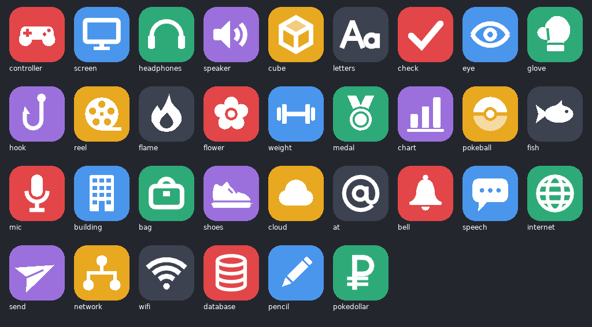

# WoobOS: development notes

For people working on the mod. Players want [README.md](README.md).

## Layout

| File | What it is |
|---|---|
| `main.lua` | Wiring: loads the modules below, the engine reads they need (session, clock, the Pokédollar glyph), options, `mod.exports` |
| `src/ui_kit.lua` | The drawing kit: page layout on the window's safe area, rect / hit pools, memoised colours, cached gradient meshes, text, the metal plate, the W logo, hints, toast |
| `src/apps.lua` | The app registry and the built-in apps |
| `src/kanto_gear.lua` | Slots, R-Bay and the GTS as Kanto Gear apps, through its public hook |
| `src/icons.lua` | The pictures an app's icon can use: other mods choose one by name |
| `src/apps/appstore.lua` | The App Store window: the removable apps, GET / OPEN, an app's page |
| `src/desktop.lua` | The desktop: monitor, boot, menu bar, home grid with pages, dock, W menu, sheets, buttons / touch / mouse |
| `src/shell.lua` | The PC menu takeover, the UI stack layer, the `render.hud` / `input.pointer` / `input.wheel` / `script.command` hooks, the touch pad hide |
| `src/inventory.lua` | The item model: PC and Bag rows, withdraw / deposit / toss / sort (the PC's list; a Bag pocket's slots, as the game's own Bag moves them, except the pockets the game keeps sorted) through the engine's `Storage` and `Bag` |
| `src/mailbox.lua` | The mail model: inbox and held rows, to Bag / give / take on the engine's mail pool |
| `src/apps/items.lua` | The Items window: Bag \| PC commander |
| `src/apps/mail.lua` | The Mail window: folders, list, the open letter, the party picker |
| `src/apps/settings.lua` | The Settings window: Language, Wallpaper, Watch (the START row, the banners), Map (the 3D Town Map) |
| `src/auction.lua` | R-Bay's market: auctions worked out from the save's seed and the clock, eBay proxy bidding, bids / results in `mod.save` |
| `src/apps/auction.lua` | The R-Bay window: Browse \| My Bids, the IVs, the max-bid stepper |
| `src/gts.lua` | The GTS: strangers and their Pokémon (traded, their OT), the trade rules, Wonder Trade, the deposit and its match, the listings |
| `src/apps/gts.lua` | The GTS window: Wonder Trade's picker, the globe search and the reveal; the listings; My Deposit |
| `src/slots.lua` | Rocket Slots: the reels, the pay table, spins (the win held until the reels stop), tickets and the prize corner |
| `src/pcgames.lua`, `src/apps/pcgames.lua` | The PC Games mod's screen kept in a window: catching its layer, the picture |
| `src/apps/slots.lua` | The Slots window: the stage, the reels' roll, the pay ladder and table, free spins, Auto, Prizes |
| `src/mart.lua` | The shop model: the badge-gated stock, buy / sell on the session's money and the engine's `Bag` |
| `src/apps/mart.lua` | The Mart window: Buy \| Sell, a tabbed list, the chosen item with its stepper |
| `src/boxes.lua` | The Pokémon model: party and boxes through the engine's `Storage` (take / fits / place / putBack, release, items, the preview's words, the send-to box) |
| `src/apps/boxes.lua`, `src/apps/boxes_view.lua` | The Boxes window: state, buttons, pointer, modes (`boxes.lua`); its drawing (`boxes_view.lua`) |
| `src/i18n.lua`, `lang/*.lua` | The words, by language (`lang/en.lua` the master) |
| `src/settings.lua` | The Settings app's choices, kept in `mod.cache` (`settings.lua`) for the installation |
| `src/wallpaper.lua` | The drawn wallpapers and the `wallpapers/` folder's pictures, painted once into canvases |
| `src/notify.lua` | The notifications: a list, the banners' queue, the card, the field's banner |
| `src/map3d/model.lua` | The 3D map's model: the region from the game's Town Map (its picture a heightmap and its colours, its grid the places), the census's Centers / Marts / Gyms, the badges, the player's cell, Fly's checks |
| `src/map3d/render.lua` | The 3D map's drawing: meshes, the shader, the depth canvas, the camera (`camera` / `project`), day and night; a flat fallback |
| `src/map3d/scene.lua` | The 3D map's window: the camera, pins, the beacon, the card, the controls (the Map app and the Town Map) |
| `src/map3d/towns.lua` | The 3D map's towns: sizes by tier, roofs by name, the signature structures and landmarks, the Center / Mart / Gym, trees |
| `src/phone.lua`, `src/apps/phone.lua` | The Phone: Match Call's contacts (Emerald) or Trainer's Eyes' (Ruby / Sapphire), the game's calls, recents / favourites in `mod.save` "phone"; its window |
| `src/condition.lua`, `src/apps/condition.lua` | Condition: the contest conditions, the search, the Pokéblock case and feeding; its radar window |
| `src/ribbons.lua`, `src/apps/ribbons.lua` | Ribbons: who wears what, the game's words and pictures; its window |
| `src/hall.lua`, `src/apps/hall.lua` | The Hall of Fame: the game's records, newest first; the trophy case |
| `src/oak.lua`, `src/apps/oak.lua` | Oak's PC (FireRed / LeafGreen): the Kanto counts and the game's rating |
| `src/pokenav.lua` | The PokéNav takeover: stand-in screens for every feature, which open our apps |
| `src/townmap.lua` | The third host: the 3D map full screen in place of the game's Town Map / Fly map |

## How the PC is taken over

The game's PC scripts open their menu through `src.ui.game3.pc_menu`'s `show(opts)`, looked up when
they run (`scripting/adapters.lua` `openPc`). The shell wraps that one function, once per process
(`PcMenu.__woobOs`, which calls the current mod instance), and opens the desktop for
`startMode == "select"` (a Pokémon Center PC's menu) and `opts.bedroom` (the bedroom PC). Every other
call (the storage menu, the player's PC menu the scripts open after a choice) is the game's own.

A `script.command` hook skips the two lines the scripts show in front of those menus ("X booted up
the PC." and "Which PC should be accessed?"): the msgbox before the menu and the prompt the menu
script prints, found by the rows that follow them (`Sh.skips`). With the Desktop option off they
stay.

An app ends the desktop with the row the game's own list (`PcMenu._rootEntries`) has for it, so the
script carries on as if that row was chosen and comes back to the PC menu, which is the desktop
again (without the boot, the app's icon zooming back). Logging off hands back 127. Decorate (the
Ruby / Sapphire / Emerald bedroom) is a window (`src/decorate.lua`, `src/apps/decorate.lua`). Toss and
Put Away happen in it. Placing goes through `ctx.over`: `Dc.place` opens the game's Decoration menu,
sets its list state on the chosen decoration and feeds it an A, then watches `handleInput` until the
cursor mode ends and closes the menu on the black, before its list can show. Only dolls and cushions
go in the bedroom, as in the game, so Put Away only has sprites to deal with.

Items and Mail never go through the script: they are windows inside the desktop and change the
session the way the game's own screens do (`Storage.withdrawItem` / `depositItem` / `tossItem`,
`Bag.add`, the mail pool's `giveMailToMon2` / `takeMailFromMon` / `clear`). Nothing marks the save;
the player's next save writes it. The rules: important items (`importance ~= 0`) stay in the Bag
and can't be tossed (Emerald's rule, for every game); Move to Bag erases the message (as the game
does); a Pokémon holding an item can't take mail.

## Adding an app (from another mod)

Register your app when the game is ready, so it doesn't matter which mod loads first. WoobOS is
optional for you: `mod.find` gives nil when it isn't installed.

```lua
return function(mod)
  mod.events:on("game.ready", function()
    local wos = mod.find("woob_os")
    if not wos then return end
    wos.exports.apps.register({
      id = "my_app",                  -- unique; keep it the same, the player's arrangement is kept by id
      label = "My App",               -- under the icon, about 10 letters
      glyph = "flame",                -- one of the icons below
      color = { 232, 96, 40 },        -- the tile, red / green / blue, each 0..255
      order = 60,
      available = function(ctx) return true end,
      window = function(ctx, env)     -- or open = function(ctx) ... end
        local K, title = env.K, "Hello from my mod"
        return {
          title = "My App",
          draw = function(body) K.text(title, body[1] + 8, body[2] + 8, 7, K.UI.label) end,
          hints = function() return { { "B", "Close" } } end,
        }
      end,
    })
  end)
end
```

`register` returns `true`, or `false` and why: a repeated id, no `open` or `window`, an icon that
isn't in the set, or a colour that isn't `{ r, g, b }` from 0 to 255 (love's 0..1 colours are refused,
they'd come out black). The reason also goes to the log. `game.ready` can fire again in a session: a
second `register` with the same id is refused and does no harm. The icon is white, so pick a tile
colour it shows up on.

**The icons** (`wos.exports.apps.icons()` lists them):



`controller` `screen` `headphones` `speaker` `cube` `letters` `check` `eye` `glove` `hook` `reel`
`flame` `flower` `weight` `medal` `chart` `pokeball` `fish` `mic` `building` `bag` `shoes` `cloud` `at`
`bell` `speech` `internet` `send` `network` `wifi` `database` `pencil` `pokedollar`

The built-in apps' own pictures work too (`ball`, `mail`, `cart`, `rocket`, `slots`, `globe`, `map`,
`phone`, `radar`, `ribbon`, `gamepad`, `home`, `trophy`, `dex`, `power`, `logo`, `gear`), though
`ribbon` and `gamepad` have their own apps' colours painted in. Or draw your own:
`glyph = function(K, cx, cy, size, alpha) ... end`.

Other fields: `dock = true` starts it in the dock, `pad = false` keeps it off WoobPad, and
`badge = function(ctx) return n end` puts a count on its corner (read once a second).

**The App Store.** Every app another mod registers is listed there, under From Your Mods, and the
player can remove it or get it back. `tagline` (the row's few words), `description` (its page) and
`by` (your name or your mod's) fill in its listing. A removed app stays registered and is just left
out of `apps.list`, so `available`, `badge` and a notification's tap are unaffected by it; don't
count on the icon being there. In the registry, `removable = true` is what puts an app in the store:
`exports.apps.register` sets it, and of the built-ins only the Mart, GTS, R-Bay, Slots and PC Games
have it. The removed ids are Settings' `removedApps`, for the installation, like the arrangement. A
window can call `ctx.refreshApps()` after changing them and `ctx.launchApp(id)` to open another app.

`ctx`: `session`, `mode` (`"select"`: a Pokémon Center's PC, `"bedroom"`: the player's own PC, `"pad"`:
WoobPad, anywhere), `family` (`"frlg"` / `"rse"`), `row(id)`, `finish(row)`, `done()`, `logoff()`,
`over(open)`, `original(opts)`, `sheet(kind)`. A `window` is the simplest fit: it works on the PC and on
WoobPad alike, where `finish` and `row` have no PC script to go back to.

A window instead of `open`: `window = function(ctx, env) return win end`, where `win` has `title`,
`draw(body, clock, portrait)` (body in units; hits as `K.addHit(rect, "win", arg)`),
`input(input, nav)` (true when handled; a B it leaves closes the window), `tap(arg, x, y)`,
`scroll(dy, x, y)`, `hints()` and `close()`. `env` has `K`, `session()`, `se(name)`, `now()`,
`itemIcon(id, x, y, size, alpha)`, `monIcon(species, x, y, size)`, `monIconOf(mon, x, y, size, frame,
alpha)`, `boxWall(id, x, y, w, h)`, `itemName(id)`, `monPic(species, x, y, size)` (its front picture -> true when drawn),
`amount(n, x, y, size, c, measure)` (money with the game's sign -> its width) and
`pad.transfer(id, dir, kind)` (kind `"ball"`: a Poké Ball instead of an item). The garbage rules below apply.

**The look.** Windows share the kit's macOS / iOS pieces, so a window from another mod can match:
`K.UI` (the system colours), `K.card`, `K.selection` (accent while the list has the focus, grey
when not), `K.hairline` / `K.vline`, `K.chevron`, `K.button` (`"accent"`, `"danger"`, `"gray"`,
`"tinted"`; `focused` draws the focus ring), `K.segmented`, `K.dim` + `K.sheet` for sheets and
popovers, `K.scrollbar` and `K.bold`. The desktop draws the toolbar (the red, yellow and green
lights, the title) and fills the body with `K.UI.grouped`; a window draws its cards on that.

A window may also have:
- `pointer(phase, x, y)` (units). It then gets every press, move, release and cancel inside it,
  plus `"hover"`; returning true from `"released"` means it used the release. A release it doesn't
  use, with no drag, is a tap as usual.
- `pad = true`, which lights the shelf's pad.

`ctx.over(open, state)` opens one of the game's screens. When it closes, the window comes back at
once, handed `ctx.resume = { app, state }`. Boxes uses this for Summary and Rename.

## Kanto Gear

`src/kanto_gear.lua` registers Slots, R-Bay and the GTS with Kanto Gear's public hook
(`exports.modules`, api 1) at `game.ready`, once, and only when that mod is on. No Kanto Gear file is
involved and none of its code is used. The Silph Store and the App Store are independent.

A tile opens the app on its own screen, separate from the PC's and WoobPad's windows: `src/gear_panel.lua`, a
second `src/townmap.lua` host (`keepHits`, because it shares the kit with whichever other host drew that
frame) with nothing on the game's stack, so the game runs on. Physical buttons stay with the game; the app
takes touch and the mouse. While `shown` is true the Gear stands down and hands over the layout, so:

- With a separate display (`SecondScreen.available()`, and the Gear not in a combined layout just before it
  opened), a 744 x 648 canvas (the shape of the Ayn Thor's lower screen; the engine can't ask a display its size) goes out at 30 frames a second and taps come back through `pollTouch`. The
  desktop companion sends only presses and releases, so a release elsewhere is treated as a drag.
- Otherwise it sits in the window through `render.viewport` / `render.window`, where the Gear's combined layout
  was, or under the game in the bottom half.

It opens only when `Sh.free(game)`, and locks (`opts.locked`: the toolbar's way back still works) whenever
the game above stops being free, because these apps change the party and the money. A GTS evolution runs on
the game's screen through `ctx.over`, locked, and the window is made again after.

## Arranging the desktop

`src/arrange.lua` (Ar) is the model: `Ar.place(apps, dockText, gridText)` lays the available apps
out by the kept arrangement (named apps in order, the rest by `app.dock`, the dock capped at
`Ar.DOCK_MAX` = 6), `Ar.encode` writes it back (ids this PC doesn't show stay in their list), and
`Ar.move` moves one app between the two lists. The texts are comma-separated ids in Settings
(`dockApps`, `homeApps`), read and written through main.lua's `layout` / `saveLayout`.

In desktop.lua, `r.edit` is the wiggle mode and `r.carry = { app, list, i, ptr, x, y }` the app in
hand. The app stays in its list as it's carried: `carryTo(list, j)` moves it live, so the others
make room. The pointer's target is worked out against the dock as wide as it will be with the app
in it (`carryToPointer`), so it doesn't hop as the dock re-centres. A long press (`D.LONG_PRESS`,
not moved past 4 px) is checked in `D.draw`; while arranging, a press on an icon picks it up at
once. Each drop saves.

## Boxes

`src/boxes.lua` wraps the engine's `Storage`:
- **How many boxes:** `Bx.BOXES` is read live (a metatable field) from the engine's
  `Storage.TOTAL_BOXES_COUNT`, which WoobleDex's Bigger PC raises to 40; a box's addresses are made
  the first time they're asked for.
- **Moves:** `pickUpMon`-style taking, done by hand so a group is taken all or nothing; then
  `placeHeldMon` (healing in a box, compacting the party, the quest log) and `restoreHeldMon`.
- **Rules,** applied on every game: the party keeps a Pokémon that can battle; mail holders stay
  out of boxes; no releasing Eggs, mail holders or the last usable Pokémon; on Ruby/Sapphire, the
  game's Surf/Dive release rule.
- **Groups:** a box group keeps its shape (`dx` / `dy` from its top-left cell); a party group goes
  on the end.
- **On close:** the window puts back anything held, and sets the game's send-to box (the variable
  and flag the game's own screen sets).
- **Dynamax (WoobleDex):** `Bx.dynamax()` returns WoobleDex's `exports.dynamax` (main.lua looks it
  up with `mod.find("national_dex_gen3")`) or nil. `Bx.info` reads `canDynamax`, `level` and
  `canGigantamax` once per Pokémon: `info.dmax` (0-10; nil without WoobleDex or for a Pokémon that
  can't Dynamax) and `info.gmax`. The preview draws a ten-segment gauge row and a G-Max badge over
  the picture's foot. Nothing is written to the Pokémon.
- **Help:** FireRed/LeafGreen's Help opens on L/R and stops the game's update. The shell sets
  `help_system.enabled = false` while the desktop is up, the same way as the touch pad.

## The shelf

Under the monitor is a shelf (`D.SHELF.h` units; the page is the monitor's 160 plus the shelf, so
the screen keeps its size in units). In its middle is the pad, used for the Poké Ball and for items.

- **The ball.** A window with `ball = true` (Boxes) holds it, when there's a party (read once a
  second). `r.ballPhase` runs off -> `drop` (falls `D.BALL.height` units with a bounce,
  `SE_BALL_BOUNCE_1`) -> `on` (unlit; red, pulsing, while `win.moving()` is true -- Boxes carries
  a Pokémon --, then a green flash over `D.BALL.moved`) -> `done` when the window closes (a green flash, `SE_BALL_CLICK`) -> `lift` -> off.
  Reopening during the flash goes straight back to `on`. Coming back from the game's Summary
  (`ctx.resume`) sets `r.ballSkip`: the ball is already there. `D.ballState()` gives the phase and
  the glow ("moving" | "moved" | nil). While it sits there a `"ball"` `padTransfer` is dropped (no
  crossing: the glow tells it); elsewhere (GTS, R-Bay, Slots) a Pokémon crosses as a Poké Ball and
  the resting ball, if any, sinks into the pad meanwhile (`D.PAD.ball`).
- **Sizes.** The ball and the item on the pad are both `D.SHELF.item` units across.

The pad lights up while the open window has `pad = true` (Items and the Mart do), and
`env.pad.transfer(itemId, "out" | "in")` plays an item crossing it. "out" (Bag to PC) drops the
item onto the pad and digitizes it away (`SE_WARP_OUT`); "in" (PC to Bag) digitizes it in
(`SE_WARP_IN`), holds it, and fades it into the Bag. One effect plays at a time, at most two
wait, and a waiting one going the same way is replaced, so the pad shows the last item chosen.
Timings in `D.PAD`; `D.padState()` for tests. The Mart uses the same two: a purchase is "in", a
sale "out".

## The Mart

`src/mart.lua` holds the stock: four tabs (Balls, Medicine, Battle, Field) of `{ item id, badges
needed }`, laid out like the later games' badge-tiered Marts. Prices and names come from the
engine's `ItemsData.info` when the tabs are first built (an item without a price is dropped), so
they're each game's own. Badges: `Flags.countBadges` on the live script store
(`scripting.space`'s `getStore()`), read once when the window opens (`st.badges`).

- **Buy:** badges, then money (`session.money`), then `Bag.canAdd`; `Bag.add` before the money is
  taken. Ten or more Poké Balls add a Premier Ball when it fits (the Gen 3 shop's bonus).
- **Sell:** half the price, floored; nothing priced 0 or important. `Bag.remove`, then
  `Prize.apply` (capped at 999,999). The last one sold stops being the registered item.
- **Money in a window:** `env.amount(n, x, y, size, c, measure)` (`D.amount`: the game's
  Pokédollar glyph and the digits, as the menu bar draws them).

Headless the cart's font isn't there and the engine's glyph draw tries loading it again on every
call (about 0.26 KB each), so the test stands in for it while measuring the Mart's garbage; the
probe measures the real one (about 0.06 KB a frame).

## R-Bay

`src/auction.lua` stores nothing about an auction. Slot `k` (0-11) runs auction number
`n = floor((t - EPOCH - k * 900) / 10800)`: three hours each, staggered fifteen minutes apart.
`generate(s, k, n)` makes it from a Park-Miller generator seeded by the save (`meta.playthroughId`)
and `k`, `n`: the tier (weights 34/26/20/11/6/3), the Pokémon from that tier's pool, the level
(tier range + 3 per badge, at least its evolution level), the IVs (the best of 1-3 rolls by tier),
the hidden value `V` (the tier's band x `0.6 + 0.8 q^2` x `1 + 0.08` per 31), and the bidders
(a count and keenness by tier, maximums at most `1.35 V`, some sniping in the last ten minutes).

- **Pools,** built once: the cart's #1-386 by evolution stage (`Pokemon.evolutions` inverted;
  first stages Common, middle and lone Uncommon, finals Rare), our own Legendary / Mythical /
  Prized lists, and WoobleDex's `listSpecies` (its `legendary` / `mythical` flags) with
  `evolutionsOf` for the stages. Shedinja never sells.
- **Pricing:** `sim(L, t, mine)` replays the bids up to `t` in time order, the player's
  `steps` (time, max pairs) among them: eBay's proxy rule (one `step(price)` over the
  second-highest maximum, capped at the highest; a tie goes to the earlier bid). A challenger
  under the leader's maximum logs two bids: theirs, then the leader's answer at the new price
  (the top bid shown). No tables made; the last five bids kept in two ring arrays.
- **The player's part** is `mod.save` "auction" (`session.modData.woob_os`): `bids[key]` (the
  listing's species / level / IVs copied, `max`, `held`, `steps`), `results` (newest first, 20 kept),
  `unread`. It rewinds with the save, as the money and the party do. `Au.bid` takes the
  difference from what's `held` (`Au.heldOf`: older saves, all of `max`); outbid (in `Au.bid`,
  or a listings refresh: the window's, or `Au.settle`'s while a bid holds money) it's paid back
  at once and `held` = 0 (a beaten maximum never leads again); `Au.settle` (on `save.loaded`, and the desktop's once-a-second
  `deps.tick`) gives a win through `Party.giveMonToPlayer`, then writes the listed IVs into
  `mon.ivs`, `Pokemon.applyStats` and full HP, and pays the change back with `Prize.apply`. A
  loss refunds what's still held. With no room anywhere, a win waits (`b.won = true`).
- **The icon's count:** an app's `badge(ctx)` (read once a second) sets `app.badgeN`, which
  `appIcon` draws.
- **The window's show** (`src/apps/auction.lua`): `pickHot` (once a second: tier rank, then
  value, bids, ending within 30 min) names `st.hotKey` for the Hot Auction card; `watch(L)` keeps
  `L.seenPrice` / `L.flashT` (a price that moved flashes up) and `L.wasLead` (losing the lead
  toasts); taking the lead throws confetti from a fixed pool (`PARTICLES`).
- **Tests** swap `Au.store` (a fake `mod.save`) and `Au.now` (the clock). The probe's garbage
  checks warm up first: LuaJIT compiling new paths' traces landed 0.5-3 KB one-off spikes.

- **Shiny auctions:** `L.shiny` from its own dice (`shinyDice`: the seed, the slot, the number;
  not the market's rolls), one in `SHINY` (10): the value x `SHINY_VALUE` (2.5), `SHINY_BIDDERS`
  (2) more bidders, keener; `L.picMon = { species, isShiny = true }` for `env.monPic`'s sixth
  argument; the Hot Auction's score +4.5M (four tiers). The bid record keeps `shiny`; `deliver`
  makes it with `Party.giveMon(..., { toPC = true, fixedPersonality })`, the personality from
  `Au.shinyPersonality(tid, sid, lo, k)` (the game's test: tid ^ sid ^ hi ^ lo < 8) for the player
  as its OT. The GTS uses the same (`deps.shinyPersonality`): `Gx.make(..., shiny)` for the
  stranger's IDs; `Gx.SHINY` (10) for Wonder Trade, a deposit's answer, a listing (`L.shiny`).
- **Pictures:** `env.monPic(sp, x, y, size, a, mon)` asks a bare species for the normal colours
  (`isShiny = false`: no personality or OT ID would read as shiny); with `mon`, its own.

## Slots

`src/slots.lua`: five fixed strips of 30 stops, `REELS` (one Bonus each; wilds on reels 2 to 4 only,
so a line's first symbol is never wild). `LINES` are rows per reel (-1 top, 0 middle, 1 bottom);
1, 5, 10 or 20 are played (`LINE_SETS`), the bet on each, and `Sl.at(r, stop, row)` reads one.
`Sl.payout(a, b, c, d, e)` counts three, four or five from the left, wilds standing in:
`PAYS[sym].x[n - 2]` × the bet and `.t[n - 2]` tickets per ₽50 bet. Bonus counts anywhere
(`Sl.bonusOn`): `BONUS_PAY[n]` × the whole bet and `FREE[n]` free spins. The return is computed exactly
in the test from each reel's symbol counts: 68.7% lines + 2.1% Bonus + 20.5% free spins = 91.3%;
free spins about 1 spin in 117, the jackpot 1 line in 225,000. A ticket costs about ₽290 of expected
loss whatever the bet, which prices the prize corner (Rare Candy 15 ≈ ₽4.4k, Porygon 200 ≈ ₽58k).

- **A spin:** `Sl.spin(s, level, lines)` takes the bet × the lines and draws the five stops at once (`Sl.rng`, else
  `love.math.random`); the reels' stopping is only shown. The win is held until `Sl.collect(s)`
  (when the last reel lands, or the window closes), so the menu bar's money doesn't give it away.
  `result.won[l]`, `count[l]`, `sym[l]` describe each line; every line's distribution is the
  middle's (each reel's stop is uniform), so the return is the same on any number of lines.
- **Free spins:** `d.free = { left, level, lines, total }` in the save (`Sl.freeState()`), so they
  rewind with the money and carry on if the window closes. `Sl.spin` then ignores its arguments, charges
  nothing and multiplies by `FREE_MULT`; `Sl.collect` adds up `total` and ends them on the last.
- **Prizes:** `Sl.prizes()` (TMs named with their move, `Pokemon.moveFromTmItem`), `Sl.redeem`
  (`Bag.add`, or `Party.giveMonToPlayer` at `10 + 3 × badges`); the tickets come off only after.
- **Kept:** `mod.save` "slots" (`tickets`, `stats`). Tests swap `Sl.store` and script `Sl.rng`.
- **The show** (`src/apps/slots.lua`): `drawMachine` lays out ladder | reels | spin, or stacks them under
  170 units wide. `st.teaseFrom` (two Bonus down) holds the later reels back `TEASE` seconds each with
  rising `SE_NOTE_*`. `celebrate` picks a `TIERS` row by × everything bet: under 36 coins the win shows
  above the reels (`drawLogo`), else across the window (`drawBigBack` / `drawBigFront`, the coins
  between them so the words stay clear). `winCell` lights the symbols, `shownLine` then cycles the
  winning lines. `st.nextAt` is when free spins or Auto spin again, after the banner and the
  `st.intro` / `st.outro` cards. `glow` is one kept additive mesh, nothing without meshes (headless).
  Sounds queue with `seLater` (the engine plays one at a time). Coins, confetti and flying tickets come
  from a fixed pool of `PARTICLES` records.

## PC Games

The app appears only when the PC Games mod (`pc_solitaire`) is on. `src/pcgames.lua` calls its public
`exports.openGames(game)` with `Stack.push` stood in for during that one call, and keeps the layer
(`draw` / `handleInput` / `update`) instead of letting it reach the stack; anything else it pushes
goes through untouched, so a future change of shape falls back to it opening over the desktop. Its
`Stack.pop("pc_solitaire")` is watched only while its own code runs, which is how we learn it closed.

- **Closing:** it has no way to be closed from outside, so closing the window keeps the layer and the
  next open carries on; `H.reset()` at `game.ready`, when the mod forgets its own. While it's kept,
  that mod's other ways in (the Kanto Gear app; the PC menu with the desktop off) do nothing.
- **The picture:** drawn 240 x 160 into a canvas and shown at a whole number of screen pixels.
  `g.setCanvas(target)` comes before `g.pop()`: restoring the scissor with the picture still bound
  works it out for the wrong target's height and clips the top and bottom of the screen.
- **Buttons:** the real ones only, handed straight to it, as when it opens on its own.
- **The whole screen:** `win.fullscreen = true` gives a window `L.screen` as its body, with no toolbar
  and no menu bar. The window draws its own way out (a `"winclose"` hit), shown on `win.pointer`.

## GTS

`src/gts.lua` (Gx): Wonder Trade and the Global Trade Station with made-up Trainers (`STRANGERS`:
a name of seven letters at most, a home region, a gender; each trade a fresh 32-bit OT ID that is
never the player's).

- **Their Pokémon:** `Gx.make` builds it the way the engine's NPC trades do (`Trade.createTradeMon`):
  `Party.giveMon` on a throwaway session (the real party and Pokédex untouched), then the OT name,
  ID, gender, `metLocation = 0xFE`, sometimes a held item, `applyStats`. `Pokemon.isTradedMon` is then
  true: the game's 1.5x EXP and badge obedience apply on their own.
- **The rules:** `Gx.canSend` asks the game's `Trade.canTradeSelectedMon` (a box Pokémon through a
  two-Pokémon stand-in party; the National Pokédex check only on FireRed / LeafGreen, whose rule it
  is), plus our own: an Egg, a mail holder, the last Pokémon that can battle stay. What may come in:
  `Gx.allowed` (Kanto's 151 on FRLG without the National Pokédex).
- **The swap:** a party slot through `Trade.tradeMons` (mail, friendship 70, the Pokédex); a box cell
  by hand (healed, the Pokédex); `Trade.noteLinkTrade` counts it.
- **Wonder Trade:** a tier by weight (45 / 30 / 15 / 8 / 1.5 / 0.5 %), a species from R-Bay's pools
  (`Au.pools`, `Au.tierOf`, `Au.minLevel`), the level within 5 of yours.
- **Your deposit:** the Pokémon itself kept in `mod.save` "gts".deposit while posted. `matchAt` from
  the ask's fairness (the tier rank asked minus given, +1 for a level range well above): within an
  hour, within four, a 30% chance within six, or never. `Gx.settle` (the shell's tick,
  `save.loaded`) makes the stranger's Pokémon when it's time (a "gts" notification);
  `Gx.collect` places it.
- **Listings:** ten per half hour from the save's seed (R-Bay's `Au.seedOf`), 40% asking for a species
  the player owns; `done` keys per window.
- **Trade evolution:** `Gx.evolveTarget` (`Evolution.tradeTarget`), then the window's reveal opens
  `Gx.openEvolution` (the game's `EvolutionScene`) through `ctx.over` and comes back via `ctx.resume`.
- **Tests** swap `Gx.store`, `Gx.rng`, `Gx.now`; the probe scripts `Gx.rng` for a legendary and a
  Kadabra (its evolution scene in the engine).

## WoobPad

WoobPad is `src/desktop.lua` again: `main.lua` makes a second desktop with `deps.device = "pad"`
(the same deps through a metatable), opened from the START menu anywhere. `src/shell.lua` keeps
one host open at a time: `Sh.host()` is the desktop, the pad or the full-screen host, and the
layer, `render.hud` (`Sh.frame`), `input.pointer` (`Sh.pointer`) and `input.wheel` go to whichever
is up.

- **The row:** the `ui.start_menu.items` hook (`Sh.startRows`) puts `{ id = "woob_watch", label =
  T("watch.start") ("WOOBPAD"), onSelect }` in the `pokenav` row's place (Ruby / Sapphire / Emerald:
  the Map, Phone, Condition and Ribbons apps do its jobs), else
  under BAG, where it would be (FireRed / LeafGreen, and before the PokéNav is got), only in a menu with
  SAVE (not a link room's or the Safari Zone's), the Desktop option and Settings' `watchRow` on
  (the old ids kept: an installation's settings). `onSelect` runs with the START menu still on the
  Stack, so popping the pad's layer is the menu again.
- **The layer:** `woob_pad` (`Sh.PAD_ID`, also `Sh.WATCH_ID`), pushed `{ hideBelow = true,
  fullscreen = false }`: the START menu's box hides, the field is still drawn (the pad dims it).
  The desktop's stays full screen.
- **ctx:** `mode = "pad"` (`Apps.list` gives Boxes then; Oak, the Hall and Decorate want PC rows
  and drop out; apps with `pad = false`, Log Off, are left out), `warm` (no boot), `finish` /
  `done` / `logoff` put it away, `over(open, state)` as the desktop's (back with `ctx.resume`),
  `sheet(kind)` the pad's own.
- **The device:** `D.PAD_PAGE` (160 tall; the body over the hints), `D.padLayout` (a 6-unit bezel:
  the screen about 130 units tall), `D.screenLayout` (the menu bar, the grid, the dock, the windows:
  shared with the PC), `drawPadDevice` (the game dimmed, the aluminium edge, the glass, the camera,
  the top button = "power": put away). No boot, no shelf (`padTransfer` does nothing), the hints
  under the body. B on the home screen: `logoff()` at once. The W menu: About, Notifications, Put
  Away (the PC's: About, Notifications, Log Off).
- **Notifications:** the "notes" sheet (both devices): `Nt.list()` as cards (`Nt.drawCard`, its
  `Nt.ago`), Up / Down, A or a tap opens its app (`D.openApp`); on the pad a press in the top 12
  units pulled down more than 20 opens it.

## Notifications

`src/notify.lua` (Nt), made in `main.lua` and handed to the models as `deps.notify(kind, data,
quiet)`: `Au` ("outbid" in `refund`, quiet when the player's own `Au.bid` lost it; "soon" once per
bid at `deps.soon()` seconds before the end (Settings `soonMinutes`: 5 / 10 / 15 / 30, the
Settings app's choice row), `b.soon` kept in the record; "won" / "lost" in `Au.settle`) and `Gx` ("gts" in `Gx.settle`).
`main.lua`'s `notify` makes it quiet while the player is looking at that app's window.

- **Records:** `{ kind, app, title, text, sp, at, state }`, the text made once (`T.f`), 20 kept
  (memory only). `state` is handed to the app as `ctx.resume.state` when it's opened from one
  (R-Bay `{ tab, key }`, the GTS `{ tab = "deposit" }`).
- **Banners:** a queue of three (older than ten minutes: the list only), `Nt.step(clock, canShow)`
  shows them one at a time (`IN` / `HOLD` / `OUT`). With no host open, `Sh.frame` draws the
  field's (`Nt.drawField`, `K.place` on the game's own pixels, `Nt.FIELD`) only while `Sh.free(game)`
  (the engine's quicksave test: the field, not `Hud.busy()`, `Hud.startButtonAllowed()`); a press
  on it (`Nt.hitField`) opens the watch on that app. The desktop shows it under its menu bar, the
  watch over its screen (hits "notify" / "wbanner"). Settings' `notifications` off: list only.
- **The tick** moved to the shell: `main.lua`'s `tick()` once a second from `render.hud`, wherever
  the player is (the open host's session first): `Au.settle`, `Gx.settle`.

## The 3D map

Clean room: the idea of a 3D region map (TERRARIUM's for Gen 1) and none of its code.

- **The storms** (Emerald): `Mdl.storm` reads `VAR_ABNORMAL_WEATHER_LOCATION` (1..8 Groudon's routes,
  9..16 Kyogre's, one rumour at a time; only the Weather Institute's scientist sets it, special 491),
  `VAR_SHOULD_END_ABNORMAL_WEATHER` and `FLAG_DEFEATED_*`, and names the route through the Town Map's
  `terraOrMarineCaveMapSecIds`. `render.lua` keeps two meshes per kind built around the origin (flags 5
  rain, 6 puffs, 7 grains; `uStorm` places and animates them, `uStormAt` / `uStormTint` shade the ground
  under them; separate uniforms per shader stage, for GLES's differing precisions). `scene.lua` reads it
  once a second, drifts it from `env.map3d.lastStorm`, draws the lightning and the flat map's version.

- **The model** (`src/map3d/model.lua`, made in `main.lua` with `pixels(img, x, y, w, h)`, a
  canvas read-back): one Town Map cell (8 px) a world unit, x right, z down the picture, y up.
  FireRed / LeafGreen: `region_map_extract`'s `LAYOUTS[0..3]` (22 x 15 per picture, `map` and
  `dungeon` layers; cell (x, y) covers pixels (8x + 32, 8y + 32)), the pictures through
  `region_map_gpu.image("kanto_map" ...)`. Ruby / Sapphire / Emerald: `rse.region_map`'s
  `manifest().layout` (28 x 15; column c, row r = the cursor (c, r + 1) = pixels (8c, 8(r + 1))),
  the picture through `rse.scene_kit`'s `Kit.image`. The picture is sampled every 2 px (`classify`:
  the sea, a sea lane, the greens' lightness as height, a route's yellow, a faded route's beige;
  markers filled from around them), smoothed, mountains raised on our own `PEAKS`, towns levelled.
  The places are the grid's sections (town / route / landmark; a landmark in a town's own cells is
  on its card). Center / Mart / Gym come from the engine's map catalog
  (`MapCatalog.isKnown`: `<Town>_PokemonCenter_1F`, `_Mart` / `_DepartmentStore_1F`, `_Gym` / `_Gym_1F`), the badge from
  `Flags.forVersion(...).BADGES`' `gym`. Built once per game and region (headless: no picture, land
  under the grid). `live` reads visited / Fly (FireRed's `RegionMap.mapsecType` asked as the Fly
  map; Ruby's `mapSecType`) and the badges; `player` is the game's own position code
  (`Position.playerCell`, `rse.region_map.newState`), shown only on one of the map's places.
- **The drawing** (`src/map3d/render.lua`): meshes of our own (`FORMAT`: position, normal, colour
  and a flag: 1 the sea, waved in the shader; 2 a window, lit at night; 3 a cloud, its anchor in the
  normal, drifting, faded near the eye; 4 unlit) into a canvas `{ c, depth = true }` (msaa 4 when it
  can), drawn into the window's rect. The view-projection is kept in a table (sent `"column"`; a
  canvas's rows run upside down: `VPF`); `project` places the overlays with the same maths. Night
  and dusk come from the device's clock (`env.map3d.clock`, once a second). With no shader or mesh
  (headless), the land is drawn as flat polygons through the same camera.
- **The towns** (`src/map3d/towns.lua`, `Tw.build(region)` -> vertices for one mesh): the
  model's `tier` (0 a route's Pokémon Center, 1 a town, 2 an island's, 3 a city) sets the number of
  buildings (a city's blocks with window rows among them) and the ground (`Tw.ground`; Pacifidlog's
  `water` boardwalks); `ROOF` by section name; `STYLE` (a town's own structure, in its middle) and
  `LANDMARK` (a landmark section's: in its town when `within`, else at its cell) name `BUILD.*`
  pieces made of boxes, hip roofs, frustums and domes (`FOOT`: what they keep clear). Silph Co.
  and the S.S. Anne have no Town Map cell: they're Saffron's and Vermilion's own. Water-side pieces
  (a lighthouse, a pier, a boat, the S.S. Anne) find the nearest open water (`seaNear`).
- **The glass:** after each 3D frame a quarter-size copy (`blurTarget`, linear) is kept;
  `R.frost(G, x, y, w, h, rad)` draws it through the glass shader (25 taps, a rounded rect's signed
  distance) under an overlay; the scene's `glass(b, rad, a, tint)` adds a dark tint, a gloss and a
  rim (`win.glass`, also the Town Map's hint capsule). No 3D frame (headless): the tint alone,
  darker.
- **The cursor and the flat map:** the scene keeps a world cursor (`st.cx`, `st.cz`); the held
  D-pad (`dirX` / `dirY`, read with `isDown`) moves it in screen directions from the camera's yaw
  (north up when flat), slower over a town; let go, it glides (`GLIDE`) onto the nearest nav place
  within `SNAP`; `placeAt` (town over landmark over route) is the card's place (`st.here`). The
  right stick: the engine's `input.rightStickAxis`. Flat (`st.flat`, SELECT / the chip): `R.flatCamera`
  (an orthographic view-projection, heights lifting a little) and `R.drawPicture` (the model's
  `region.picture`, its 240 x 160 at world 0, 0; `R.drawLand` without one); L / R change the region.
- **The window** (`src/map3d/scene.lua`): the window contract plus `pointer(phase, x, y, id)` (the
  desktop and the watch pass a second finger's events, by its id, while a window holds the first:
  the pinch). Modes "app" (Fly: `env.map3d.fly`; `flyCheck`: the badge, a Pokémon that knows Fly,
  outdoors), "fly" (`opts.pick`) and "town" (`opts.classic`).
- **The takeover** (`src/shell.lua` `wrapMap`, `Sh.openTownMap`): `show` of
  `src.ui.game3.region_map` (FireRed / LeafGreen) and of `src.ui.game3.rse.region_map`, wrapped once
  per process (`__woobOs`), each for its own family. The layer is `woob_map` (`{ hideBelow = true,
  fullscreen = true }`), the host `src/townmap.lua`. Fly is handed back as the game's own map hands
  it: FireRed `onPick(symbol, number)` alone (as its `finishFly`); Ruby `onPick(id, {
  posWithinMapSec = 0, mapSecType })`, then `onClose(true)`. B: FireRed `onClose(nil)` (and
  `PartyMenu.returnFromFlyMap()` from the Fly map), Ruby `onClose(false)`. START: `orig(opts)`.
  Settings' `map3d` off (or the Desktop option off): `orig` at once. FireRed's `RegionMap.open` is
  never set (`hud.lua` would route input to it).

## The PokéNav's apps

- **The Phone** (`src/phone.lua`): Emerald's contacts are `MatchCall.buildList` entries
  (`entryNameAndDesc`, `entryTrainerPic`, `mapName`, `showRematchIcon`, `shouldDoNearbyMessage`, the
  check page's `entryFlavorText`); a call is `entryMessage` (the game's side effects: rematch
  requests, flags), made text through the PokéNav's `Screen.messageIr` and `TextIR.toPlain`.
  Indoors the game answers `gText_CallCantBeMadeHere`. Ruby / Sapphire: `rs.pokenav.data`
  `trainersEyes` with `Gfx.manifest("pokenav_detail")`'s descriptions, `canCall = false`. Pictures:
  `trainer_pic.front(pic)`. Recents (30) and favourites in `mod.save` "phone".
- **Field calls:** `Sh.wrapCalls` wraps `MatchCall.startCall` (not a script's) and keeps the
  chosen message (`selectMessage` wrapped); when the call window ends, `main.lua`'s `onCall` logs it
  (`Ph.incoming`) and pushes a "call" notification (opens the Phone on Recents).
- **Condition** (`src/condition.lua`): `mon.contest` read directly (the engine's
  `Pokeblock.contest` writes a table when it's missing); the search is our own sort over the party
  and `Bx.boxMons`; `feed` is `Pokeblock.feed` then `tryClear`, refused at sheen 255 (as
  `use_pokeblock`). The radar's fill is a kept 7-vertex fan mesh (`setVertex` per frame).
- **The takeover** (`src/pokenav.lua`, installed at `Sh.ready`): each module's `new` wrapped once
  per process (`__woobOs`).
  - **Emerald:** a stand-in screen whose `open()` calls `Sh.openFull(app, session, onClose)`
    (the full-screen host with `opts.chrome`: a "< PokéNav" toolbar). Its `callback` returns 0 while
    the app is up, then a loopTask that runs the original's way out (fade, `slideHeader(false)`,
    `hideLeftHeaders` unless it's Condition's), then the original's menu id. Hoenn Map, Ribbons and
    the search's results are stand-ins too (the search opens Condition with `ctx.resume` on that
    condition). The tutorial's forced call (`shell.mode ~= NORMAL`) stays the game's. No Fly from the
    Map while it's over the PokéNav (`flyCheck` with `ctx.mode == "pokenav"`).
  - **Ruby / Sapphire:** a feature object whose `frame` opens the app and returns `"exit"` when
    it closes; Trainer's Eyes only when the game's own list isn't empty.
  - Settings' `pokenavApps` off (or the Desktop option off): the game's screens.

## Words

Every word WoobOS shows is a key of `lang/en.lua`: `T("app.items")` in code, or a key in a
constant list passed through `T.list(...)` (the hints, the menus), which keeps one translated copy
per language so a draw makes no tables. Built-in apps name themselves with `labelKey`; another
mod's app keeps its plain `label`. `T.f(key, ...)` formats (toasts: an action, not a draw). The
models (`inventory.lua`, `mailbox.lua`, `mart.lua`, `auction.lua`) return reason codes; the windows
show `reason.item.<code>` / `reason.mail.<code>` / `reason.mart.<code>` / `reason.auction.<code>`. A new word: add it to `lang/en.lua` and the other
four. The test checks every key the code names is in English and every language has every key
with the same `%s`.

Every font the kit makes gets the engine's Plain Pixel face (`assets/fonts/plainpixel`, CC-BY 4.0,
bundled with the engine for translations) as its fallback, at the font's own size: Latin keeps
LÖVE's default face, and kana, CJK and anything else it lacks come from Plain Pixel. (Not through
the engine's `UiFont.attach`, which snaps to 15 px steps: kana came out half-size at some sizes.)
A language needing glyphs Plain Pixel lacks would need a font of its own.

Language files are data: `src/i18n.lua` loads them with an empty environment. The engine has no
language setting and `mod.options` can't be set from code, so the Settings app's choices live in
`mod.cache` (`src/settings.lua`).

## Wallpapers

`classic` is the desktop's own gradient. The others are painted once into a canvas the size
they're shown at (a stencil rounds the corners) and drawn with one `draw` a frame; a new canvas
only when the choice, the size or the game changes (at most 32 kept). Each drawn wallpaper is a
painter in `src/wallpaper.lua` (`PAINT.<id>`, window pixels, the game's two colours) plus a
`wall.<id>` word. Pictures in `wallpapers/` are loaded with `mod.assets:image` and placed by
`Wall.place(iw, ih, w, h, fit)`: `fill` (one scale, cropped from the centre) or `stretch` (each side
to the screen's), the `wallpaperFit` setting; the fit is part of a picture's canvas key.

## Garbage

The desktop draws every frame. Its draw makes about 0.17 KB a frame in the engine; keep it there:
no table literals or closures in a draw, rectangles from `K.R`, colours from constants or the
memoised `mix` / `light` / `dark` / `fade` (their identity keys the gradient meshes), engine modules
kept (never the mod's `require` per frame), the clock read once a second. The windows too: their
rows are made after a change, never in a draw; item icons and their quads are kept in `main.lua`
(the engine's own icon calls build strings every call). The Items window draws about 0.12 KB a
frame on FireRed and 0.33 KB on Emerald.

## Tests

From the gen1recomp root (the mod is linked as `mods/woob_os`):

```bash
luajit mods/woob_os/tests/desktop_test.lua [firered|leafgreen|ruby|sapphire|emerald]
luajit mods/woob_os/tests/pad_test.lua [firered|leafgreen|ruby|sapphire|emerald]
luajit mods/woob_os/tests/map3d_test.lua [firered|leafgreen|ruby|sapphire|emerald]
luajit mods/woob_os/tests/pokenav_test.lua [firered|leafgreen|ruby|sapphire|emerald]
SHOT_DIR=<dir> POKEPORT_GAME=firered POKEPORT_VERSION=firered \
  POKEPORT_DRIVER=mods/woob_os/tests/drivers/desktop_probe.lua love .
python tools/modkit.py lint mods/woob_os
```

The headless test draws through a stand-in for `love.graphics` and checks the rows, the boot, the
warm return, logging off, the bedroom, the options, every window shape and the garbage. The probe
walks to a real Pokémon Center PC, runs Boxes and Items through the game's own scripts and takes
shots (`d*.png`); then START, the watch's row, every app on the watch, a banner over the field and
a tap on it (`w*.png`); then the Town Map and the Fly map in 3D (`t*.png`); on Ruby / Sapphire /
Emerald the PokéNav's Phone and Condition (`n*.png`). `watch_test.lua` covers the START row, the watch's screens and apps,
`ctx.over`, every notification's source, the banners and their setting, and the garbage.
`map3d_test.lua` covers every region's model, the towns' facts and badges, the player's cell, the
D-pad reaching every town, the takeover's hand-backs (Fly, B, START, the setting, the other
family's module), Fly's refusals, the words and the garbage.
