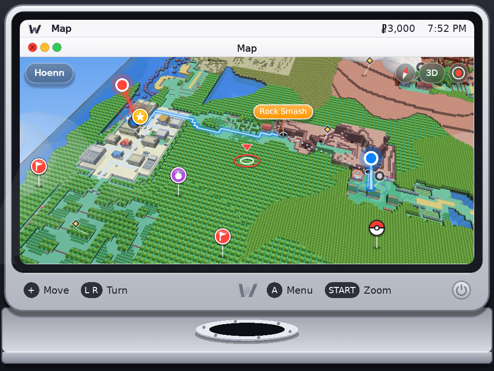
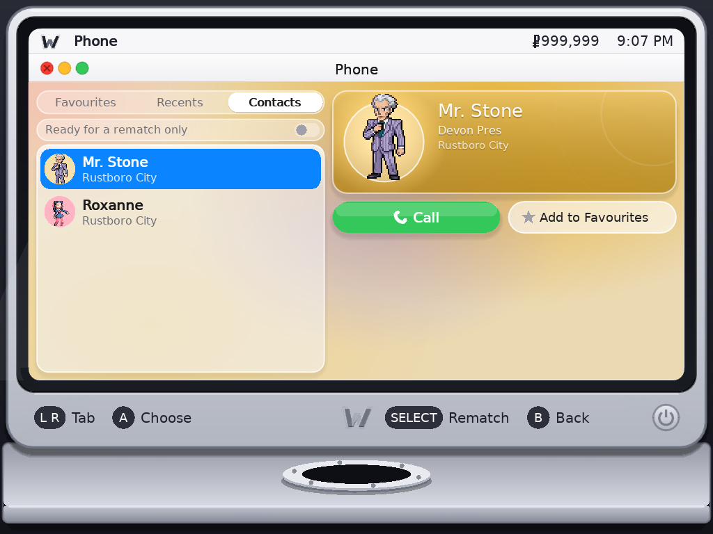
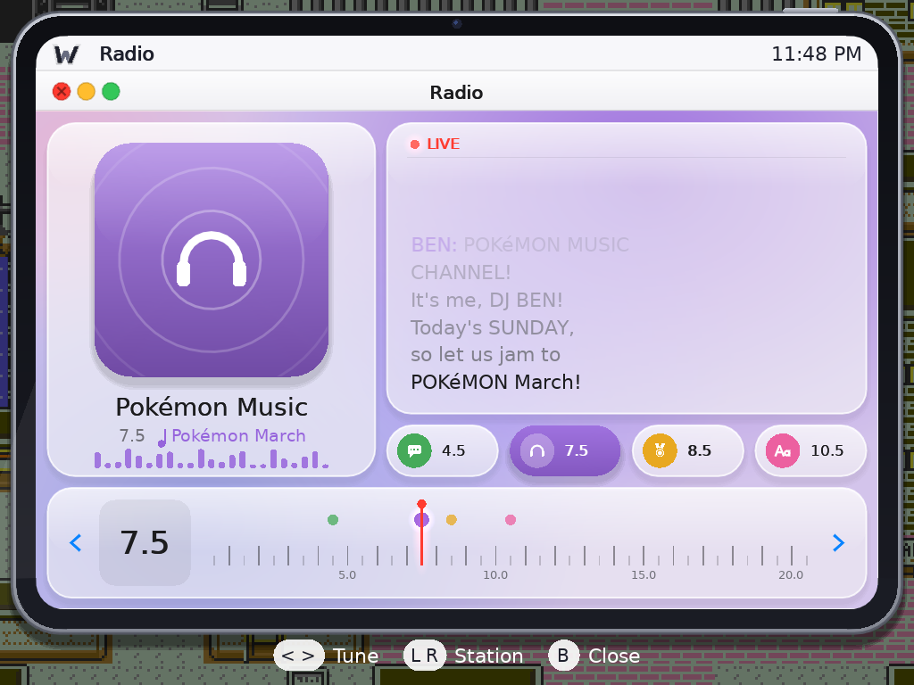
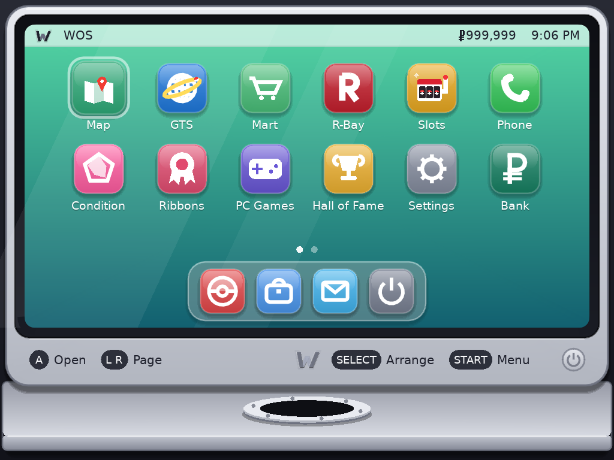
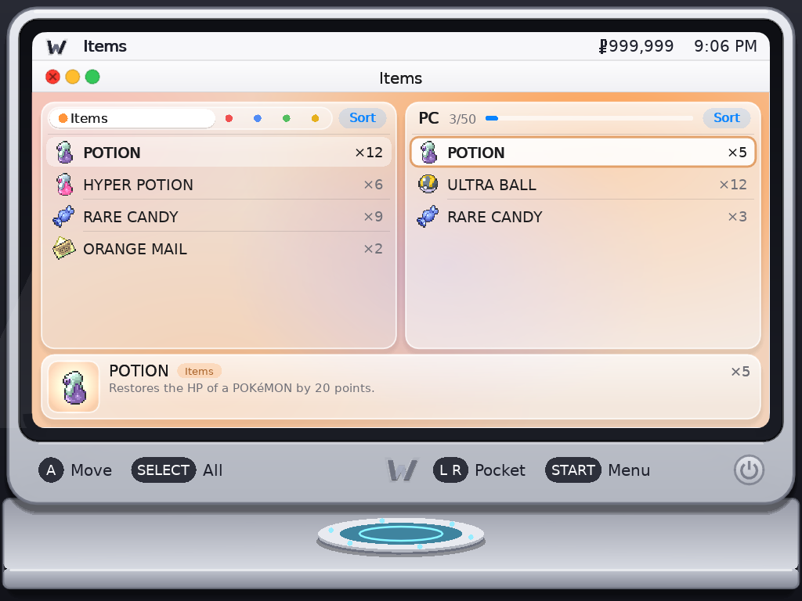
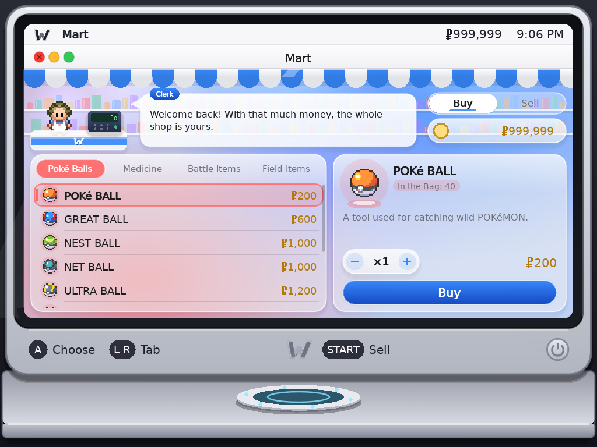
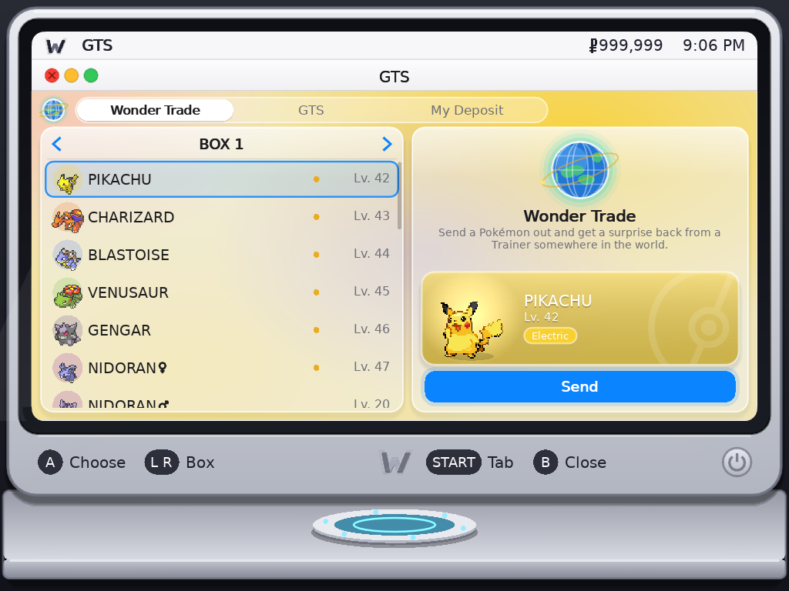
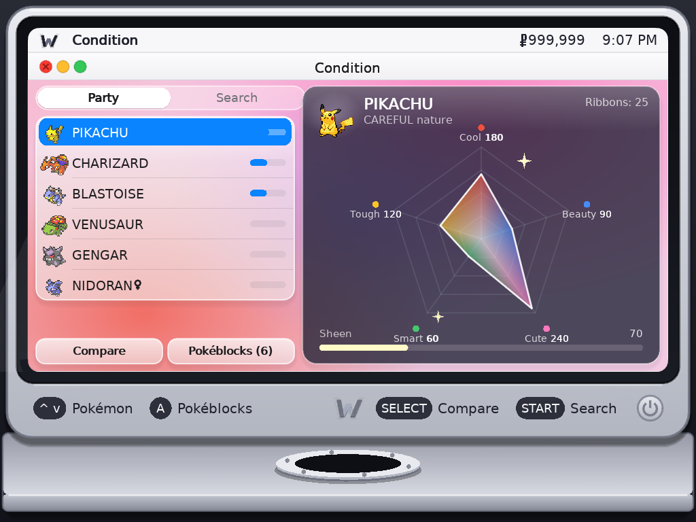
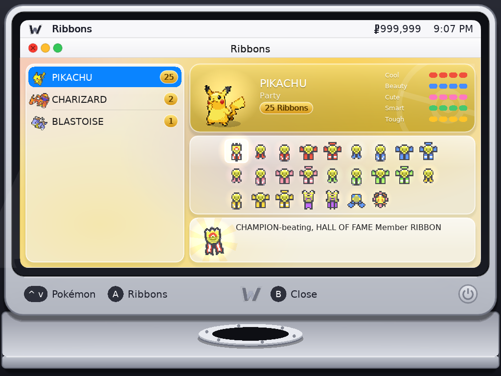
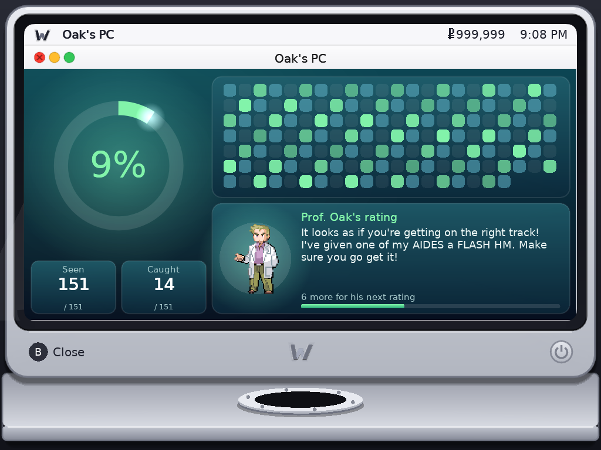

# WoobOS 🖥️

*The PC as a modern desktop. Boot it up, tap an app, and get on with your Pokémon.*

The Pokémon PC has always been a stack of text menus. WoobOS swaps it for a desktop you'd actually want to use, with a home screen of apps, a dock, notifications and a wallpaper of
your choosing. Walk up to any PC, in a Pokémon Center or in your bedroom, and it boots straight into it.

It doesn't stop at the PC. **WoobPad** carries the same desktop with you as a tablet from the START menu,
and the Pokédex, the Town Map, the shops and the Pokémon Center all get a modern, glassy look to match.

WoobOS is a mod for [Gen1Recomp](https://github.com/bryanthaboi/gen1recomp) and works on all eleven of its
games: Red, Blue, Yellow, Gold, Silver, Crystal, FireRed, LeafGreen, Ruby, Sapphire and Emerald. Play it
with a controller, a touch screen, or a mouse and keyboard.

## ✨ What's inside

### 🗂️ Your Pokémon, sorted

**Boxes** lets you move, swap or drag a whole group of Pokémon at once, with each one's summary a tap
away. **Items** puts your Bag and your PC side by side, and **Mail** is an inbox for your letters. The
**Pokédex** is rebuilt from the ground up, with a search, a page for every form, and a height chart that
stands each Pokémon beside your trainer.

<table>
  <tr>
    <td align="center" width="50%"> Boxes</td>
    <td align="center" width="50%"> The Pokédex</td>
  </tr>
</table>

### 🗺️ A map that knows the way

The Town Map becomes your whole region in 3D, built from the game's own maps, its towns lighting up at
night. Pick any spot to fly there, drop a marker, or set a waypoint: a glowing line traces the shortest
walk there, through caves and forests, keeping to the story's path and pointing out whatever still stands
in your way. Turn on Overworld GPS and a small arrow beside your trainer leads you to the next door.

<table>
  <tr>
    <td align="center" width="50%"> A waypoint's route, a Rock Smash sign and markers</td>
    <td align="center" width="50%"> Overworld GPS pointing the way</td>
  </tr>
</table>

### 🎒 The game's own screens, modernised

Talk to a nurse and you'll see her up close behind her counter while your Pokémon go into the healing
machine. Talk to a shop clerk and the shop opens full screen, dressed for wherever you are. On FireRed,
LeafGreen, Ruby, Sapphire and Emerald, the Bag, the Pokémon menu and each Pokémon's summary are redone in
frosted glass too.

<table>
  <tr>
    <td align="center" width="50%"> The Pokémon Center</td>
    <td align="center" width="50%"> A shop: Slateport's market</td>
  </tr>
  <tr>
    <td align="center" width="50%"> The Pokémon menu</td>
    <td align="center" width="50%"> A Pokémon's summary</td>
  </tr>
</table>

### 🎰 Things to do

Bid against Team Rocket on **R-Bay**, trade with strangers on the **GTS**, try your luck at **Slots** for
prizes that change every day, send your Pokémon on **Errands**, take on weekly **Challenges**, and keep up
with the **News**, which reports on your battles and follows the region's story as it unfolds. The
**Bank** holds whatever your wallet can't.

<table>
  <tr>
    <td align="center" width="50%"> R-Bay</td>
    <td align="center" width="50%"> Rocket Slots</td>
  </tr>
</table>

### 📱 And the rest

A **Phone** for calls (and a **Radio** on Gold, Silver and Crystal), **Condition** and **Ribbons** for
contest fans, Oak's PC, the Hall of Fame and Decorate. Arrange your home screen however you like, remove
the apps you don't use, and pull down from the top for your notifications.

<table>
  <tr>
    <td align="center" width="50%"> Phone</td>
    <td align="center" width="50%"> The Radio (Gold, Silver and Crystal)</td>
  </tr>
</table>

**Read more:** [every app](docs/apps.md) · [the map and GPS](docs/map.md) ·
[the menus, shops and Pokémon Center](docs/in-game.md) · [what each game has](docs/games.md)

## 📸 Gallery

<table>
  <tr>
    <td align="center" width="50%"> The desktop</td>
    <td align="center" width="50%"> Items</td>
  </tr>
  <tr>
    <td align="center" width="50%"> The 3D map</td>
    <td align="center" width="50%"> Mart</td>
  </tr>
  <tr>
    <td align="center" width="50%"> GTS</td>
    <td align="center" width="50%"> News</td>
  </tr>
  <tr>
    <td align="center" width="50%"> Condition</td>
    <td align="center" width="50%"> Ribbons</td>
  </tr>
  <tr>
    <td align="center" width="50%"> Hall of Fame</td>
    <td align="center" width="50%"> Oak's PC</td>
  </tr>
</table>

## 💾 Getting started

Install WoobOS from Gen1Recomp's mod manager (or unzip a release into the game's `mods` folder) and turn
it on for your games. Then walk up to any PC.

It's safe to add to a save you're already playing, and to turn off again later. WoobOS keeps only its own
things in your save (R-Bay bids, a GTS deposit, teams out on errands, the Bank, this week's challenges),
and they wait for it while it's off.

## ⚙️ Options

If you'd rather keep the game's own version of something, you can switch it back piece by piece: the
desktop itself, WoobPad, the Pokégear, the shops, the Pokémon Center and the modern menus, which have a
switch each for the Pokédex, the Bag, the Pokémon menu, the summary and the battle menus.
The options also hold the theme (Light, Dark or OLED), the text size, a 24-hour clock, Overworld GPS, and,
with Kanto Gear, a battle's menus on its screen.
Find them under OPTIONS > WOOBOS in the game, or MODS > WoobOS. [Every option](docs/options.md)

## 🔗 Works With

- **Other mods** can add their own apps to the desktop.
- **Kanto Gear:** Slots, R-Bay and the GTS are apps in its Silph Store, on the Gear's own screen, and a
  battle's Bag and Pokémon menu can open there too (the Kanto Gear Battle Menus option).
- **WoobleDex:** every box of its Bigger PC, its Pokémon in R-Bay and the Pokédex, a page for each of its
  forms, and Dynamax Level and G-Max Factor in Boxes.
- **Galar Rising:** Dynamax Level and G-Max Factor in a Pokémon's summary, and the G-Max Factor's mark under
  its picture in the Pokémon menu.
- **WoobleSpawns:** the Pokédex shows where its wild Pokémon live, and how likely you are to meet them.
- **WoobleSpritePack:** its animated sprites in the Pokédex, and its icons and pictures on the Game Boy
  games.

## 📌 Good to Know

- **Fly and phone calls need the open air,** and the PC is indoors: use them from WoobPad.
- **Make it yours:** add your own wallpapers, or translate WoobOS into your language.
- More in [tips and questions](docs/tips.md).

## 🪪 Credits

Made by Wooble. The touch-screen look grew out of WoobleDex's vending machines.

Original sprites by Wooble: the News anchor, and Mom, Scott and Mr. Stone in the Phone.

The Pokémon Center's nurse: [InnerMobius](https://www.deviantart.com/innermobius).

The G-Max Factor's mark: Lucidious89's [Dynamax plugin](https://lucidious89-tutorials.gitbook.io/deluxe-battle-kit-tutorial/deluxe-battle-kit-for-v21.1/add-on-tutorials/dynamax).

---

[MIT License](LICENSE) · [Changelog](CHANGELOG.md) · [Development](DEVELOPMENT.md)
