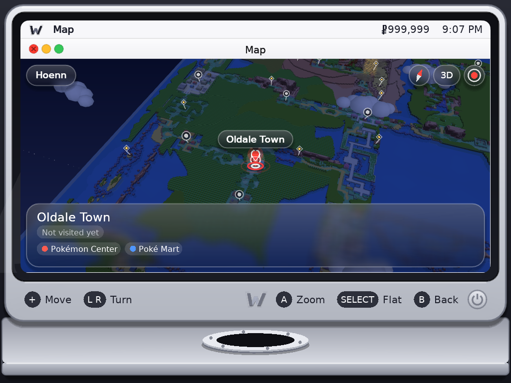
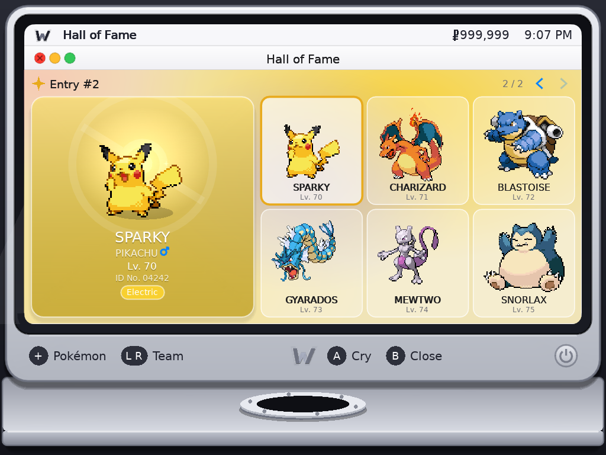
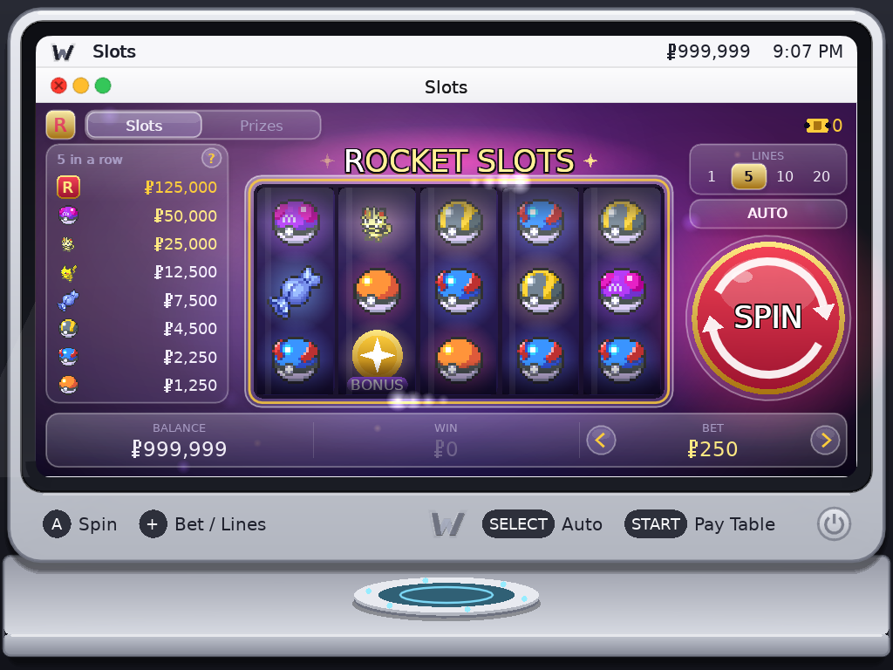

# WoobOS 🖥️

*The PC as a modern desktop. Boot it up, tap an app, and get on with your Pokémon.*

A mod for [Gen1Recomp](https://github.com/bryanthaboi/gen1recomp)'s games: Red, Blue and Yellow,
Gold, Silver and Crystal, FireRed, LeafGreen, Ruby, Sapphire and Emerald. Every PC in a Pokémon
Center, and the one in your bedroom, opens a desktop of apps instead of a text menu. Play it with a
controller, a touch screen, or a mouse and keyboard.

## ✨ Features

### The desktop

- 🗂️ **Your home screen:** press and hold an app (or press SELECT) to move it around or into the dock.
- 📱 **WoobPad:** the same desktop as a tablet, from the START menu, wherever you can open it.
- 🔔 **Notifications:** when you're outbid or win on R-Bay, your GTS deposit is traded, a team is back
  from an errand, a challenge is done, and more. Pull down from the top of the screen to see them all.
- 🛍️ **App Store:** remove the apps you don't want from your home screen, and get them back later.
- 🏪 **Real shops:** every shop counter opens the Mart full screen with that shop's own goods: Poké
  Marts, every department store floor, herb shops, the pharmacy, souvenir and decoration shops, the
  Underground's bargain stall and Slateport's market stalls by the sea, each dressed for its place and
  what it sells.
- 🎒 **Bag:** on FireRed, LeafGreen, Ruby, Sapphire and Emerald, the Bag opens in glass from the START
  menu and in battle: each pocket a page (FireRed and LeafGreen's TM Case and Berry Pouch too), the chosen
  item's picture and words beside the list, a TM's move with its type, power, accuracy and PP. Use, give,
  toss (choosing how many), register and reorder items there; an item used on a Pokémon opens the
  Pokémon menu over the Bag, in battle too. Planting a Berry, the Berry Blender, putting items in the PC and
  selling at a shop choose from it as well.
- 📋 **Pokémon menu and summary:** on FireRed, LeafGreen, Ruby, Sapphire and Emerald, the Pokémon menu
  is six glass cards over lights in the chosen Pokémon's colours: the lead's picture, every Pokémon's
  level, HP, status and held item. Each one's menu has its summary, its field moves, Switch and its item or
  mail; in battle, Shift or Send Out. Items used from the Bag (a Potion's HP filling, a TM's able / not
  able on every card, a Rare Candy's new stats), items given to hold, choosing a Pokémon for the Day Care
  or a trade, choosing a team for the Battle Tower and Frontier, and the Move Tutor happen there too. A Pokémon's
  summary is the same glass as the Boxes' one: its picture, info, stats with IVs and EVs, and moves. When a
  Pokémon learns a new move with four already, you choose the one to forget there, with the new move shown
  below.
- 🏥 **Pokémon Center:** talk to the nurse and she greets you in a close-up behind her counter, in a
  room drawn after Emerald's own Pokémon Center. Choose to heal and your Pokémon go into the healing
  machine: a ball for each, the machine's glow and its jingle, and their health filling back up.
  Everything the game's own nurse does still happens, such as Pokérus, Emerald's Gold Card and where
  you return after a loss.

### Apps

- 🔴 **Boxes:** move, swap, or drag a whole group of Pokémon at once; their Summary, items, Release,
  and box names and wallpapers.
- 🎒 **Items:** your Bag and your PC's items side by side.
- ✉️ **Mail:** your PC's mailbox, and the mail your Pokémon are holding.
- 📕 **Pokédex:** a modern Pokédex in place of the game's, from the START menu and as an app.
- 🗺️ **Map:** your region in 3D, built from the game's own maps, in place of the Town Map and the Fly
  map. Emerald shows Kyogre's and Groudon's storms where they're rumoured.
- 📞 **Phone:** Match Call (Emerald), Trainer's Eyes (Ruby and Sapphire) or the Pokégear's phone book
  (Gold, Silver and Crystal). Calls are the game's own.
- 📻 **Radio** (Gold, Silver and Crystal): the Pokégear's radio, with each station's artwork, a live
  transcript of the show, presets and a tuner. Every station and show is the game's,
  and the music you leave playing keeps doing what it does in the game (the Poké Flute, the March and
  the Lullaby).
- 🎀 **Condition** and **Ribbons:** your Pokémon's contest conditions and Ribbons (Ruby, Sapphire and
  Emerald).
- 🌐 **GTS:** Wonder Trade, other Trainers' offers, and a deposit of your own. Traded Pokémon act like
  real trades: they can evolve on arrival and may not obey without enough Badges.
- 🛒 **Mart:** buy and sell from the PC, with more stock for each Badge.
- 🚀 **R-Bay:** Team Rocket's Pokémon auctions. They run on your device's clock, even while the game
  is off.
- 🎰 **Slots:** a five-reel slot machine played with your money, with prizes for its tickets. Four
  limited prizes change every day: a sought-after Pokémon, a held item, a 10th Anniversary Pokémon,
  and a special: an event ticket (Eon, Mystic, Aurora or the Old Sea Map) that sails from the harbor
  like the real one, or an event Pokémon as it was given out (Aura Mew, Mystery Mew, Space Center
  Deoxys, Doel Deoxys). The 10th Anniversary Pokémon, the specials and the tickets are on FireRed,
  LeafGreen, Ruby, Sapphire and Emerald, each ticket on the games whose harbor takes it.
- 🏦 **Bank:** holds the money your wallet can't (past ₽999,999) and pays a little interest each day.
- 👟 **Errands:** send up to three Pokémon on a timed job for money, an item and EXP.
- 🏅 **Challenges:** five goals a week, counted from how you play, each with a reward.
- 📰 **News:** the day's stories about your battles, catches and week, and where today's swarm is.
  A battle with a legendary Pokémon gets its own report, catch or not. On FireRed, LeafGreen, Ruby,
  Sapphire and Emerald the News follows the region's story as it happens: Team Rocket's schemes from
  Mt. Moon to Silph Co. and the Sevii Islands, or Team Magma and Team Aqua's, the legend's awakening
  and the drought or downpour it brings. It also says where Raikou, Entei or Suicune, or Latias or
  Latios, has been seen.
- 📟 **Oak's PC**, 🏆 **Hall of Fame**, and 🛋️ **Decorate** at your bedroom PC.
- 🕹️ **PC Games:** with the PC Games mod installed, its games get an icon too.
- ⚙️ **Settings:** language, wallpaper, text size, notifications for each app, and switches for
  WoobPad, the 3D map, the PokéNav apps and daily swarms.

### On Red, Blue, Yellow, Gold, Silver and Crystal

The same desktop, WoobPad and most apps, with each game's own Pokémon, items and moves. On Gold,
Silver and Crystal, WoobPad takes the Pokégear's place in the START menu: its Map, Phone and Radio do
the Pokégear's jobs, and Fly and the wall maps open the 3D map. Condition, Ribbons and the PokéNav are
Ruby, Sapphire and Emerald's only. Red, Blue and Yellow have no Mail, Phone, Radio or shiny Pokémon, and
their Map can't Fly.

## 📸 Gallery

<table>
  <tr>
    <td align="center" width="50%"> The desktop</td>
    <td align="center" width="50%"> Boxes</td>
  </tr>
  <tr>
    <td align="center" width="50%"> A Pokémon's Summary</td>
    <td align="center" width="50%"> The Pokédex</td>
  </tr>
  <tr>
    <td align="center" width="50%"> Items</td>
    <td align="center" width="50%"> The 3D map</td>
  </tr>
  <tr>
    <td align="center" width="50%"> Phone</td>
    <td align="center" width="50%"> Ribbons</td>
  </tr>
  <tr>
    <td align="center" width="50%"> Condition</td>
    <td align="center" width="50%"> Mart</td>
  </tr>
  <tr>
    <td align="center" width="50%"> Hall of Fame</td>
    <td align="center" width="50%"> Oak's PC</td>
  </tr>
  <tr>
    <td align="center" width="50%"> GTS</td>
    <td align="center" width="50%"> News</td>
  </tr>
  <tr>
    <td align="center" width="50%"> R-Bay</td>
    <td align="center" width="50%"> Rocket Slots</td>
  </tr>
</table>

## ⚙️ Options

| Option | Choices | Default | What it does |
|---|---|---|---|
| Desktop | On / Off | On | Off: every PC opens the game's own menu. |
| Boot Screen | On / Off | On | The W boot screen before the desktop. |
| 24-Hour Clock | On / Off | Off | The clock as 15:30 instead of 3:30 PM. |
| Text Size | Normal / Large / Larger | Normal | Bigger text in every app. Also in Settings; whichever you changed last counts. |
| Pokédex | On / Off | On | Off: the game's own Pokédex, and no Pokédex app. |
| Pokégear | On / Off | On | Gold, Silver and Crystal. Off: the game's own Pokégear. |
| Real Shops | On / Off | On | Off: every shop counter opens the game's own shop menu. |
| Pokémon Center | On / Off | On | Off: the nurse's counter is the game's own. |
| Modern Menus | On / Off | On | Off: the Bag, the Pokémon menu and the summary are the game's own. |
| Map: Invert X | On / Off | Off | The 3D map's camera turns the other way. |
| Map: Invert Y | On / Off | Off | The 3D map's camera tilts the other way. |

## 💾 Installation

Install it from Gen1Recomp's mod manager, or unzip a release into the game's `mods` folder, then
turn it on for your games.

## 🔗 Works With

- **Any save:** you can turn WoobOS on and off whenever you like. It only keeps its own things in
  your save (R-Bay bids, a GTS deposit, teams on errands, the Bank, this week's challenges), and they
  wait for it while it's off.
- **Other mods:** they can add their own apps to the desktop.
- **Kanto Gear:** Slots, R-Bay and the GTS are apps in its Silph Store, on the Gear's own screen.
- **WoobleDex:** every box of its Bigger PC; its Pokémon in R-Bay and the Pokédex, and a page for each of
  its forms (regional forms included); Dynamax Level and G-Max Factor in Boxes.
- **Galar Rising:** Dynamax Level and G-Max Factor in a Pokémon's Summary.
- **WoobleSpawns:** the Pokédex shows where its wild Pokémon are, forms included.
- **WoobleSpritePack:** its animated sprites in the Pokédex, and its icons and pictures on the Game
  Boy games.

## 📌 Good to Know

- **Fly and calls need the open air**, and the PC is indoors: use them from WoobPad.
- **Boxes follows the game's rules:** your party keeps a Pokémon that can battle, a Pokémon holding
  mail can't go in a box (take the letter off in Mail first), and Eggs can't be released.
- **Your own wallpapers:** put PNG or JPG pictures in the mod's `wallpapers` folder and pick them in
  Settings. SELECT switches between filling the screen and stretching to it.
- **Your own language:** copy `lang/en.lua` to a new file in the same folder, write the language's
  name at the top and translate the words. It shows up in Settings.
- **Settings** are kept for the whole game, not per save file.
- **R-Bay bids** are saved with your game: load an older save and its bids and money come back with
  it. A won Pokémon waits if your party and PC are both full.
- **Notifications** wait until you're free to move, and aren't kept after you close the game.
- **WoobPad** isn't in the START menu in a link room or the Safari Zone. Decorate stays at the PC.

## 🪪 Credits

Made by Wooble. The touch-screen look grew out of WoobleDex's vending machines.

Original sprites by Wooble: the News anchor, and Mom, Scott and Mr. Stone in the Phone.

The Pokémon Center's nurse: [InnerMobius](https://www.deviantart.com/innermobius).

---

[MIT License](LICENSE) · [Changelog](CHANGELOG.md) · [Development](DEVELOPMENT.md)
