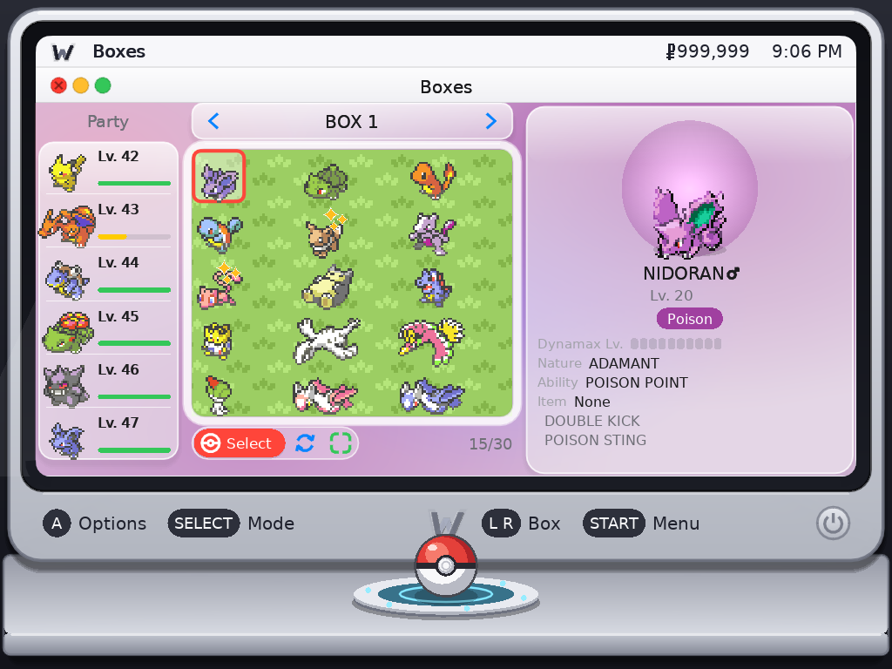
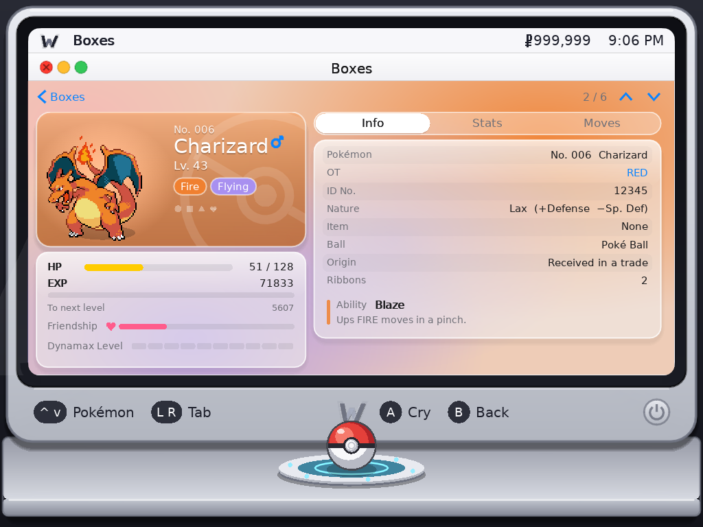
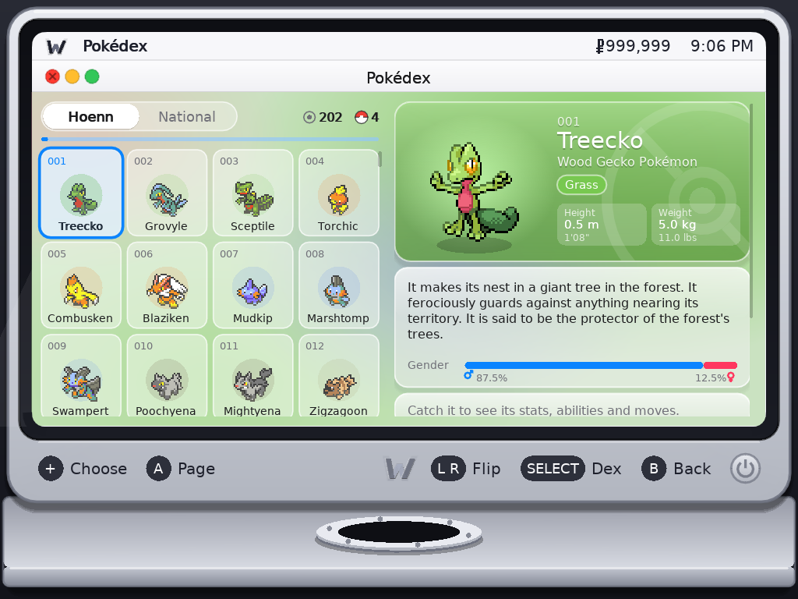
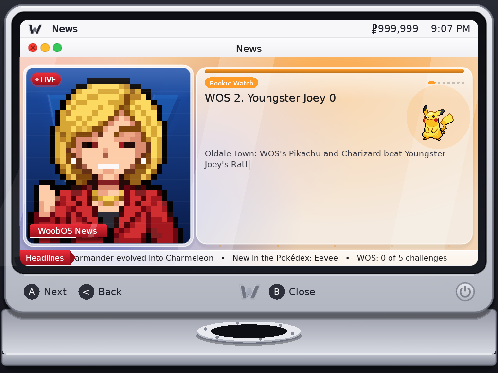
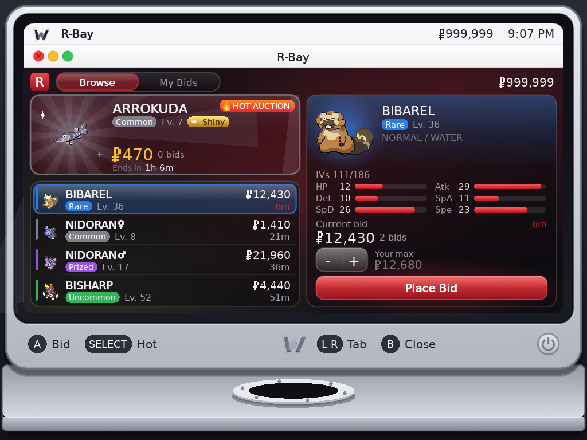

# WoobOS 🖥️

*The PC as a modern desktop. Boot it up, tap an app, and get on with your Pokémon.*

A mod for [Gen1Recomp](https://github.com/bryanthaboi/gen1recomp)'s games: Red, Blue and Yellow,
Gold, Silver and Crystal, FireRed, LeafGreen, Ruby, Sapphire and Emerald. Every PC in a Pokémon
Center, and the one in your bedroom, opens a desktop in a sleek monitor instead of a text menu.

## ✨ Features

### Core Mechanics

- 🎮 **Made for controllers and touch:** move between icons with the D-pad, open with A, flip
  pages with L and R, and press START for the W menu. On a touch screen, tap an icon or swipe
  between pages. A mouse works too: click, hover and scroll.
- 🗂️ **Arrange your apps:** press and hold an app (or press SELECT) and the icons wiggle. Drag an
  app to a new place, from the home screen into the dock or back out again; with a controller,
  A picks it up, the D-pad carries it and A puts it down. The dock holds up to six. Done, B or a
  tap on an empty spot finishes, and every PC remembers the arrangement.
- 🫧 **Frosted glass everywhere:** every app is drawn like a modern phone's, in glass panes over
  soft lights that take the colours of what you're looking at (a Pokémon's types, an item's pocket,
  a job or a story). Highlights glide, switches slide, and cards and rows rise in as they appear.
  R-Bay and Slots keep their night-time look in smoked glass.
- 📱 **WoobPad:** the PC as a tablet you carry. Choose WOOBPAD in the START menu, anywhere you can
  open it, and a pad comes up over the game with a big touch screen.
  - **Like the PC:** the same home screen and dock (arranged the same way), the menu bar with your
    money and the time, your wallpaper, and the same apps in the same windows: Boxes, Items, Mail,
    Map, Phone, Condition, Ribbons, GTS, Mart, R-Bay, Slots, the App Store and Settings, plus Oak's PC and the
    Hall of Fame once you've earned them.
  - **Notifications:** pull down from the top of the screen (or choose Notifications in the W
    menu) and the drawer follows your finger down over frosted glass, the screen blurred behind
    it: the time, then a card for each notification, newest first. Tap one to open its app, swipe
    it left or right to clear it, or Clear to clear them all; push the handle back up (or B) to
    close it. On the buttons: Up / Down to choose, Left / Right to clear, SELECT to clear all.
- 🗺️ **A 3D Town Map:** the Town Map, the maps on the walls and the Fly map open the region as a
  little 3D model you can turn, tilt and zoom. The sea waves, clouds drift over it and it follows your
  device's clock: dawn, day, a warm dusk, and a starry night with the windows lit.
  - **Built to scale from your game's own maps:** every route and town where it really is and every
    tile in its own colours.
  - **Legendary storms (Emerald):** after the Weather Institute tells you about abnormal weather, a
    rainstorm with lightning hangs over the route where Kyogre is rumoured, or a sandstorm over
    Groudon's. Ask again and it moves with the report. It clears once that Pokémon is caught or
    knocked out.
  - **Everyday weather (Ruby, Sapphire, Emerald):** the weather your game has, where it has it, gentler
    than the legendary storms.
  - **Where you are:** a red beacon stands on your spot.
  - **Fly:** from the party menu, pick a town you've visited and press A (or tap Fly): you fly
    there as the game flies you.
  - **The camera:** L and R (or the right stick) turn it, the right stick tilts it, A steps through
    its zooms (or the mouse wheel).
  - **Flat or 3D:** SELECT (or the 2D / 3D button) swaps to the flat map.
  - **The islands:** in FireRed and LeafGreen, the region's name (or L and R on the flat map)
    switches to the Sevii Islands once your Town Map shows them.
  - **The classic map:** START opens the game's own map instead, and Settings can keep it for
    good.
- 🛍️ **App Store:** choose what's on your home screen. R-Bay, Slots, the GTS, the Mart, the Bank, Errands,
  Challenges, the News, PC Games and
  any app another mod adds can be removed and got back whenever you like. The game's own PC and PokéNav apps can't be removed.
- 🔔 **Notifications:** WoobOS tells you when you're outbid on R-Bay,
  when an auction you're in is about to end, when you win or lose one, when your GTS deposit is traded, when a full wallet sends money to the Bank, when a team is back from an errand, when a challenge is done, and when a new day's
  swarm appears. Each app's notifications can be turned off in Settings.

### On Red, Blue, Yellow, Gold, Silver and Crystal

- 🕹️ **The same desktop and WoobPad:** the Pokémon Center's PC and your bedroom's open the desktop
  (on Red, Blue and Yellow, the "Which PC?" menu too), and WoobPad is in the START menu.
- 📱 **The apps there:** Boxes (12 boxes on Red, Blue and Yellow, 14 on Gold, Silver and Crystal,
  with their names), Items (Red, Blue and Yellow's one Bag; Gold, Silver and Crystal's pockets),
  Mail (Gold, Silver and Crystal), the Pokédex, the Hall of Fame, Oak's PC, Settings, the App Store,
  and the Mart, the Bank, R-Bay, Slots, the GTS, Errands, Challenges and the News, each with that
  game's own Pokémon, items, moves and types.
- 🗺️ **The Map:** Kanto in 3D on Red, Blue and Yellow; Johto and Kanto on Gold, Silver and Crystal,
  each built from the game's own towns and routes, their buildings, trees, cliffs and water (in the
  game's own colours on Gold, Silver and Crystal). Kanto is there once you've been.
- 📞 **Phone** (Gold, Silver and Crystal): your Pokégear's phone, straight to your contacts; calls
  are the game's own.
- 🛋️ **Decorate** (Gold, Silver and Crystal, at your bedroom PC): the game's decoration menu; your
  room shows its new look when you turn the PC off.

### Apps

- 🎒 **Items:** your Bag and your PC's item storage side by side.
- 📕 **Pokédex:** a modern Pokédex in place of the game's, from the START menu and as an app on the
  PC and WoobPad once you have one.
- 🗺️ **Map:** the 3D map of your region, from the PC or WoobPad, with the same places, cards and
  camera as the Town Map.
- 📞 **Phone** (Ruby, Sapphire and Emerald, once you have the PokéNav): your PokéNav's contacts as
  a phone. Favourites, Recents and Contacts tabs; each contact's card shows their picture, class
  and where they are, a green dot when they want a rematch, and their profile.
  - **Emerald:** Call rings them up and they answer in the game's own words, just as a PokéNav
    call does (a Trainer can ask for a rematch).
  - **Ruby and Sapphire:** Trainer's Eyes' Trainers and Gym Leaders, their profiles and who's
    ready for a rematch (those games have no calls).
  - In the PokéNav, Match Call (Trainer's Eyes) opens the Phone, and B goes back to the PokéNav.
- 🎀 **Condition** (Ruby, Sapphire and Emerald): your Pokémon's contest conditions (Cool,
  Beauty, Cute, Smart and Tough) as a glossy radar chart that glides from one Pokémon to the
  next, with its sheen sparkling round it, its nature and ribbons.
- 🎀 **Ribbons** (Ruby, Sapphire and Emerald, once you have the PokéNav): a display case of every
  Pokémon in your party and boxes that wears a Ribbon, most first, with its contest ranks at a
  glance, each Ribbon lit in its colour, and the one you pick swinging in the spotlight with what
  it's for in the game's own words.
- 🌐 **GTS:** trade with Trainers from around the world.
  - **Wonder Trade:** pick any Pokémon from your party or a box and send it off.
  - **GTS listings:** Trainers' offers, refreshed every half hour, each saying what they want in
    return.
  - **My Deposit:** put one of yours up and ask for a species you've seen, at a level range.
    Someone answers in real time if the deal is fair
  - **As in a real trade:** what you receive belongs to its original Trainer. It gains more EXP,
    a high-level one may not obey until you have the badges, and Pokémon that evolve by trading
    (Kadabra, Machoke …) evolve as they arrive.
- 🛒 **Mart:** a Poké Mart in your PC: a shopfront under a striped awning, with your game's own
  Mart clerk behind the counter.
- 🚀 **R-Bay:** Team Rocket's auction house for Pokémon. Twelve auctions run at once, each for
  three hours, and a new one opens every fifteen minutes, on your device's clock, so the market
  keeps moving while the game is off.
- 🎰 **Slots:** Team Rocket's five-reel video slot, played with your money.
- 🏦 **Bank:** a savings account beside your wallet. Your wallet holds the game's ₽999,999; when it's
  full, any money you earn goes into the bank instead (prize money, the Mart, R-Bay, Slots, rewards),
  up to ₽999,999,999, and a notification tells you how much. What you keep
  earns a little interest each day (a tenth of a percent, up to ₽5,000 a day, for up to a week away).
- 👟 **Errands:** send your Pokémon out to work. Three jobs are posted every six hours (a delivery
  round, a dig in the mine, Berry picking, a ferry escort, the power plant, a bakery, the library, a
  night patrol), each one, four or eight hours long. Pick a team of up to three from your party and
  boxes; they leave while they work and come back with money, an item, and EXP for each of them
  (they level up and learn their moves, as at the Day Care).
- 🏅 **Challenges:** five goals every week (Monday to Sunday), counted from how you really play:
  beat trainers, win wild battles, catch Pokémon (of a type, new to your Pokédex, or from today's
  swarm), hatch an Egg, evolve, level up, use items, walk, visit places. Goals grow with your
  badges. Each pays money or items, and claiming all five earns the week's bonus.
- 📰 **News:** the day's stories, read live by the WoobOS News anchor in a TV close-up:
  - **your latest Gym:** the score, the turns and a play-by-play: the leads, each knockout and the
    turn it came on, the setbacks, and the blow that won it;
  - **your last two trainers beaten:** the score ("Red 3, Youngster Joey 0"), where, both teams and
    the finisher, critical hits and super-effective blows included;
  - **your latest catch:** a signing, with where, the level and the Ball it took;
  - **your week:** trainers beaten, Pokémon caught and steps walked.
- 🕹️ **PC Games integration:** with the PC Games mod installed, its games (Solitaire, Snake, Tetris, Blackjack,
  Collapse, Minesweeper and PokePet) get an icon on the desktop and on WoobPad.
- ✉️ **Mail:** your mailbox as an inbox. The Held folder shows the mail your Pokémon are
  carrying, and Take files a letter back in the inbox. Works in all five games.
- 🔴 **Boxes:** the Pokémon Storage System in one window:
  - **Select** (red): A opens a Pokémon's options: Move, Summary, Item (take it to the Bag or give
    one) and Release. A on the box's name, or START, jumps to a box, renames it or changes its
    wallpaper.
  - **Summary:** the Pokémon's own page, in the same glass. Its picture (animated as in the
    Pokédex, a shiny in its shiny colours) with its number, name, level, gender, types and markings;
    its HP and status, its EXP to the next level, its item and its friendship. Then three tabs:
    **Info** (its OT, ID No., nature with the stats it raises and lowers, ability and what it does,
    Poké Ball, where and at what level it was met, Pokérus, Ribbons), **Stats** (every stat with its
    IV and EV, the nature's stats marked, and its EVs on a radar with their total out of 510) and
    **Moves** (each with its type and PP; A on one shows its power, accuracy, category and what it
    does, and on Ruby, Sapphire and Emerald its contest type, appeal and jam). Up and Down go to the
    Pokémon before and after it, Left and Right (or L and R) change the tab, A plays its cry. A
    party Pokémon's moves can be reordered as in the game: A on a move, then A on another. With
    Galar Rising, its Dynamax Level and G-Max Factor show too. On the Game Boy games it shows the
    games' own DVs and Stat Exp.
  - **Swap** (blue): A picks a Pokémon up and A puts it down; on another Pokémon, the two trade
    places. With the mouse or a finger, drag it onto its new place.
  - **Drag** (green): hold A and move to draw a rectangle (or drag one out), let go, and every
    Pokémon in it moves together. They keep their shape in the new box. Holding a carried Pokémon over the box's arrows turns the box.

- 📟 **Oak's PC:** your Kanto Pokédex as a dashboard, once you have the Pokédex (FireRed and
  LeafGreen): a ring of how much you've caught, all 151 as a mosaic of caught, seen and missing, and
  Professor Oak's rating in his own words with how many more you need for the next one.
- 🏆 **Hall of Fame:** every champion team as a trophy case, newest first: L and R go through the
  teams, and each Pokémon calls out as you pick it. Once you've beaten the Elite Four.
- 🛋️ **Decorate:** every decoration you own, as a catalogue with a showroom, at the bedroom PC
  (Ruby, Sapphire and Emerald). See where each one is, set dolls and cushions out in your room,
  put them away, or throw out what you don't want.
- ⚙️ **Settings:** like a phone's or a Mac's.
  - 🌐 **Language:** WoobOS in English, Français, Deutsch, Español, Italiano, 日本語 or
    Português (Brasil).
  - 🖼️ **Wallpaper:** the classic colours of your game, five drawn wallpapers (Ribbon, Hills,
    Coast, Waves and Bloom, each tinted to your game), or your own pictures.
  - 🔔 **Notifications:** banners on or off (off, notifications still wait in the list), then a
    switch for each app that tells you things.
  - 📱 **WoobPad:** show WoobPad in the START menu or not.
  - 🗺️ **Map:** the 3D Town Map on or off. Off, the Town Map and Fly open the game's own map.
  - 📟 **PokéNav:** WoobOS's apps in the PokéNav, or its own screens.
  - 🚩 **Gameplay:** daily swarms on or off.
- ℹ️ **About:** which version you're running, in the W menu at the top left.
- ⏻ **Log Off:** turns the PC off. B, or the power button under the screen, asks first.

## 📸 Gallery

<table>
  <tr>
    <td align="center" width="50%"> The desktop</td>
    <td align="center" width="50%"> Boxes</td>
  </tr>
  <tr>
    <td align="center" width="50%"> A Pokémon's Summary</td>
    <td align="center" width="50%"> The Pokédex</td>
  </tr>
  <tr>
    <td align="center" width="50%"> Items</td>
    <td align="center" width="50%"> The 3D map</td>
  </tr>
  <tr>
    <td align="center" width="50%"> Phone</td>
    <td align="center" width="50%"> Ribbons</td>
  </tr>
  <tr>
    <td align="center" width="50%"> Condition</td>
    <td align="center" width="50%"> Mart</td>
  </tr>
  <tr>
    <td align="center" width="50%"> Hall of Fame</td>
    <td align="center" width="50%"> Oak's PC</td>
  </tr>
  <tr>
    <td align="center" width="50%"> GTS</td>
    <td align="center" width="50%"> News</td>
  </tr>
  <tr>
    <td align="center" width="50%"> R-Bay</td>
    <td align="center" width="50%"> Rocket Slots</td>
  </tr>
</table>

## ⚙️ Options

| Option | Choices | Default | What it does |
|---|---|---|---|
| Desktop | On / Off | On | The PC opens the desktop. Off: the game's own PC menu. |
| Boot Screen | On / Off | On | The W boot screen before the desktop. |
| 24-Hour Clock | On / Off | Off | The menu bar's clock as 15:30 instead of 3:30 PM. |
| Pokédex | On / Off | On | WoobOS's Pokédex from the START menu and as an app. Off: the game's own Pokédex, and no app. |
| Map: Invert X | On / Off | Off | The 3D map's camera turns the other way (the right stick, a drag). |
| Map: Invert Y | On / Off | Off | The 3D map's camera tilts the other way (the right stick, a drag). |

## 💾 Installation

Install it from Gen1Recomp's mod manager, or unzip a release into the game's `mods` folder, then
turn it on for your games.

## 🔗 Works With

- **Any save:** items and mail move exactly as the game's own PC moves them, and the Mart spends
  and pays money as a Poké Mart does. The only things WoobOS keeps in your save are its own: your R-Bay
  bids and results, your Rocket Tickets, a Pokémon you've put on the GTS or sent on an errand, the
  Bank's balance, this week's challenges and what you've done for them, and the Badges the Mart's
  clerk last saw. So you can turn the mod on and off whenever you like (bids still running, errands
  and the Bank's money wait for it to come back).
- **Other mods:** other mods can add their own apps to the desktop, and the App Store lets you keep or remove them.
- **Kanto Gear:** Slots, R-Bay and the GTS are apps in its Silph Store. Turn them on there and they open on the Gear's own screen, with the game still playing above or beside them. They wait while you're in a battle, a menu or a conversation.
- **WoobleDex:** Boxes shows every box of its Bigger PC (40 instead of 14). R-Bay auctions its Pokémon too, its legendaries and mythicals in their tiers. The
  Boxes preview shows a Pokémon's Dynamax Level and G-Max Factor (from
  WoobleDex's Dynamax Candy and Max Soup, or Galar Rising's dens), as the game's summary does. The
  Pokédex shows all of its Pokémon with their own types (Fairy too), moves, abilities and forms, says
  which can Gigantamax, and opens in place of its Pokédex too; its Register Owned still marks your
  party and PC caught when it opens.
- **Galar Rising:** the Boxes summary shows a Pokémon's Dynamax Level and its G-Max Factor.
- **WoobleSpawns:** the Pokédex's Where tab shows where its wild Pokémon really are, on every game:
  every place each one turns up in grass, on the water and on the rods it changes, with its levels and
  chances (by day or at night when its Time of Day Spawns is on, and "Rare" where a legendary waits).
- **WoobleSpritePack:** the Pokédex shows its sprites, animated, for every Pokémon it has art for.
  On Red, Blue, Yellow, Gold, Silver and Crystal, every window shows its party icons and its
  pictures too.

## 📌 Good to Know

- The PC's own sounds and its screen flicker when you turn it on are kept as they are. The game's
  "booted up the PC" and "Which PC should be accessed?" lines are skipped: the boot screen does
  their job.
- With the Desktop option off, every PC opens the game's original menu.
- **Boxes follows the game's rules:** your party always keeps a Pokémon that can battle, a Pokémon
  holding mail stays out of the boxes (take the letter off in Mail first), and Eggs can't be
  released. A Pokémon put in a box is healed, as in the game. On FireRed and LeafGreen, L and R
  turn the boxes and pages here instead of opening the game's Help.
- **Your own wallpapers:** put PNG or JPG pictures in the mod's `wallpapers` folder, then pick them
  in Settings. With one of your pictures chosen, a Fill / Stretch switch appears by the title
  (SELECT or a tap): Fill covers the screen and crops the picture from its centre, Stretch shows
  the whole picture stretched to the screen's shape.
- **Your own language:** copy `lang/en.lua` to a new file in the same folder (for example
  `lang/pt.lua`), write the language's name at the top and translate the words. It shows up in
  Settings. The other languages' files can be edited the same way.
- Your Settings choices are kept for the whole game, not per save file.
- **R-Bay and your save:** your bids are saved when you save the game. Load an older save and its
  bids and money come back with it. Auctions keep their own time, so one may have ended while you
  were away: it settles as soon as you load the save. If both your party and the PC are full, a
  won Pokémon waits until there's room.
- **Calls from the Phone** follow the game's rules: inside a building (the PC) the call can't be
  made, as from the PokéNav, so call from WoobPad. Your Recents and Favourites are kept in your
  save, like your R-Bay bids.
- **Fly from the Map app:** the game's own rules: the badge that allows Fly, a Pokémon in your party
  that knows it, and the open air. The PC is always indoors, so fly from WoobPad.
- **WoobPad's apps:** Decorate stays at the PC. When an app opens
  one of the game's screens (a box's naming screen, an evolution), the pad comes back on that app
  when it closes. WoobPad isn't in the START menu in a link room or the Safari Zone.
- **On the Game Boy games:** shiny Pokémon on R-Bay and the GTS are shiny by the game's own rule on
  Gold, Silver and Crystal, and there are none on Red, Blue and Yellow. The Map can't Fly and shows
  no weather. Gold, Silver and Crystal's sixteen Badges count up to eight for the Mart's shelves.
  Condition, Ribbons and the PokéNav's screens are Ruby, Sapphire and Emerald's only.
- **Notifications** wait while a script, a battle or a menu is running, and show once you're free
  to move. They're kept until you turn the game off, not in your save.

## 🪪 Credits

Made by Wooble. The touch-screen look grew out of WoobleDex's vending machines.

Original sprites by Wooble: the News anchor, and Mom, Scott and Mr. Stone in the Phone.

---

[MIT License](LICENSE) · [Changelog](CHANGELOG.md) · [Development](DEVELOPMENT.md)
