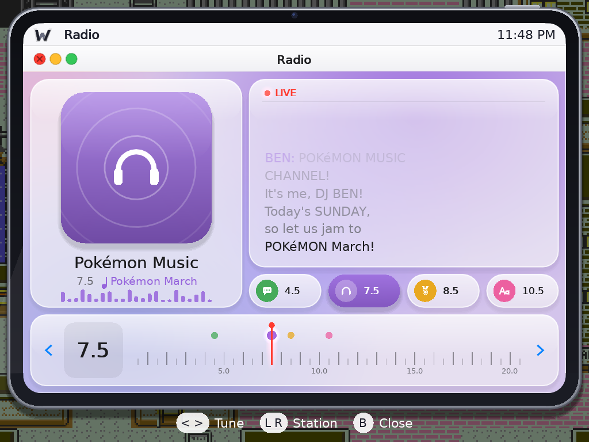

# The apps

Everything on the WoobOS desktop, and on WoobPad. Some apps are only on some games:
[what each game has](games.md) sorts that out.

[← Back to the README](../README.md)

## The desktop

- 🗂️ **Your home screen:** press and hold an app (or press SELECT) to move it around or into the dock.
- 📱 **WoobPad:** the same desktop as a tablet, from the START menu, wherever you can open it.
- 🔔 **Notifications:** when you're outbid or win on R-Bay, your GTS deposit is traded, a team is back
  from an errand, a challenge is done, and more. They show as a banner over the field once you're free to
  move. Pull down from the top of the screen to see them all.
- 🛍️ **App Store:** remove the apps you don't want from your home screen, and get them back later.

## Your Pokémon and things

- 🔴 **Boxes:** move, swap, or drag a whole group of Pokémon at once; their summary, items, Release,
  and box names and wallpapers.
- 🎒 **Items:** your Bag and your PC's items side by side.
- ✉️ **Mail:** your PC's mailbox, and the mail your Pokémon are holding.
- 📕 **Pokédex:** a modern Pokédex in place of the game's, from the START menu and as an app, with a
  search by name or number, a page for each form, where to find each Pokémon, and a height chart for
  each one you've caught, standing beside a trainer.
- 🗺️ **Map:** your region in 3D, in place of the Town Map and the Fly map, with markers and the GPS.
  It has [a page of its own](map.md).

## Out and about

- 📞 **Phone:** Match Call (Emerald), Trainer's Eyes (Ruby and Sapphire) or the Pokégear's phone book
  (Gold, Silver and Crystal). Calls are the game's own.
- 📻 **Radio** (Gold, Silver and Crystal): the Pokégear's radio, with each station's artwork, a live
  transcript of the show, presets and a tuner. Every station and show is the game's, and the music you
  leave playing keeps doing what it does in the game (the Poké Flute, the March and the Lullaby).
- 🎀 **Condition** and **Ribbons** (Ruby, Sapphire and Emerald): your Pokémon's contest conditions and
  Ribbons.

## Trading, shopping and money

- 🌐 **GTS:** Wonder Trade, other Trainers' offers, and a deposit of your own. Traded Pokémon act like
  real trades: they can evolve on arrival and may not obey without enough Badges.
- 🛒 **Mart:** buy and sell from the PC, with more stock for each Badge. Hold - or + to count faster, or
  tap the number for as many as you can buy (or all you have, selling).
- 🚀 **R-Bay:** Team Rocket's Pokémon auctions. They run on your device's clock, even while the game is
  off. Hold - or + to raise your maximum faster, or tap the amount for the most you can bid.
- 🎰 **Slots:** a five-reel slot machine played with your money, with prizes for its tickets. Four
  limited prizes change every day: a sought-after Pokémon, a held item, a 10th Anniversary Pokémon, and a
  special: an event ticket (Eon, Mystic, Aurora or the Old Sea Map) that sails from the harbor like the
  real one, or an event Pokémon as it was given out (Aura Mew, Mystery Mew, Space Center Deoxys, Doel
  Deoxys). The 10th Anniversary Pokémon, the specials and the tickets are on FireRed, LeafGreen, Ruby,
  Sapphire and Emerald, each ticket on the games whose harbor takes it.
- 🏦 **Bank:** holds the money your wallet can't (past ₽999,999) and pays a little interest each day.

## Every day and every week

- 👟 **Errands:** send up to three Pokémon on a timed job for money, an item and EXP.
- 🏅 **Challenges:** five goals a week, counted from how you play, each with a reward.
- 📰 **News:** the day's stories about your battles, catches and week, and where today's swarm is. A
  battle with a legendary Pokémon gets its own report, catch or not. On FireRed, LeafGreen, Ruby,
  Sapphire and Emerald the News follows the region's story as it happens: Team Rocket's schemes from
  Mt. Moon to Silph Co. and the Sevii Islands, or Team Magma and Team Aqua's, the legend's awakening and
  the drought or downpour it brings. It also says where Raikou, Entei or Suicune, or Latias or Latios,
  has been seen.

## The classics

- 📟 **Oak's PC** and 🏆 **Hall of Fame**, as the game has them.
- 🛋️ **Decorate** at your bedroom PC.
- 🕹️ **PC Games:** with the PC Games mod installed, its games get an icon too. On a phone with no controller,
  the game's on-screen buttons stay up to play them.

## Settings

⚙️ **Settings** holds the language, wallpaper, theme, text size, notifications for each app, and
switches for WoobPad, the 3D map, Overworld GPS, the PokéNav apps and daily swarms. Some of these are
mod options too: see [every option](options.md).
