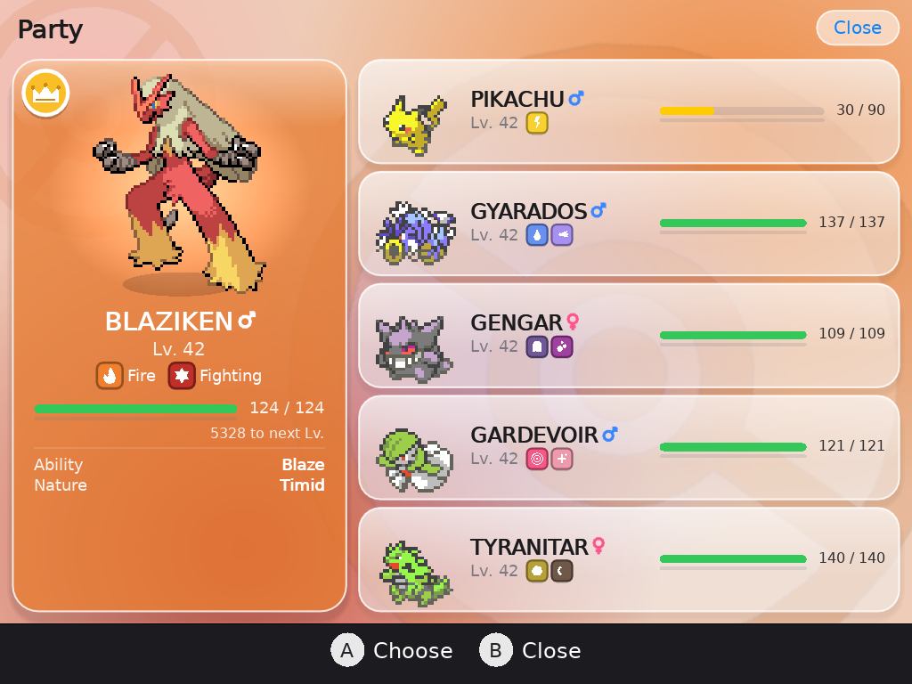

# The menus, shops and Pokémon Center

WoobOS doesn't only live in the PC. These are the game's own screens it redoes. Each one can be switched
back to the game's own in the [options](options.md).

[← Back to the README](../README.md)

## 🏪 Shops

Talking to a shop clerk fades straight into the Mart, full screen, with that shop's own goods: Poké
Marts, every department store floor, herb shops, the pharmacy, souvenir and decoration shops, the
Underground's bargain stall and Slateport's market stalls by the sea, each dressed for its place and what
it sells.

## 🏥 The Pokémon Center

Talk to the nurse and she greets you in a close-up behind her counter, in a room drawn after Emerald's
own Pokémon Center, its window showing the sky for the time of day: sun by day, a warm sunset in the
evening, stars at night. Choose to heal and your Pokémon go into the healing machine: a ball for each,
the machine's glow and its jingle, and their health filling back up.

Everything the game's own nurse does still happens, such as Pokérus, Emerald's Gold Card and where you
return after a loss.

## 🎒 The Bag

On FireRed, LeafGreen, Ruby, Sapphire and Emerald, the Bag opens in glass from the START menu and in
battle. Each pocket is a page (FireRed and LeafGreen's TM Case and Berry Pouch too), with the chosen
item's picture and description beside the list, and a TM's move with its type, power, accuracy and PP.

In a wild battle, each Poké Ball shows its chance to catch the Pokémon in front of you, worked out the
game's own way: its HP and status, and each Ball's own rules (a Net Ball on a Water or Bug type, a Timer Ball
as the turns go by, and so on).

With Kanto Gear showing its own screen, turn on **Kanto Gear Battle Menus** and a battle's Bag, Pokémon menu
and summary open there instead, laid out for its shape with larger text, while the battle stays on the game's
screen.

Use, give, toss (choosing how many), register and reorder items there (SELECT, or Reorder in an item's
menu, then tap where it goes). START (or the Sort button by Close)
sorts a pocket by name or by type, the game's own order that keeps the medicine, the Balls and the hold
items together; FireRed and LeafGreen's TM Case and Berry Pouch keep the game's order. An item used on a Pokémon opens
the Pokémon menu over the Bag, in battle too. Planting a Berry, the Berry Blender, putting items in the
PC and selling at a shop choose from it as well. Emerald's Battle Pyramid has its bag there, and Teachy
TV's lessons and the Old Man's catching lesson play on it; B (or Skip, where Close is) stops a lesson, all
but the Old Man's.

## 📋 The Pokémon menu and summary

On FireRed, LeafGreen, Ruby, Sapphire and Emerald, the Pokémon menu is six glass cards over lights in the
chosen Pokémon's colours: the lead's picture, and every Pokémon's level, HP, status and held item. Each
one's menu has its summary, its field moves, Switch and its item or mail; in battle, Shift or Send Out.

Items used from the Bag happen there too: a Potion's HP filling, a TM's able / not able on every card, a
Rare Candy's new stats. So do items given to hold, choosing a Pokémon for the Day Care or a trade,
choosing a team for the Battle Tower and Frontier, and the Move Tutor.

A Pokémon's summary is the same glass as in Boxes: its picture, info, stats with IVs and EVs, and moves.
When a Pokémon learns a new move with four already, you choose the one to forget there, with the new move
shown below.

## 📕 The Pokédex

The Pokédex from the START menu is WoobOS's own, the same as the [Pokédex app](apps.md). START, or Classic
at the top right, opens the game's own.

## 📱 WoobPad in the START menu

WoobPad sits in the START menu on every game. On Ruby, Sapphire and Emerald it takes the PokéNav's place,
and its Map, Phone, Condition and Ribbons apps do the PokéNav's jobs. On Gold, Silver and Crystal it takes
the Pokégear's place: its Map, Phone and Radio do the Pokégear's jobs, and Fly and the wall maps open the
3D map.
