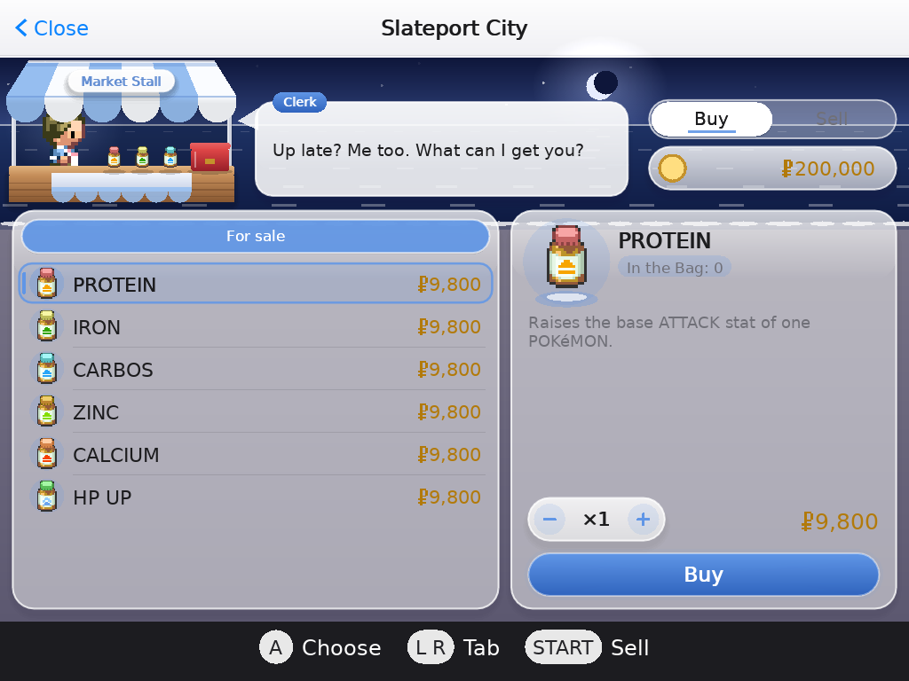
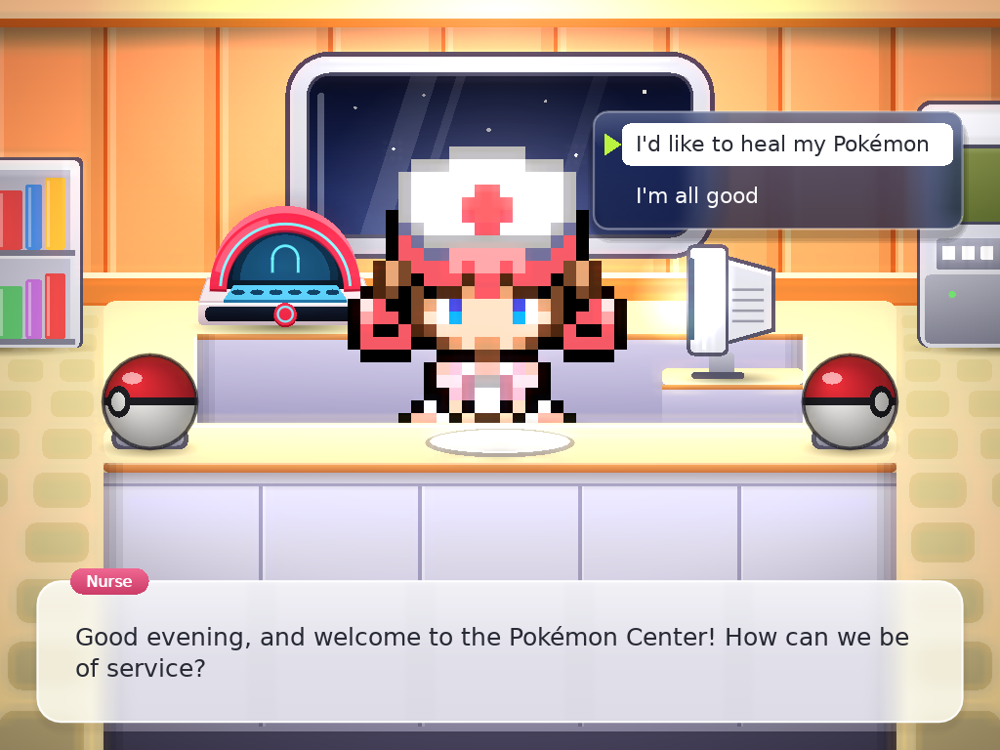

# The menus, shops and Pokémon Center

WoobOS doesn't only live in the PC. These are the game's own screens it redoes. Each one can be switched
back to the game's own in the [options](options.md).

[← Back to the README](../README.md)

## 🏪 Shops

Talking to a shop clerk fades straight into the Mart, full screen, with that shop's own goods: Poké
Marts, every department store floor, herb shops, the pharmacy, souvenir and decoration shops, the
Underground's bargain stall and Slateport's market stalls by the sea, each dressed for its place and what
it sells.

## 🏥 The Pokémon Center

Talk to the nurse and she greets you in a close-up behind her counter, in a room drawn after Emerald's
own Pokémon Center, its window showing the sky for the time of day: sun by day, a warm sunset in the
evening, stars at night. Choose to heal and your Pokémon go into the healing machine: a ball for each,
the machine's glow and its jingle, and their health filling back up.

Everything the game's own nurse does still happens, such as Pokérus, Emerald's Gold Card and where you
return after a loss.

## 🎒 The Bag

On every game, the Bag opens in glass from the START menu and in battle. Each pocket is a page (FireRed and
LeafGreen's TM Case and Berry Pouch too; Red, Blue and Yellow have one list), with the chosen item's picture
and description beside the list, and a TM's move with its type, power, accuracy and PP. On Red, Blue, Yellow,
Gold, Silver and Crystal, using an item does exactly what the game's own Bag does, with its words and its
choice of Pokémon in the same glass.

In a wild battle, each Poké Ball shows its chance to catch the Pokémon in front of you, worked out the
game's own way: its HP and status, and each Ball's own rules (a Net Ball on a Water or Bug type, a Timer Ball
as the turns go by, and so on).

With Kanto Gear showing its own screen, a battle's Bag, Pokémon menu and summary open there instead, laid out
for its shape with larger text, while the battle stays on the game's screen. **Kanto Gear Battle Menus** turns
this off. A catch's page and the nickname keyboard stay on the game's screen.

Use, give, toss (choosing how many), register and reorder items there (SELECT, or Reorder in an item's
menu, then tap where it goes). START (or the Sort button by Close)
sorts a pocket by name or by type, the game's own order that keeps the medicine, the Balls and the hold
items together; FireRed and LeafGreen's TM Case and Berry Pouch keep the game's order. An item used on a Pokémon opens
the Pokémon menu over the Bag, in battle too. Planting a Berry, the Berry Blender, putting items in the
PC and selling at a shop choose from it as well. Emerald's Battle Pyramid has its bag there, and Teachy
TV's lessons and the Old Man's catching lesson play on it; B (or Skip, where Close is) stops a lesson, all
but the Old Man's.

## 📋 The Pokémon menu and summary

On every game, the Pokémon menu is six glass cards over lights in the chosen Pokémon's colours: the lead's
picture, and every Pokémon's level, HP, status and held item. Each one's menu has its summary, its field
moves, Switch and its item or mail (Red, Blue and Yellow's Pokémon hold none); in battle, Shift or Send Out.

Choosing who to switch in, each Pokémon shows two chips beside its types: a sword, the best its own attacks do
against the foe (2x, 4x, 0.5x, 0x...), and a shield, the most the foe's types do to it. Green is good for you,
red is bad, blue is 1x and grey is 0x. In a double battle they count the worse of the two foes. They go by the type chart alone, not
abilities or weather.

Items used from the Bag happen there too: a Potion's HP filling, a TM's able / not able on every card, a
Rare Candy's new stats. So do items given to hold, choosing a Pokémon for the Day Care or a trade,
choosing a team for the Battle Tower and Frontier, and the Move Tutor.

A Pokémon's summary is the same glass as in Boxes: its picture, info, stats with IVs and EVs, and moves.
When a Pokémon learns a new move with four already, you choose the one to forget there, with the new move
shown below. On Red, Blue, Yellow, Gold, Silver and Crystal, an Ether, a Max Ether or a PP Up asks which
move there too, and so does Blackthorn's Move Deleter.

## ✨ Evolution

On every game, a Pokémon evolves full screen under a night sky lit in its new colours. It goes as the game's does: "What? It's evolving!", its cry, the music, then the old Pokémon
and the new one trading places as white silhouettes, faster and faster, while sparkles swirl round them,
behind and in front. Then a flash breaks into a ring and a shower of stars, the new Pokémon steps out in
colour, and its name and types drop in at the top. Then it steps aside for a card of its stats, each one
counting up from before to after with what it gained, and the moves it learns at its new level follow. On
Red, Blue and Yellow the card has five rows, with their one Special stat.

You can still stop it the game's way: B (or Stop at the top) while it's changing.

## 🎉 After a catch

The first time you catch a Pokémon, its Pokédex page comes up in glass over its types' colours: the Pokémon out of its Ball's light
among sparkles, a Registered stamp, its number, category, types, height, weight and entry. Then comes the
game's question, whether to give it a nickname. Yes brings up a keyboard like a phone's: capital letters,
small ones after the first, and the game's marks (0-9 ! ? ♂ ♀ / - … “ ” ‘ ’ , .), up to ten letters. The
battle doesn't ask again.

Every Pokémon's nickname uses the same keyboard: a catch you've caught before, an Egg that hatched, a gift,
the Name Rater. This is the same on every game.
On a controller, the D-pad moves over the keys, A types, B deletes a letter, START jumps to OK and SELECT
changes the letters. OK with the name left blank gives no nickname.

On a phone with no controller, the game's touch buttons stay out over an evolution and a catch's page, with
the page above them when the phone is upright. The keyboard has the whole screen to itself.

## 🪪 The trainer card

START's trainer card is a glass card floating over a night sky, its metal and its light the colour of its
tier: Classic, Bronze, Silver, Gold or Black. On FireRed, LeafGreen, Ruby, Sapphire and Emerald that's the
game's own stars. On Red, Blue, Yellow, Gold, Silver and Crystal a star comes with each of: all eight badges,
the Champion, then a full Kanto Pokédex and Mew (Red, Blue, Yellow) or Kanto's eight badges and a full Pokédex
(Gold, Silver, Crystal). A holographic shimmer crosses it now and then, and a holo sticker turns its colours.

It turns over like a real card, in perspective, page by page:

- **The front:** your trainer under a spotlight, your name, ID number, the Hall of Fame, money, the Pokédex
  (seen and caught), play time with its colon blinking, your stars and your badges along the foot.
- **The badges:** each in a glass medallion with its name and its Gym Leader, the ones you've earned lit and
  glinting, the rest dark. On Red to Crystal the leaders' faces sit beside them, and Gold, Silver and Crystal
  have a page for Johto and one for Kanto (Kanto's in colour when FireRed or LeafGreen is imported).
- **The records:** your Hall of Fame debut, link battles won and lost, trades, the game's own counts (battles,
  Pokémon caught, Eggs hatched, steps and more), contests, Pokéblocks and Battle Points on Emerald, and your
  party.

A, Right or R turns to the next page, Left or L back, B closes. By touch: tap the card, the arrows beside
it or the dots under it. Held upright, the card stands tall. A link partner's card in the Union Room or the
Cable Club is the game's own. The Modern Menus' "- Trainer Card" switch turns it off.

## 📕 The Pokédex

The Pokédex from the START menu is WoobOS's own, the same as the [Pokédex app](apps.md). START, or Classic
at the top right, opens the game's own.

## ⚙️ OPTIONS

On every game, OPTIONS from the START menu opens in glass, with every option the game's own screen has: the same pages (Speed, Video, Audio...), each option's whole name, a switch
for one that's on or off, and its value between arrows for one with choices. The rows other mods add sit below
a line marked "Added by mods", each with a Mod tag.

Each mod's own options page opens there too, from its row or from MODS (on Gold, Silver and Crystal, MODS in
the START menu): options that only show once another
is on sit indented under it, with a line to it, and the chosen option's description is in a card along the
bottom.

## 🧩 MODS

On every game, MODS opens in the same glass: the installed mods under a heading for each kind (Content,
Gameplay, Mechanics, Graphics, Interface, Tools, Other), each with a coloured letter, an On or Off chip by its
name (a green dot or a grey one), and an arrow to its page. A line under the name says more when there's more to
say: on or off after a restart, not made for this game, waiting on a mod it needs, or didn't load. With Cleaner
Mod Options, the mods its settings hide stay hidden here too.

A on a mod opens its page: its switch, its options, its place in the load order (Left / Right moves it), its
version, who made it, its kind, its games and what it may reach beyond its own data, with its description in
the card along the bottom. A mod not made for this
game can be tried on it anyway. Turning on a mod that needs another asks to turn that one on too, and turning
off a mod another needs asks to turn both off; a mod that can't run with one that's on says so.

Mods switch on and off as the game starts, so a change waits at the top under "Waiting for a restart", with
Restart now and Undo the changes. Classic mod manager, at the bottom, opens the game's own, for profiles.

## 📱 WoobPad in the START menu

WoobPad sits in the START menu on every game. On Ruby, Sapphire and Emerald it takes the PokéNav's place,
and its Map, Phone, Condition and Ribbons apps do the PokéNav's jobs. On Gold, Silver and Crystal it takes
the Pokégear's place: its Map, Phone and Radio do the Pokégear's jobs, and Fly and the wall maps open the
3D map.
