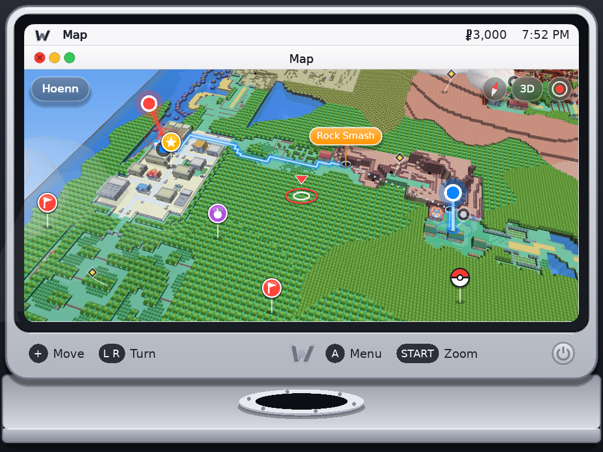
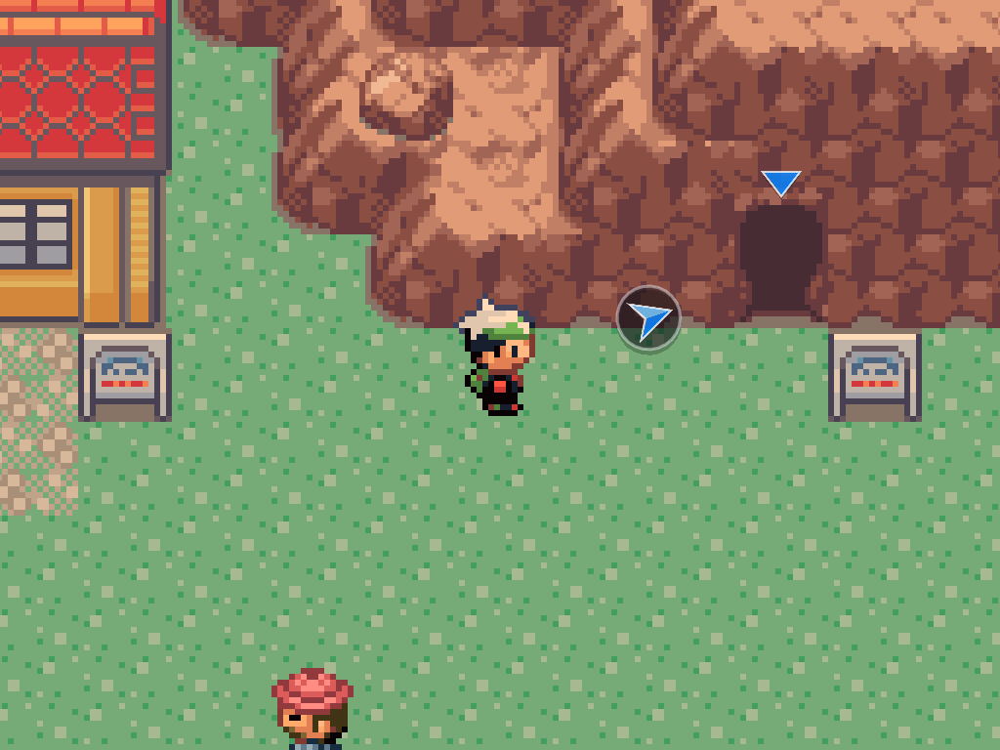

# The map and GPS

[← Back to the README](../README.md)

<table>
  <tr>
    <td align="center" width="50%"> A waypoint's route, a Rock Smash sign and markers</td>
    <td align="center" width="50%"> Overworld GPS pointing the way</td>
  </tr>
</table>

## 🗺️ The 3D map

The Map app shows your region in 3D, built from the game's own maps. It also opens in place of the Town
Map and the Fly map. At night the towns light up, with the odd aurora and shooting star, and on Emerald
you'll see Kyogre's and Groudon's storms where they're rumoured.

Press **A** on any spot (or tap the land) for its menu:

- **Fly** there, once you've visited it and can use Fly.
- **Set Waypoint** to start the GPS (below).
- **Place Marker** to put down a Flag, Star, Berry or Poké Ball.

**START** zooms in and out. On the START menu's Town Map, START opens the game's classic map instead,
and the spot's menu has Zoom.

## 🚩 Markers

Place up to 20 markers anywhere, one per town or landmark. They stand upright and face you whichever way
the map is turned, stay in sight however far you zoom out, and glow at night. Each save keeps its own.
Markers work on every game.

## 🧭 The GPS

On FireRed, LeafGreen, Ruby, Sapphire, Emerald, Gold, Silver and Crystal, set a waypoint on any town,
landmark or spot and the map draws a glowing line along the shortest walk there. It goes through caves,
forests and gatehouses, and rides Mt. Chimney's cable car, the Magnet Train and the S.S. Aqua. A cave or
tunnel shows as a dotted line between its doors.

**It keeps to the story's way.** Cut trees, Rock Smash rocks and Strength boulders (and, on Gold, Silver
and Crystal, whirlpools and waterfalls) stand in the way until you can use that HM; then the shortcuts
they open are taken. If the only way goes through one you can't use yet, the line is still drawn, with a
sign on the spot naming the HM.

**On Gold, Silver and Crystal, the story's roadblocks** are signed the same way until they're out of the
way: Sudowoodo, the sleeping Snorlax by Diglett's Cave, Team Rocket holding Mahogany Town's east road,
Victory Road Gate's guards and Badge check, the Cycling Road's Bicycle, the Magnet Train's Pass and the
S.S. Ticket.

**Water** counts once you can Surf. Until then the map says "No suitable route found. Requires Surf".
A place only Fly can reach (or a boat, on FireRed, LeafGreen, Ruby, Sapphire and Emerald) says "No
Route Found".

Arriving clears the waypoint with a notification, and so does flying anywhere.

## ➡️ Overworld GPS

Turn on **Overworld GPS** (a mod option, and in Settings > Map) and, while a waypoint is set, a small
glass arrow beside your trainer points to the next exit, ladder, hole or door on the way, with a mark
over it once it's in sight. It's off unless you turn it on.
